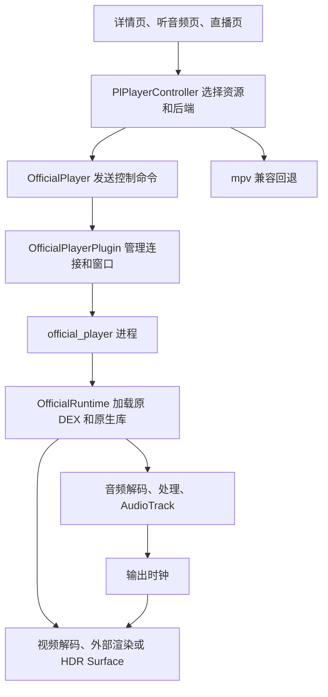

# PiliPlus 官方播放器接入指南

这次改造把 PiliPlus 的音频和视频交给同一个 B 站播放器实例处理。Flutter 继续负责页面、选源、弹幕和操作界面，原生播放器负责解码、声音处理、播放时钟及视频输出。这样做的直接原因是：早期在 mpv 上调整音量和滤镜，用户仍然能听出与官方客户端的差异；接入官方播放链后，用户确认听感明显接近，后来也确认扬声器和蓝牙的画音同步均有改善。

这份指南解释这个方案怎样落地，以及哪些地方仍然需要验证。它面向准备接手代码的音视频、Android 和 Flutter 工程师。文中的主要参照物是国内版 B 站 **9.14.0 / 9140400**，研究对象限定为观看视频、听音频和直播，排除了投稿编辑器、录制和通话的处理代码。早期研究用过 `com.bilibili.app.in` 6.6.0 / 9130300 和国际版 3.83.0 / 3830100；它们的发现只有经过当前版本复核，才能用于本实现。

截至 2026-10-17，本轮在 308/311 基础上补齐了文字字幕、截图和实际输出反馈，开发包为 316。311 只撤除了临时 CPU 采样许可，播放器行为与 308 相同；314～316 的变化及小米 14 验证范围见[本轮记录](playback-316-validation.md)。首开性能优化已经暂停，详情见[另一份指南](video-startup-optimization.md)。这里不把用户的“已经接近”扩大为所有视频、设备和输出方式完全一致。

## 一、先弄清楚接入的是什么

`libijk.so` 管理的不只有音频解码。媒体准备、音视频解码、队列、播放时钟和视频呈现调度都与它有关，它还会调用同包的 FFmpeg、SDL 和扩展处理库。因此，本项目让音频和视频都通过官方播放器实例运行。若只接官方音频、继续让 mpv 播视频，就必须额外协调两套时钟，以及暂停、拖动、倍速、缓冲和片尾状态；目前没有证据表明这样拆分会更可靠。

官方库也不是取出来就能直接播放。它依赖原有 Java 类、JNI 签名、动态库之间的符号关系，以及调用方提供的资源信息。最初的 G0 阶段先确认上游能够构建、旧版可以回退；G1 再用最小 Android 宿主确认原库能够产生完整 PCM，并正常结束和释放。只有这些条件成立后，才把它放进 Flutter 页面。最小宿主成功的意义是确认组件可以工作，真实页面还要另查窗口、纹理消费、系统路由和生命周期。

### 代码和进程怎样分工

播放器的控制链如下。箭头表示调用关系，音频样本和逐帧视频数据不会经过 Dart。



官方播放器运行在非导出的 `:official_player` 服务进程中，使用开发应用自己的 UID；它不是 Android 的 `isolatedProcess`，也没有运行完整的官方客户端。这个进程划分主要用于隔离动态库：mpv 和官方库各自带有 FFmpeg 及相关符号，放进同一个 JNI 搜索空间会发生同名库或 ABI 冲突。官方库因此作为私有资产加载，没有混进 mpv 的 `jniLibs`。

原 DEX 保留必要类名，应用包名仍是 `com.example.piliplus.audio.dev`。自有 DEX 桥负责在正确的 ClassLoader 中加载适配库，使 DSP 注册和播放器解码使用同一个 FFmpeg 实例。注册到另一个副本，即便返回成功，也不会给当前播放器增加解码能力。这是早期“库加载了，功能却没生效”的一个重要排查方向。

业务层选择真实音轨和备用地址，`OfficialPlayer` 管理会话及异步请求，`OfficialPlayerPlugin` 传递命令和 Surface，`OfficialPlaybackService` 在工作线程串行执行命令，`OfficialRuntime` 持有原播放器及渲染对象。需要查代码时，可以从文末源码地图进入，不必先遍历 native 补丁。

### 为什么必须锁定原始文件

当前使用的 APK SHA-256 为：

```text
7c82d171f1fb7681b4e2bdf35c4b0842376acd27da810e85e1229d2f4e3c53cd
```

其中 `libijk.so` 的 SHA-256 为：

```text
d3971ffa09006581cf612f4d803fc8fd1677fe687f3712ae6d64953e55db5bc2
```

[运行库清单](../android/official-runtime-manifest.json)还记录了其余原生库。准备脚本生成的 14 项资产由 9 个原始库、一个 DEX 运行归档、3 个自有桥接或适配文件和 manifest 组成。运行归档改变了压缩方式和对齐，所以它的 SHA 不能与原始 APK 比；33 个 DEX 及全部归档条目的内容另行逐字节核验。

native 适配依赖私有函数、结构布局和虚表槽，文中地址只适用于这个样本。同为 9.14.0 的另一个 APK 也不能直接套用。准备阶段核文件哈希，加载和安装适配时再核原指令及槽值；发现不匹配就停止该路径。升级原库应重新验证这些条件，再跑最小宿主和真实页面。

曾经出现的 `native process died / reason_5 / status_6`，其中一类原因是修改已加载的代码页：把 RX 页改成可写再改回，触发了 SELinux 的 execmod 限制。后来改为加载前生成并验证私有镜像；运行时只改允许的数据、GOT 或虚表槽，并成对恢复。原 APK 和原 so 一直保留。这个例子也说明，崩溃不能直接归结为“官方库有自毁保护”，还要区分权限、调用约定、对象寿命和媒体格式问题。

## 二、声音接近官方，具体依赖哪些处理

比较听感之前，先确认实际后端和实际音轨。设置页开启官方内核，不代表开片后没有回退；`AudioParams` 显示 `s32/48000/stereo`，也不能证明输入是 FLAC。Hi-Res 和杜比音轨还取决于账号权益与服务器实际返回的资源。CDN 切换可以解决某条地址不可达，却无法补出服务器没有返回的音轨。

### 普通音轨的响度处理

国内观看路径中的 `ijkloudnorm`，经初始化和帧处理对照，主要执行受元数据约束的固定增益。早期国际版的同名实现有动态行为，所以不能只凭名称，把标准 FFmpeg `loudnorm` 或 mpv 动态归一化当成等价实现。当前适配针对经过 9.14 原库复核的国内规则。

响度元数据必须属于当前 cid 和实际选中的音轨。业务层先检查是否缺失、是否为有限数值、范围是否有效，以及场景和门限是否满足；绝对值不超过 0.0001 的近零值也有单独处理。默认门限是 -28，目标值从 `normal_target_i`、`high_dynamic_target_i`、`undersized_target_i` 等实际字段读取。它们决定滤镜是否启用，不能与滤镜内部的数值计算混为一谈。

对于已进入处理的普通音轨，正增益的主要约束可以写成：

```text
requested_gain_db = min(target_I - measured_I, 10)
positive_headroom_db = max(max(target_TP, 3) - measured_TP, 0)
```

最终正增益不得超过 `positive_headroom_db`，负增益按原规则处理。完整参数顺序、哨兵值和场景条件见 [OfficialLoudness.java](../android/app/src/main/java/com/example/piliplus/official/OfficialLoudness.java)。例如，原滤镜直接调用时允许 `I=0` 哨兵，不代表 Java 业务层也会接受零值，两者处在不同层。

本项目没有把原响度滤镜逐帧原样接进来。该滤镜还进行 EBUR128 统计，实际渲染线程开销较大；在预解码队列中提前处理，又会让队列里的旧增益推迟切换生效。尝试改用原 `volume` 滤镜时还遇到未注册的问题。当前在音频源供数时复用原格式转换，将数据转为 double、应用已验证的固定增益，再转回 float。这样避开了不需要的统计，也避免积压的解码帧带着旧增益继续播放。若以后要对齐国际版动态响度，必须重新研究那条分支，不能直接沿用这一实现。

普通观看路径尚未找到默认开启通用 EQ、bass/treble、haas、crossfeed、reverb、amix 或独立 alimiter 的证据。库内有这些滤镜，只能说明具备能力。现在不额外加低音或扩展声场，因为听感差异也可能来自音轨、响度、下混、重采样、倍速或系统处理；没有确认原因就叠加效果，会使比较失去依据。

系统音量、应用内 cubic 软件音量、响度增益和音频焦点 duck 是不同环节。同样的界面百分比不保证实际增益相同。官方路径也不经过 mpv ReplayGain，不能再重复归一化。超过 100% 的软件音量及部分 mpv 专属设置，在当前实现中仍可能触发兼容回退。

### Dolby 解码和扬声器、耳机配置

`libffext.so` 带有 AC3/EAC3 专有解码实现，但注册插件以后，按 codec ID 选解码器仍可能选中普通 FFmpeg 实现。当前适配只对确认的 AC3/EAC3 ID 选择 `ijkac3` / `ijkeac3`，其他格式沿用原选择。排查时要记录真正被创建的 decoder，不能只看插件加载日志。

扩展解码器借用一组 9 个 int32 参数，观察到的初始化形式为 `{2,1,6,-14,65535,0,0,0,0}`。这组内存必须活到 decoder 不再使用，不能指向函数栈。后来还发现，全局修改公共解码描述符会被重新注册覆盖，因此改为每个 decoder 持有受控的私有描述符和参数副本。

小米上的硬件能力报告曾让新 AudioEngine 协商出 12 声道、布局 `0xb58fc` 等不支持的组合。当前接入选择软件解码，但先读取原硬件增强能力，再处理能力缓存。原 `isEac3HwRender` 分支要求清除软件 virtualizer/dialogue，目的是避免硬件和软件重复增强，并非关闭全部 Dolby 效果。

普通响度与 Dolby 也不能重复叠加。早期同一 EAC3 样本额外增加了约 4.4dB，原因就是专有处理后又套了一层普通增益。现在按实际 AC3/EAC3/AC4 编码走 `dolby_codec_bypass`，而非只看界面上的“杜比音质”标签。既有 EAC3 对照中，约 55.28 秒有效立体声 PCM 与官方内部捕获完全相同；FLAC 对照的约 55.7 秒、5,347,840 个样本值中，514 个最多相差 1 个最低有效位。这些结果覆盖指定素材和内部采集位置，不能推导为耳机末端或全部视频完全一致。

官方旧 Java 路径通过 `addEndpointChangeListener/updateEac3Endpoint` 更新属性 `30200`：1 表示扬声器，2 表示耳机。它没有因此重开整个播放器。122 版宿主曾在路由变化后完整重开，用户随即报告暂停数秒、黑屏和偶发后续卡顿；128 改为只更新 decoder 私有参数。更新带有版本号，请求与解码确认分开，失败后重试，暂停时还未经过解码的更新不会被当成已生效。AAC/FLAC 也不再因这一参数变化重建整条播放链。

132 的验证确认，在同一个播放器、AudioTrack 和时钟对象下，注入的端点参数能够请求、确认并恢复播放，限定窗口内保持 24fps。但那次物理输出一直是扬声器，所以它验证的是参数处理，不能写成真实蓝牙热切换通过。

AC3 后续补做了同编码包对照：原 9.14 旧 SDL 参考宿主与当前产品的 17 秒有效段，共 1,632,000 个值完全相同。AC4 则仍有开发缺口，新 AudioEngine 缺少 CodecId 映射。旧路径研究中，公开描述符把它标为 VIDEO，扩展实现标为 AUDIO，曾导致 `avcodec_open2=-22`；显式注册并校验后，研究宿主能播放 32 秒样本，但存在少量满幅值且缺可信无损参考。该实验没有变成当前产品能力，也没有证明普通观看业务会下发 AC4。

## 三、Hi-Res、下混和倍速怎样验证

### 格式转换必须保留有效数据

新 AudioGraph 接受的格式集合包含 1/4/7/10，却不接受格式 2 的 S32。因此 FLAC 曾经出现 `prepared`、甚至 `completed` 都正常，但 PCM 为零、内部返回 -22 的情况。适配对 S32 乘以 `2^-31` 转成 float，再调用原 Frame 工厂；采样率、声道布局、PTS、有效字节和 side-data 一起保留。

这里最容易出错的是对象调用约定和所有权。ARM64 的某些结构体按值返回使用隐藏寄存器 x8，必须由 `graph_sret.S` 按真实约定调用。引用计数和 side-data vector 也需要正确复制。旧帧还活着，不等于新帧已经取得它引用的内存。

片尾还发现原图会重复返回同一个缓存帧。当前只在同对象、相同来源、PTS、size、serial、队列已 EOF 且没有新内容时去重，并保留强引用。不能简单按“PTS 相同”丢帧，否则会删掉合法帧或换流首帧。另一个独立错误是 `nb_samples * 1,000,000` 的 32 位中间值溢出：8192 个样本在 96kHz 下应约为 85,333µs，却得到约 40,594µs。修复使用经指令校验的 64 位计算，随后检查队列时长和完整输出。

### 输入无损不等于最终输出仍是 24 位

150 的转换测试覆盖全部 16,777,216 个有符号 24 位码值，左对齐放入 S32 后，在主机和 ARM64 上执行生产转换表达式，恢复整数的错误数均为 0。真正使用低 8 位的 24 位 FLAC 经官方解码后也逐值一致。测试还保留了真 32 位最大值的负对照，它出现最低位误差，说明检查没有把所有输入都笼统判为无损。

原 graph 的 float→S16 路径默认不加 dither，静音不添噪，有限超范围值饱和。缓冲地址对齐会影响半格取整：64 字节对齐的 NEON 路径与偏移 4 字节的路径，分别出现中点向正方向和最近偶数取整，最多差 1 个 S16 最低有效位；`FCVTZS #31 + SQRSHRN #16` 指令与这个现象吻合。最初假设两路都采用最近偶数取整，实际测试否定了它。

这些验证解决的是格式转换是否额外丢数据。小米的 96kHz/24 位输入仍可能最终写入 48kHz/S16 AudioTrack，内部捕获也可能再次重采样，不能倒推出输出设备的格式。原 9.14 旧 SDL 参考宿主对照进一步确认：六声道 FLAC 的 17 秒、1,632,000 个值相同；真 96k24 输入的 20 秒、1,920,000 个值中，关闭增益时 115 个差 1 LSB，受控 -6dB 时 398 个差 1 LSB。-108dBFS 输入最终量化为零，不能称其仍保留了超出 S16 输出精度的细节。

该参考宿主最初因 attribution 身份错误而出现 session=0 和静音，修成实际 shell UID 后才取得有效输出。因此报告里的“原库参考宿主”与“官方完整 APP”必须分开，尤其不同 UID 还可能受到厂商音效策略影响。

### 多声道和空间化的边界

六声道下混为双声道已有独立声道窗口、20 秒样本和后续原库参考对照；LFE 单独窗口可能输出为零。它们证明当前下混行为，没有证明物理 5.1/7.1 输出或耳机空间化。

原 `QuerySpatializerAvailable` 要求 SDK≥32，且系统同时返回 `isAvailable` 与 `isEnabled`；它没有对具体格式调用 `canSpatialize`，失败结果也可能被缓存。小米实测是 available=1、enabled=0，因此原引擎走 ForceStereo。准确含义是设备报告支持、当前未启用，不能写成设备不支持，也不能写成空间化已生效。路由变化时该缓存的完整失效路径尚未查清，需要额外硬件的空间化验证本轮暂缓。

### 倍速是一套连续算法，但请求值不一定生效

倍速复用原算法，不是每个可选小数都有独立实现。界面的 2 倍按官方习惯映射为 1.99；SoundTouch overlap 从新图默认 8ms 对齐到官方使用的 16ms。在有限样本中，包络误差从约 +0.336～0.378dB 收敛到 -0.005～-0.048dB，但严格逐样本波形仍不一致。

曾经的 0.25 倍设置返回成功，实际进度却接近 1 倍。原因是 renderer 只接受 0.5～3，而上层声明更宽。148 在锁定私有镜像中只把下限从 0.5 改成 0.25，保留上限、AICenter 和多声道保护。六声道下混样本的实测速率为 0.2499696，有效声段约 68.19 秒，测试音音高保持；这是本实现输出验证，还不是官方 APP 同源 0.25 倍比较。

4 倍则仍可能被 AICenter 限为 3，某些软件或慢解码策略还会限为 2。实际设备输出超过两声道时，非 1 倍可能被 AudioEngine 拒绝；这个错误不会完整地从 renderer 传回 JNI/core。因此，设置返回成功和 core 的倍率字段都不足以证明最终音频速率。149 增加的是 core 倍率反馈；316 进一步读取 AudioEngine 当前倍率、待切换标志和切换错误。界面保留请求值，但播放倍率与弹幕按引擎反馈更新。若输出对象还不可读，就明确标为“播放器报告”。这补齐了反馈来源，没有解除原来的 4 倍保护。

长按加速曾有另一处独立竞态：开始加速仍在等待时，松手恢复提前退出，迟到的开始命令随后又把速度调高。131 按会话和源代际串行提交，保证恢复排在真实开始之后，旧视频命令失效。163 又验证固定 30 秒 H264/AAC 的 1→1.99→1，切速窗口最大帧间隔约 25ms，5ms RMS 窗没有近静音；真实 Flutter 页面两轮长按也恢复原速率，合成层最大间隔约 41～50ms。不过合成层包含弹幕和控件，公网供数及其他手机上的偶发卡顿仍要单独调查。

## 四、扬声器和蓝牙的同步问题是怎样修好的

用户在 98 版观察到：蓝牙已基本同步，扬声器却不同步。这是有用的定位条件，但不能直接证明某一输出算法正确，也不能用库版本新旧解释。扬声器和蓝牙的输出延迟不同，同一个错误的恢复锚点可能在两条路由上表现不同。调查需要回到真正的输出帧位置和时间戳。

锁定的 9.14 库中，相关调用链是：

```text
AudioTrackDevice.GetTimestamp (0x1b9e6c) / GetLatency (0x1b9ec8)
  → AudioDevicePositionTracker (0x18af28)
  → PositionClock.UpdateTimestamp (0x18b394)
  → PositionClock.GetEstimate (0x18b4f4)
  → AudioEngineRenderer.GetPositionInternal (0x15938c)
  → 视频调度/提交
```

播放器通过这条链估计声音已经播放到哪里，再安排视频。这里的时钟依据来自输出设备，不是页面进度条。研究中看到的 200ms 设备 buffer 配置也不能直接解释成蓝牙专用补偿。在已经审查的路径里，没有找到按耳机型号查固定延迟的表，也没有找到 APP 强制选择 SBC/LDAC 的策略，蓝牙编码仍由系统协商。这一结论仅覆盖已检查的路径。

### 暂停恢复时，旧时间戳不能继续当作播放依据

问题之一是暂停后的锚点仍被用于推算媒体进度，负向跳变保护又拒绝了本应接收的新时间戳。117 的局部对照中，有效时间戳拒收从 143 次降为 0，视频 PTS 相对 AudioTrack 外推位置的偏差中位数从约 +249.726ms 变为 -5.265ms。这是内部估计量，不能当作嘴形与扬声器声音的物理误差。

122 的修复把暂停和恢复分开处理。暂停成功后冻结当前时钟；恢复成功后，等一个新鲜且确实前进的输出时间戳，再建立新锚点。零帧、过旧和倒退的输入仍被拒绝。还有一个细节：调用方在 `GetTimestamp` 之前采样 `now`，系统可能在调用期间给出略晚的时间戳，因此应按合理绝对窗口判断，不能把所有“未来”时间戳机械丢掉。

生命周期操作只标记受锁保护的状态，实际时钟字段仍由原时钟线程更新。等待也有边界：超过原稳态 interval 后，回到原 `GetLatency` 估计路径，防止永远冻结；该样本的 interval 为 500000µs。123 做过时间戳失败注入，证明超时回退能避免永久停住，但实验先关闭再开启超时，约 12.96 秒的记录不能当作“自动 500ms 墙钟上限”的测试结果。

用户随后确认，122 的扬声器和蓝牙看起来都已同步。这与时钟修复的方向一致，但覆盖范围仍是其测试设备、素材和观察方式。

### 拖动后持续一卡一卡，是另一个状态转换遗漏

122 之后出现过拖动或切耳机后持续卡顿。可稳定复现的一处原因是：Flush 让 AudioEngine 从 Paused(3) 进入 Prepared(1)，旧恢复代码只处理 Paused→Playing，结果时钟的暂停冻结标记没有清除。视频持续按旧锚点估时，约每 500ms 集中提交一批画面。

135 把恢复条件改为“成功进入 Playing，且同一个时钟仍有待恢复标记”。已经 Playing 时重复调用 play 不会重置等待，失败或另一个时钟也不会误清状态。这里没有更换库、DSP 或增益，而是补全原状态机的遗漏。

修复前，约 4.86 秒有效窗口里的最大提交间隔为 489.90ms；修复后 AAC、FLAC 各六轮 seek，在所测窗口中最大分别为 46.02ms、44.94ms，没有超过 100ms 的间隔，也没有新增有效时间戳拒收。这些窗口描述的是 seek 后原生提交的稳态，不包含网络缓冲等待，更不能覆盖所有蓝牙热切换问题。

### 端点配置和真实输出路由必须分开

旧官方 Java 监听 `HEADSET_PLUG` 和 `bluetooth.headset.profile.CONNECTION_STATE_CHANGED`。后一个是 HEADSET profile，连接成功不等于 A2DP 已开始输出。当前宿主在 API 33+ 使用媒体 AudioAttributes 查询系统预计路由，其他情况下结合连接设备列表，并通过 AudioDeviceCallback 和 250ms 检查更新端点。

这能为 Dolby 提供端点配置，但连接列表仍不能证明声音实际去了哪里。316 沿原 GetTimestamp 的对象关系取得当前 AudioTrack 的 Java 引用，再读取 `getRoutedDevice()`、采样率、声道和格式。小米 14 的 AAC/FLAC 样本实际返回扬声器、48kHz、双声道、PCM 16 位；读不到设备时仍显示未知。端点策略与实际输出分别展示，这次没有用诊断结果另改路由算法。

原对象引用只在原设备锁内复制，查询在宿主工作线程执行；引擎关闭前失效观察指针，防止迟到读取已释放对象。这些私有布局也受原库身份和指令守卫约束。研究时仍可用 `dumpsys media.audio_flinger` 复核实际 Track；Track 从活动列表加入、移出，不必然意味着对象重新创建。

用户已经取消专门的物理蓝牙延迟和长时间专项。本轮继续对照官方链路和现有设备上的可复现问题，不恢复那项硬件测试。128 消除的是端点变化整链重开，135 消除的是 seek 后冻结标记遗漏；用户只遇到一次的真实蓝牙切换后卡顿，还没有完整复现证据。

## 五、视频观感还取决于呈现路径

解码器交出一帧，不代表屏幕已经显示它。早期试过 direct、SurfaceTexture、SurfaceProducer、Hybrid Composition 和原外部渲染，多次出现“native 提交齐了，屏幕仍缺帧”。一个样本有 1800 个唯一帧提交，Flutter 屏幕只看到 1694 个；另一些候选则因尺寸错误，让原 FrameGraph 的渲染开销异常。因此显示验证需要带帧号素材及屏幕证据，不能只数解码回调。

SDR 当前使用原外部渲染器与稳定窗口适配。支持条件下的 HDR 走 API 33+ 持久 SurfaceControl，保留 10 位 YUV、PQ/HLG 路径，避免绕入普通 8 位 GL 纹理。输出选择依据 `colr/nclx/nclc/dvcC/dvvC` 和原 native 元数据；未知时继续准备，而不是先按 SDR 播放再重建。早期占位 Surface 方案就因重复创建 decoder 和显示配置而退步，准备顺序详见首开指南。

比例、裁剪和镜像还要考虑独立 Surface 的坐标系。对 SurfaceView 设置负 `scaleX/scaleY`，不保证其内容随 View 一起翻转。当前使用可验证的 SurfaceControl geometry，以正尺寸配合 orientation/mirror，分别处理源像素、父视图和子 BLAST 层。曾把子层 1×1 的语义误套进归一化矩阵，得到 0.3125 像素尺度；仅检查父 View bounds 看不出这个问题。指定样本已测适配模式及 X/Y/XY 镜像，但 GPU、系统色彩管理和面板仍影响最终观感。

用户反馈的横屏残留有明确触发条件：点击视频还在加载时，立即进入横屏，简介或评论留在画面后面。排查发现是旧 FlutterSurfaceView 暂停后留下的 UI surface，并非视频解码坏帧。127 在官方构建中把 Flutter 根渲染改成 Texture，旧竖屏界面残留随之消失，原评论区域约 0.9343 的白色比例特征也不再出现。视频 HDR 仍走 native SurfaceControl，没有因此变成 Flutter 8 位视频纹理。这个改动也不等于整体 Flutter 流畅度问题已解决。

回桌面和暂停涉及窗口重绑、播放意图与播放器寿命。旧 session 的 `surfaceDestroyed` 不能销毁新视频的 Surface；迟到的窗口或准备回调也不能恢复已取消的播放。曾尝试用 `setAudioOnly` 绕开恢复显示，结果引起音频重播，因此没有采用。已有录屏能看到恢复后的有效画面，但可变帧率录屏的间隙从几十毫秒到数秒，不足以排除短暂闪黑。后续修复必须从可复现窗口故障出发，不能为掩盖黑屏重开整条音频链。

基线里字幕和截图会主动回退 mpv，这会让用户在播放中离开已对齐的音视频链。316 的文字字幕改用现有样式和 Flutter 叠加层，跟随官方播放位置；换视频或换字幕后，迟到的下载结果被丢弃。支持的是 B 站文字字幕及普通 VTT/SRT，ASS 样式、VTT 排版标记和精确到帧的字幕时间尚未实现。当前按 250ms 状态更新，极短字幕和高速播放还有限制。

普通视频截图调用原 `IJKPlayerExternalRender.captureOneImage`，HDR 直出则尝试系统 PixelCopy。小米 14 上已取得普通视频及 4K PQ 视频的有效预览，播放仍留在官方内核。截图失败、超时或页面退出只结束本次请求；迟到图片与临时 PNG 会释放，渲染器旧回调尚未结束时不会发起下一次截图，以免把旧帧误交给新请求。输出 PNG 是普通 SDR 图片，颜色与动态范围没有做物理校准，不能当作 HDR/Dolby Vision 导出。

## 六、资源、交互和异常也属于播放器接入

### 资源信息必须随实际音轨传递

同样编码的普通 MP4 与 B 站分片 DASH，未必符合原播放器相同的索引假设。早期缺 fragment/global_sidx 的输入曾导致 mov index=-1 或错误 -16，伪造文件大小回调无法解决。当前已识别的在线 DASH 复用原 native 查流和索引，Java 回退路径仍负责拒绝不合适的格式。`OfficialStream` 同时传递真实轨道 ID、码率、codec、主地址和备用地址，不能只给播放器一条 URL。

资源地址会失效，且失败方式不同：主源 403/503、响应体不再前进、所有备用源失败、打开前过期、播放中断流，都有对应验证。刷新必须保持原音轨和编码约定，结果还要匹配账号、当前资源选择、session 和请求代际；旧视频的刷新结果不能覆盖新视频。同轨备用源尚未用完时，不应直接退 mpv；普通刷新超时也不能统一报成 native 崩溃。

纯音频页曾遗漏官方后端，后来 69 接入，70 又补上没有先播视频时的响度参数。81～89 继续修复错误后重播、加载中换源、详情迟到及分 P 的 cid 查询迟到。判断这些功能是否完成，要分别看页面选择、Dart Future、native 确认和实际首音，尤其停止后迟到的 play 不能让旧声音重新出现。

### 拖动、片尾和直播

准确 seek 要等待底层结果，不能把进度条数字改变当成定位成功。起始定位超时可以保留可播的官方实例，但等待必须有界；到片尾时按有效目标处理，并重新检查 EOF 后缓冲状态。HE-AAC/HEv2 还曾在 seek 后残留解码状态，单纯 flush 不够，需要在正确所有权下重建 decoder context，同时保留失败传播。内部录音的暂停残音也可能来自 Android 捕获方式，不能一概判为播放器还在出声。

直播的工作超过打开 `isLive` 开关。90～104 已接入真实直播页，并处理 403 刷新、重连、PTS 归零与 discontinuity。发生时间线变化时，音频源、队列 serial、PositionClock 和视频调度必须一起回到正确时间域；只刷新 URL 会留下跳变或持续断续。跨页面旧直播抢播也靠代际取消防止。早期 89 的“直播未接入”结论已经过时，但后续有限样本通过，也不能代表所有 HLS/FLV、断流和长时间直播都已通过。

### 音频焦点和进程回收

“用户想继续播放”和“底层此刻正在播放”要分开保存。临时失焦后可以恢复，但用户在此期间点了暂停，就不能在焦点恢复时擅自播放。永久失焦、duck 和系统媒体用途分别处理，duck 还必须幂等，避免重复事件反复把音量乘小。

官方使用的 `MEDIA/MOVIE`、`willPauseWhenDucked`、`acceptsDelayedFocusGain` 以及前台永久失焦行为，与当前产品仍有差异，尚不能称焦点策略完全一致。107 已对系统 OOM/kill_bg_proc 增加有界前台恢复，没有对所有 native crash 无限重启。旧 Binder 的死亡回调按连接身份过滤，回退前确认旧输出停止；108 又处理了等待恢复或回退时，用户取消后仍发出迟到 play 的问题。

## 七、怎样继续验证而不重复走弯路

先确定对照的是哪个版本、哪条播放分支，再从 Java 调用者追到 JNI 和 native。9.14 同时存在旧 SDL 与新 AudioEngine，官方 APP 的既有实测常走旧 SDL，本宿主使用新 AudioEngine。代码里存在某个滤镜、接口返回成功、界面显示某种状态，只能分别证明这些事实，不能自动证明它已参与最终输出。

静态分析要检查调用位置、默认配置、服务端参数及实际选择分支。JNI 签名、虚表、结构体返回和所有权再用字节码、指令或运行结果复核。反编译失败的地方保持未知。开发中尤其容易误判的是把 `haas` 字符串当成默认声场增强，把 Spatializer 查询当成空间化已开，或把端点属性变化当成 AudioTrack 真正切到了耳机。

声音对照应使用同编码包、同音量和增益，比较对齐后的完整 PCM，并包含片尾；同步对照还需校准媒体时间、设备时间戳和主机时间。屏幕、扬声器或耳机的物理输出是更后面的一层证据。模拟器转译、AudioFlinger 欠载、录屏采样和脚本操作失败都可能污染结果，先确认采集链有效，再据此改产品。

本轮暂缓额外设备、物理多声道和空间化专项。本轮已补字幕、截图、倍率和实际输出状态，并在现有手机上检查相关播放操作；验证没有覆盖所有交叉组合。AC4、全部 HDR 交叉场景、完整焦点策略和所有素材的听感等价仍在未完成清单里。构建和测试方法、54 项功能状态、历史失败及原始报告入口保留在下面，供定位具体问题时查阅。


## 附录：源码与证据入口

|层次|主要源码|职责与必须保留的边界|
|---|---|---|
|业务选源|`lib/http/video.dart`、`lib/pages/video/controller.dart`、`lib/pages/audio/controller.dart`|账号/资源权限、真实音轨与备用地址、响度归属、选择代际|
|Dart 播放门面|[controller.dart](../lib/plugin/pl_player/controller.dart)、[official_player.dart](../lib/plugin/pl_player/official_player.dart)|后端选择、准备/seek/倍速/取消、回退原因、用户播放意图|
|平台桥|[OfficialPlayerPlugin.java](../android/app/src/main/java/com/example/piliplus/official/OfficialPlayerPlugin.java)|会话、Binder 连接身份、Surface 所有权、过期回调丢弃|
|独立宿主|[OfficialPlaybackService.java](../android/app/src/main/java/com/example/piliplus/official/OfficialPlaybackService.java)、[OfficialRuntime.java](../android/app/src/main/java/com/example/piliplus/official/OfficialRuntime.java)|加载、控制串行化、原库对象生命周期、输出与错误诊断|
|音频适配|[graph_adapter.c](../android/official_audio/graph_adapter.c)、[dsp_adapter.c](../android/official_audio/dsp_adapter.c)|格式、所有权、DSP 注册/选择、供数时响度、时间线适配|
|输出观察|[output_observer.h](../android/official_audio/output_observer.h)|取得原 AudioTrack 引用、读取音频引擎倍率；关闭时失效，不替换路由或时钟|
|同步|[clock_adapter.h](../android/official_audio/clock_adapter.h)、[clock_resume.h](../android/official_audio/clock_resume.h)、[timeline_reset.h](../android/official_audio/timeline_reset.h)|输出时间戳、暂停冻结、恢复重锚、seek/直播时间线重置|
|资源与格式|`DashSource.java`、`FragmentIndex.java`、`OfficialStream.java`、`media_index.c`、`media_metadata.c`|分片/索引约定、轨道 ID/码率、HDR 元数据、刷新与备源|
|呈现|`OfficialPlayerPlugin.java`、`OfficialHdrSurface.java`、`MainActivity.kt`、`widgets/official_video.dart`|SDR/HDR 输出、尺寸/裁剪/镜像、横屏与 Flutter 合成|
|验证|[android/validation](../android/validation)、[validation](../validation)|边界状态、时钟、选择、缓存、并发、Dart 控制契约；不代替真机输出|

本文的详细实验依据保存在 [research-evidence.json](research-evidence.json)。声音与格式主要对应 E029、E043–E045、E053、E075、E085–E086、E095–E096、E160、E171–E172、E183–E185、E192；同步和路由对应 E106、E108–E109、E113–E114、E129、E145–E148、E163、E165、E191；显示和交互对应 E034–E047、E067–E072、E077–E090、E103–E105、E111–E123、E132–E133、E154–E158、E187。编号用于查原始报告，不表示未公开的录音或 trace 已随仓库发布。

证据库保留报告全文、原始相对路径、原始与公开文本 SHA-256，个人目录和设备序列号已脱敏；原始 APK、PCM、Perfetto、反汇编、凭据和签名媒体地址留在研究工作区。[功能提交清单](module-commits.json)记录整理 fork 时的模块来源。最初 8 个提交共同组成基础接入，不能假定每个中间提交都能交付 APK，重建提交也不等于重跑历史实验。

历史整理覆盖 465 条去重后的用户消息和最终报告、330 份初始结果报告，并补入递归目录及专题证据，最终公开证据库共 338 份报告。产品基线身份实际是 150 项文件和 14 项运行资产；旧报告两处“151 项”是计数笔误。C4/D3 的撤回建议尚未执行，当前暂停首开优化不代表已经恢复这些代码。

可在克隆后的仓库提取单份报告，例如读取同步修复记录：

```sh
python3 -c 'import json; d=json.load(open("docs/research-evidence.json")); print(next(r["text"] for r in d["reports"] if r["id"]=="E129"))'
```

## 构建与安装

### 仓库包含什么

fork 只包含自有适配源码、测试和工程文档；官方 APK/so、签名私钥、账号信息、带授权参数的媒体地址不入库。上游 GPL-3.0 保留；官方二进制不因放在开发机里就自动取得再分发许可。本指南采用本地明确输入，不提供二进制下载镜像。

当前已验证宿主环境是 Linux x86_64、JDK 17.0.20.1、Flutter 3.47.7、Android SDK/build-tools 37、NDK 28.2.13676358、目标 ARM64；native helper 编译目标 android26。FFmpeg 7.1.1 配置头用于适配编译，不替换官方实际 FFmpeg。其他主机/ABI 需要重新验证，尤其含 AArch64 汇编的测试不能直接用 x86 `cc` 执行。

### 从 fork 准备

```sh
git clone --branch feat/official-player-alignment https://github.com/windddkz/PiliPlus.git
cd PiliPlus
# 以下路径是示例；换成自己的专用工具链目录和本地 APK。
export AUDIO_TOOLCHAIN=/opt/piliplus-toolchain
export FLUTTER_ROOT="$AUDIO_TOOLCHAIN/flutter-3.47.7"
export JAVA_HOME="$AUDIO_TOOLCHAIN/jdk-17.0.20.1+1"
export ANDROID_HOME="$AUDIO_TOOLCHAIN/android-sdk"
export PUB_CACHE="$AUDIO_TOOLCHAIN/pub-cache"
export GRADLE_USER_HOME="$AUDIO_TOOLCHAIN/gradle-cache"
export PATH="$JAVA_HOME/bin:$FLUTTER_ROOT/bin:$ANDROID_HOME/platform-tools:$PATH"
python3 scripts/apply_android_patches.py --toolchain-root "$AUDIO_TOOLCHAIN"
python3 scripts/prepare_official_audio.py \
  --apk /path/to/local/official-9.14.0.apk \
  --sdk "$ANDROID_HOME" \
  --ndk "$ANDROID_HOME/ndk/28.2.13676358" \
  --java-home "$JAVA_HOME" \
  --ffmpeg-headers "$AUDIO_TOOLCHAIN/ffmpeg-source/ffmpeg-7.1.1"
python3 validation/official_dex_archive_test.py --apk /path/to/local/official-9.14.0.apk
```

工具链需预先安装，FFmpeg 源目录需已配置并含 `libavutil/avconfig.h`；命令不自动下载官方 APK。`apply_android_patches.py` 读取上游现有 patch 列表（25 个 SDK、9 个 material_ui），只允许专用工具链根下的目录，已应用时逆向检查跳过，失配停止。避免直接运行会修改全局 Git 身份、reset SDK 或删除缓存的旧脚本。共享 SDK 不适合作为实验补丁目录。

准备脚本先检查必需文件与 APK 哈希，再生成资产；317 将身份和目录守卫改为显式检查，`python -O` 下也会拒绝错误输入。`--fixtures` 是可选 debug 样本，需另给 `--fixture-dir` 或研究工作区中的自制样本目录；普通 profile 打包不需要这些私有夹具。研究目录中的夹具/捕获工具并未全部随 fork 发布，不能把所有历史实验写成一键可重现。

### 打包与安装

```sh
ORG_GRADLE_PROJECT_officialAudio=true flutter build apk \
  --profile --no-pub --target-platform android-arm64 --split-per-abi \
  --build-name=2.1.6-playback316 --build-number=316
```

316 是本轮使用的版本号，后续构建应选择高于设备已安装值的新版本号。profile 用 Dart AOT，且当前官方 profile 配置关闭 Android debuggable，以便动态 DEX 正常 ART 编译。debug 与 profile 的启动成绩不能混算；profile 也不等同最终 release 优化认证。

构建成功后再检查 `build/app/outputs/flutter-apk/app-arm64-v8a-profile.apk` 的签名、包名、versionCode、运行资产和 SHA。同包名保数据覆盖需要相同签名；新开发者的 debug key 不会自动匹配既有研究安装，不能为了安装成功而卸载用户数据。先安装到独立测试包/设备，或由持有原签名者构建。`adb install -r` 的成功不是加载资产身份验证；还应核安装路径和运行进程实际映射。

回退保留已验证 APK、源码身份、运行 manifest 和必要设置。相同签名下系统允许的降级可用 `adb install -r -d`，若设备不允许就使用旧源码前向版本构建；不把卸载清数据当默认回退。已有回退机制没变化时不机械重复覆盖降级。小米 USB 安装是否需点击取决于设备设置/系统策略，本项目已获得实机安装授权，但不向后来用户承诺所有小米免确认。

## 测试方法与样本

### 主机可执行边界检查

例如时钟状态机：

```sh
cc -O2 -Wall -Wextra -Werror android/validation/clock_resume_test.c \
  -pthread -o /tmp/piliplus-clock-check
/tmp/piliplus-clock-check
python3 validation/graph_slot_test.py
python3 validation/decoder_reset_test.py
python3 validation/buffering_recheck_test.py
python3 validation/dolby_loudness_test.py
```

timeline、audio_buffer、media_adaptive、media_dash、Dolby policy、first_seek 也有独立 C 检查；Dolby endpoint 需配置好的 FFmpeg include。`network_read_test.c` 含 ARM64 汇编，应交叉编译后在适配的自有 ARM64 进程运行；TLS 测试还需锁定的原库，不能把主机编译失败误判产品故障。

整理 fork 时重新运行上述四个 Python 检查、8 个主机 C 检查与 DEX/资产核验，通过范围见证据库的 `publication_validation`。buffering 脚本最初截取了无关的 `previous_pts` 声明导致 `-Werror`，只修正测试截取边界；没有修改生产 gate。该次整理未重新执行全量 Android Lint、所有 Dart/真机测试。这是整理 fork 时的历史结果。317 重新完成了全仓检查、上游合并和代码整理，当前验证范围及遗留 Lint 见[317 审查记录](maintenance-317-review.md)。

### 有意义的信号与样本

|问题|有效对照|不能替代它的检查|
|---|---|---|
|解码/响度|同编码包、同增益/音量、对齐后的完整 PCM，包含片尾|波形看起来大、试听一个短片段|
|24 位转换|真正使用低 8 位的全部码值、负对照、原转换函数|16 位素材重新编码成 24 位|
|下混|独立声道时间窗、LFE 单独段、原库同输入|UI 显示“5.1”|
|倍速|实际速率、输出时长、包络/波形、切速瞬态|设置方法返回成功|
|同步|校准时钟、真实 output frame/timestamp 与视频提交；物理另测|直接相减 PTS 与主机 wall clock|
|Surface|带帧号视频、屏幕逐帧/采样间隙、窗口生命周期|native submit 数量完整|
|路由|实际 AudioTrack 路由/系统 Track 对照与真实切换|连接列表或模拟 endpoint=2|
|取消/释放|迟到回调、同进程下一片、无旧声音/线程/对象|dispose 的 Future 返回|
|资源刷新|403、503、体停滞、全备源失败、取消与跨 cid|只改一个正常 URL|

真实页面优先覆盖：普通 AAC/FLAC/EAC3，AVC/HEVC/AV1，HDR/DV，视频/独立音频/直播，播放和暂停 seek，倍速长按释放，加载中切 P/横屏，Home 回前台，焦点丢失/用户取消，断网/过期/回收。样本独立记录版本、实际 backend、轨道、设备、路由、输出格式与测试窗口；无失败不等于穷尽。

### 采集工具也会失败

模拟器 ARM 转译、AudioFlinger 欠载、gRPC/宿主 monitor 可产生与手机不同的停顿；曾出现内部回调标记准确而宿主声音偏差约 60ms，不能外推真机。录屏是可变帧率，不按请求帧率强行生成时间轴。自动触控被系统丢弃、控件已隐藏、VM 脚本 late 字段未初始化，均属工具失败，不能写成产品回归。（E021、E027、E058–E059、E128、E158、E191）

日志隐藏凭据及授权媒体 URL，结束后恢复临时偏好，核对键原本是否存在，关闭采集与转发，检查是否还在播放。只清理列明的可重建缓存/重复文件，保留原始证据和回退产物。

## 附录：常见故障的定位入口

|现象|优先定位|本项目教训|
|---|---|---|
|音效改了却听不出变化|实际 backend、轨道、响度 gate、decoder 名|设置开启与实际生效分开；mpv 回退不等价|
|官方开片崩溃 reason/status|退出记录、加载镜像、权限、guard、分片索引|execmod/ABI/容器问题不要统称“官方保护”|
|FLAC prepared 无声|格式/有效字节/S32 graph 错误|准备完成不是完整输出|
|EAC3 比官方明显更响|实际 Dolby decoder、通用响度、硬软增强|重复处理约 4.4dB，不靠总音量抵消|
|扬声器不同步、蓝牙正常|两路输出 timestamp、暂停/恢复 anchor|不加凭感觉的固定偏移、不归咎新旧库|
|seek 后半秒一批画面|Flush 后状态、冻结标记、clock 身份|Prepared→Playing 也需要恢复处理|
|路由切换暂停黑屏|端点更新是否重开全播放器|DSP 参数更新与系统焦点是两条链|
|加载时横屏残留评论|Flutter 根 surface 与 hybrid 层|不是视频解码坏帧，也不靠视频镜像修|
|彩色竖条/缺帧|源/有效尺寸、裁剪、stride、Surface 世代|native submit 成功不能验收显示|
|Home 回来数秒才有画面|窗口重绑、暂停意图、元数据/Surface 顺序|setAudioOnly 候选曾引起音频重播，拒绝|
|Hi-Res 不可选|账号响应、实际音轨 ID/codec、入口取流合同|CDN 改变可达性不等于解除资源权限|
|长按放手仍加速|异步 start/restore 顺序和源代际|不能只改 UI 数字|
|切片又播旧声音|旧详情/cid/打开/连接回调|代际保护覆盖整个链，而非某个 Future|
|片尾卡 buffering|EOF、accurate seek、缓存 gate、有效目标|不能全局降低水位或丢相同 PTS|

## 附录：54 项功能及验证状态

下表延续 E330 的编号，但以之后的证据修正；“已接入/样本”表示有限范围，绝不等于所有内容完成。与首开有关的供数/缓冲/多档问题见第二份指南。

|#|对比项|当前实现与证据边界|
|---|---|---|
|1|播放内核|同 IJK 实例音视频，mpv 兼容回退；全部入口/格式并未统一|
|2|新旧官方路径|当前新 AudioEngine；官方常见旧 SDL，业务选核条件未全部恢复|
|3|解码默认值|普通音频软件、AC3/EAC3 专用；其他硬件组合未穷尽|
|4|普通编码|AAC/HE/HEv2/FLAC 等有输出；Opus/Vorbis/ALAC 不保证新核全部支持|
|5|Dolby 专用路径|EAC3 有官方同源证据；AC3 后补原库参考一致；AC4 新核仍缺|
|6|普通/Hi-Res/Dolby 资源|30251 FLAC、30250 EAC3 实际选轨；权限/语言/全部资源未穷尽|
|7|选轨与失败回退|同轨备源/刷新/取消；mpv 保可播不保听感等价|
|8|响度元数据归属|轨道/cid/选择代际绑定，防迟到覆盖|
|9|视频/离线/仅音频/直播|视频、独立音频和后续直播已接；离线元数据等价/全部直播未闭合|
|10|响度开关|默认 normal、显式 off 保留；不是官方所有远端配置的复制|
|11|场景目标|normal/high_dynamic/undersized 与 gate；服务端场景全覆盖未完成|
|12|国内响度|受限固定增益与原格式转换，普通样本/多声道对照|
|13|intl 同名算法|动态分支不同，当前国内目标不采用|
|14|动态压缩/AGC|普通不额外 dynaudnorm，Dolby 按原专用链|
|15|标准 loudnorm|不是 ijkloudnorm 等价物；不支持设置明确走兼容路径|
|16|峰值预算|原 10dB/余量规则；全素材无削波未证明|
|17|无效/过低响度|零/非有限/缺失/范围/门槛检查；坏元数据不能保证听感|
|18|软件音量|cubic 保留，默认音量有 PCM；官方完整 UI 曲线未恢复|
|19|系统音量|与应用增益分层；同百分比不代表同输出|
|20|ReplayGain|官方链不经过 mpv ReplayGain，回退状态单独清理|
|21|焦点 duck|幂等协调，后补 ARM 系统事件；与官方策略仍有差异|
|22|通用 EQ|普通观看默认启用未证实，未盲加|
|23|低/高音增强|未证实默认独立 bass/treble|
|24|扩展/交叉馈送/混响|未证实普通默认 haas/crossfeed/reverb|
|25|Dolby 虚拟化|原参数通路、硬件条件去重复；真实耳机全部分支未验|
|26|Dolby 对白|沿原参数与硬件条件；独立档位未穷尽|
|27|Dolby 参考/DRC|参考 -14 与专用参数，有样本对照；非全部预设|
|28|主伴音/presentation|AC4 能力研究有进展，观看启用和新核集成仍未知|
|29|避免双重增强|按原硬件能力清软件 virtualizer/dialogue，EAC3 对照|
|30|系统空间化|查询存在不等于启用，物理结果仍缺|
|31|空间能力更新|端点请求/确认已改原地；完整空间化缓存失效仍缺|
|32|多声道保留|六声道→双声道已测；7.1/物理多声道未验|
|33|下混顺序|六声道/原库参考补证，LFE 单独段可为零；非所有布局|
|34|amix|库能力，不据此增加普通观看混音|
|35|专用限幅|未证实普通默认 alimiter，不承诺全素材无削波|
|36|重采样器|原 graph/SoXR，44.1/96k 样本；并非所有参数|
|37|输出采样率|96k→48k、44.1k Track 与48k捕获区分；其他设备未测|
|38|位深/格式|S32适配、全部24位码值组件验证；非端到端24位|
|39|量化/dither/饱和|后补原转换对齐与取整证据；增益/重采样后全链仍未穷尽|
|40|倍速保调|原SoundTouch/16ms、2→1.99；严格全波形/4倍仍有边界|
|41|倍速队列|HE 重置、长按恢复及待生效请求恢复已修；316 读取引擎倍率/错误，所有瞬态未验|
|42|输出后端|AudioEngine/AudioTrack为主，回退不等价|
|43|用途/session|316 已取得原 AudioTrack 句柄，可读取 session/实际格式；音频焦点策略仍有差异|
|44|直通/offload|未确认普通观看启用，不凭能力类加旁路|
|45|蓝牙codec|系统协商，未发现已审路径应用强选策略|
|46|音视频调度|同 IJK 时钟/Surface，HDR/回前台/切片样本；非所有显示组合|
|47|同步策略|122恢复重锚、135跨seek修复；用户两路主观同步，不等于全物理验收|
|48|输出缓冲|网络/EOF/decoded-frame计数修复；续播长尾仍有反例|
|49|OpenSL ES|当前主链不走它；mpv回退可能不同|
|50|旧官方时间戳|已分析参照，不能计作新链实际执行|
|51|时间戳异常|新鲜/移动/超时/单调/生命周期；真实重连全组合未验|
|52|路由端点|128 原地 DSP 更新；316 另读真实 AudioTrack 路由，小米扬声器已验证，其他物理设备暂缓|
|53|seek/换轨/释放|HE、片尾、代际、135状态修复；所有网络/直播边界未闭合|
|54|长时/末端|用户取消专门蓝牙物理专项；未知继续标未知，不伪造完成|

## 附录：历史阶段与未完成工作

|阶段|关键成果/失败|主要证据|
|---|---|---|
|G0/G1、早期调音|构建与最小宿主；用户否定无明显效果；转真实官方链|E001–E003|
|12–48|分进程、DSP、图格式、Surface、异步控制；多种显示候选未通过|E025–E081|
|49–68|小米14、9.14新库、前后台/镜像/HDR、响度/Dolby/倍速|E082–E097|
|69–89|独立音频、seek、网络刷新、资源代际、54项账|E098–E105、E107、E124–E153、E330|
|90–108|直播、时间线、焦点、回收、蓝牙/扬声器链对照|E106、E111–E123、E132–E133、E145–E156|
|118–135|暂停恢复重锚、横屏、原地端点、长按、seek冻结遗漏|E108–E109、E129、E158、E163、E165、E191及证据索引|
|149–152|真24位/原图量化、旧SDL多声道参考、AC3补证、AC4研究|E160、E171–E172|
|314–316功能补齐|文字字幕、原帧截图、实际输出与引擎倍率；指南重写|[本轮记录](playback-316-validation.md)|
|136–311首开专项|预热/预读、供数、缓存、呈现、自动画质；仍未稳定400–500ms|第二份指南|

还未完成的是：所有视频/设备/入口的听感与观感等价，真实空间化与物理多声道，部分新核编码（如 AC4），完整焦点策略、倍速严格波形/极端速率，HDR/路由/交互交叉组合，以及网络与切档连续性长尾。用户报告的偶发热切换卡顿不能用端点注入测试一笔勾销。

后续原则是优先查官方业务和底层真实实现，再选择复用、移植或适配；修改应落在共享根因，保留失败/取消/迟到/释放边界。局部指标接近、加载成功或一条视频通过，都不能缩小原目标。当前 fork 是可审阅、可本地构建的研究实现及证据交接，不是全量验收结项。

## 原始结果报告索引

以下条目均可在 [研究证据库](research-evidence.json) 按编号检索全文和 SHA；路径是原研究工作区 source_ref，不是本 fork 内文件。失败、撤回和诊断轮仍保留，不计作成功交付。跨主题证据可从另一份指南索引检索。

|证据|原记录|主题|
|---|---|---|
|E001|`analysis-20261009/audio-analysis-report.md`|PiliPlus 与 Bilibili 音频播放链路对比及改造方案|
|E002|`execution/20261010-g0-g1/RESULTS.md`|G0 / G1 开发交付与实测记录|
|E003|`execution/20261010-timbre/PLAYBACK-COMPARISON.md`|官方样本与 PiliPlus：观看／听音频播放链实现对比|
|E004|`execution/20261011-auto-output-size/RESULTS.md`|原Auto输出尺寸对照：修正接入尺寸，性能门禁仍失败|
|E005|`execution/20261011-auto-render-observe/RESULTS.md`|原Auto真正绘制入口与内部耗时|
|E006|`execution/20261011-auto-visible-crop/RESULTS.md`|官方硬件帧有效尺寸适配：实测改善，Auto显示仍未通过|
|E007|`execution/20261011-av-render-path/RESULTS.md`|官方新内核：显示路径与时钟回退修正|
|E008|`execution/20261011-background-audio-control/RESULTS.md`|无显示窗口 audioOnly 对照|
|E009|`execution/20261011-background-audio-track-control/RESULTS.md`|真正仅音轨 Home 对照|
|E010|`execution/20261011-background-drain/RESULTS.md`|后台持续消费研究26：拒绝合入|
|E011|`execution/20261011-black-screen/RESULTS.md`|手动开片黑屏与视频触摸被抢占|
|E012|`execution/20261011-buffer-release/RESULTS.md`|code42 Android 队列定位|
|E013|`execution/20261011-clock-callers/RESULTS.md`|code26：播放位置诊断与可安装实验包|
|E014|`execution/20261011-cold-page/RESULTS.md`|正常页面点击冷开片|
|E015|`execution/20261011-core-background/RESULTS.md`|Home/返回核心路径：基线失败|
|E016|`execution/20261011-core-background-audioonly/RESULTS.md`|原setAudioOnly候选：画面恢复，但音频重播，拒绝合入|
|E017|`execution/20261011-core-background-auto/RESULTS.md`|原Auto后台窗口恢复对照|
|E018|`execution/20261011-core-background-auto-light/RESULTS.md`|原Auto后台窗口恢复对照：移除持续截图|
|E019|`execution/20261011-core-background-external/RESULTS.md`|官方完整外部渲染：窗口恢复通过，音频节奏门禁未过|
|E020|`execution/20261011-core-background-oes/RESULTS.md`|原OES绘制对照：保留解码目标，音频节奏缺口仍在|
|E021|`execution/20261011-core-control-clock/RESULTS.md`|日常控制：采集时间校准|
|E022|`execution/20261011-core-controls/RESULTS.md`|核心日常控制验证（产品44不变）|
|E023|`execution/20261011-core-foreground-direct/RESULTS.md`|无Home前台控制：direct|
|E024|`execution/20261011-core-foreground-oes/RESULTS.md`|无Home前台控制：oes|
|E025|`execution/20261011-dash-io/RESULTS.md`|分片入口、最新基线及 E-AC-3 验证|
|E026|`execution/20261011-direct-integration/RESULTS.md`|核心试用版43验证|
|E027|`execution/20261011-display-observation/RESULTS.md`|显示观察校验|
|E028|`execution/20261011-dsp-bridge/RESULTS.md`|DSP桥异常清理与成对回滚|
|E029|`execution/20261011-dsp-routing/RESULTS.md`|原版 Dolby 解码与新 AudioEngine 的实际接通|
|E030|`execution/20261011-engine-routing/RESULTS.md`|新 libijk 两条输出分支的完整 PCM 对照|
|E031|`execution/20261011-execmod/RESULTS.md`|图适配阶段SIGABRT：代码页权限复现|
|E032|`execution/20261011-exit-record/RESULTS.md`|原生退出记录时机|
|E033|`execution/20261011-flac-boundary/RESULTS.md`|同次 FLAC PCM 输出边界定位|
|E034|`execution/20261011-flutter-consumption/RESULTS.md`|真实 Flutter 取帧定位|
|E035|`execution/20261011-flutter-producer/RESULTS.md`|固定 SurfaceProducer 对照|
|E036|`execution/20261011-flutter-surface-ui/RESULTS.md`|HC SurfaceView：实际Flutter控件与变换兼容性|
|E037|`execution/20261011-flutter-surfaceview/RESULTS.md`|真实 Flutter Hybrid Composition / SurfaceView 对照|
|E038|`execution/20261011-flutter-texture/RESULTS.md`|真实 Flutter 纹理与原 ARM 服务对照|
|E039|`execution/20261011-focus/RESULTS.md`|焦点管理与软件 duck：候选 code14|
|E040|`execution/20261011-frame-timeline/RESULTS.md`|逐帧时间线定位（研究中，不是 PiliPlus 发布）|
|E041|`execution/20261011-framegraph-passes/RESULTS.md`|原绘制pass实测，研究收尾|
|E042|`execution/20261011-framegraph-stages/RESULTS.md`|FrameGraph 耗时定位：瓶颈在 pass 执行|
|E043|`execution/20261011-graph-coverage/RESULTS.md`|新官方音频链路：扩展数据、多编码和六声道对照|
|E044|`execution/20261011-graph-loudness/RESULTS.md`|官方响度复用与供数时增益对照|
|E045|`execution/20261011-graph-s32/RESULTS.md`|官方 AudioGraph 的 S32 适配与 EOF 重复帧修正|
|E046|`execution/20261011-hc-external/RESULTS.md`|官方完整外部渲染组件：尺寸语义错误已定位，完整显示未通过|
|E047|`execution/20261011-hc-view-transform/RESULTS.md`|原生SurfaceView视图翻转：实测不生效|
|E048|`execution/20261011-hevc-flac/RESULTS.md`|HEVC/AVC + FLAC 核心验证（未全部通过）|
|E049|`execution/20261011-hires-ferry/RESULTS.md`|BV1Sc411U7m6 实际音轨与响度排查|
|E050|`execution/20261011-hires-qn/RESULTS.md`|相同FLAC不同音轨编号对照|
|E051|`execution/20261011-initial-position/RESULTS.md`|起始位置API对照：研究481被拒绝|
|E052|`execution/20261011-integration/RESULTS.md`|PiliPlus 官方内核集成候选 1|
|E053|`execution/20261011-loudness/RESULTS.md`|code15：官方普通响度接入与实际输出回归|
|E054|`execution/20261011-native-exit/RESULTS.md`|验证边界|
|E055|`execution/20261011-new-engine/RESULTS.md`|原版新 AudioEngine 的实际输出验证|
|E056|`execution/20261011-official-renderer/RESULTS.md`|官方外部渲染线程：最小宿主实播及输出替换|
|E057|`execution/20261011-open-lifecycle/RESULTS.md`|code17：开片、回退与销毁的异步顺序|
|E058|`execution/20261011-output-boundary/RESULTS.md`|完整音频供数边界：缺口位于 AudioSink 回调之后|
|E059|`execution/20261011-output-monitor/RESULTS.md`|完整Qt模拟器已接独立静音PulseAudio sink，宿主默认路由未改。研究27同次回调29标记均1秒，但宿主monitor最大误差60.3125ms、gRPC最大误差66.395833ms，均不|
|E060|`execution/20261011-player-image/RESULTS.md`|47验证范围与证据|
|E061|`execution/20261011-plugin-callbacks/RESULTS.md`|code29：旧连接与旧Surface回调的会话归属修复|
|E062|`execution/20261011-production-bridge/RESULTS.md`|code32：真实生产控制桥的启动停顿修复|
|E063|`execution/20261011-production-metadata/RESULTS.md`|生产元数据策略进入新音频链路（未封版）|
|E064|`execution/20261011-render-consumption/RESULTS.md`|原官方外部渲染的消费点对照|
|E065|`execution/20261011-renderer-boundary/RESULTS.md`|完整legacy输出边界与重采样有效长度修正|
|E066|`execution/20261011-restart/RESULTS.md`|更新上游与官方音效输出验证|
|E067|`execution/20261011-route-focus/RESULTS.md`|路由端点修正与实际输出对照|
|E068|`execution/20261011-runtime-cache/RESULTS.md`|code27：旧运行时缓存清理修复|
|E069|`execution/20261011-seek-boundary/RESULTS.md`|片尾有效目标匹配|
|E070|`execution/20261011-seek-control/RESULTS.md`|seek结果接入：候选48|
|E071|`execution/20261011-seek-result/RESULTS.md`|准确seek结果边界：官方回调与当前桥差距|
|E072|`execution/20261011-seek-ui/RESULTS.md`|真实 Flutter 控制验证（研究 UI48 / 服务28）|
|E073|`execution/20261011-service-clock/RESULTS.md`|服务时钟与开播供数诊断：仍未封版|
|E074|`execution/20261011-service-engine/RESULTS.md`|PiliPlus 新 AudioEngine 服务集成（进行中，未交付）|
|E075|`execution/20261011-shift-probe/RESULTS.md`|原版倍速处理与完整播放链分层对照|
|E076|`execution/20261011-source-lifecycle/RESULTS.md`|code16：音源请求生命周期与格式输出对照|
|E077|`execution/20261011-stable-texture/RESULTS.md`|稳定 SurfaceTexture 接入：部分通过，整段画面仍失败|
|E078|`execution/20261011-startup-buffer/RESULTS.md`|开播短空洞定位（研究中）|
|E079|`execution/20261011-stop-boundary/RESULTS.md`|legacy 空队列停止阻塞：根因与受控修正|
|E080|`execution/20261011-texture-frames/RESULTS.md`|逐帧定位：原生提交完整，纹理显示仍缺帧|
|E081|`execution/20261011-video-geometry/RESULTS.md`|比例修正版44验证|
|E082|`execution/20261011-xiaomi14/RESULTS.md`|小米14首次接入与49实播|
|E083|`execution/20261012-aac-parity/RESULTS.md`|AAC实际对照与seek旧音频反例|
|E084|`execution/20261012-aac-reset/RESULTS.md`|65：HE-AAC seek 状态重置与实际播放回归|
|E085|`execution/20261012-audio-parity/RESULTS.md`|小米14官方9.14与开发版61：标准响度与实际输出对照|
|E086|`execution/20261012-dolby-online/RESULTS.md`|68：真实杜比音轨、解码选择和响度规则|
|E087|`execution/20261012-fit/RESULTS.md`|60：官方内核的画面适配与镜像组合|
|E088|`execution/20261012-hdr/RESULTS.md`|用户指定HDR/杜比视界素材：66初测，显示对齐未通过|
|E089|`execution/20261012-hdr67/RESULTS.md`|67：HDR显示链、缩放翻转与窗口恢复|
|E090|`execution/20261012-hev2/RESULTS.md`|66：关闭确认修复与HE-AACv2真机验证|
|E091|`execution/20261012-media-controls/RESULTS.md`|61 扩展实机对照|
|E092|`execution/20261012-mirror/RESULTS.md`|55：官方内核镜像接入与真机验证|
|E093|`execution/20261012-multichannel/RESULTS.md`|用户新增《加州旅馆》：66与官方Hi-Res输出对照|
|E094|`execution/20261012-playback-boundaries/RESULTS.md`|官方自动连播的结尾归因|
|E095|`execution/20261012-rate-chain/RESULTS.md`|64：对齐官方库的倍速拼接参数（已交付）|
|E096|`execution/20261012-rate-parity/RESULTS.md`|63：官方倍速参数与 9.14 回调修复|
|E097|`execution/20261012-resume/RESULTS.md`|54：真机前后台画面恢复与片尾状态修复|
|E098|`execution/20261013-ac3-phone/RESULTS.md`|76 AC3 真机整链检查|
|E099|`execution/20261013-ac3-reference914/RESULTS.md`|9.14 独立原库参考宿主准备|
|E100|`execution/20261013-ac4-audit/RESULTS.md`|AC4 9.14 静态接入差距及真实样本基线|
|E101|`execution/20261013-ac4-normal89/RESULTS.md`|89 真机 Normal 入口：AAC 对照与 AC4 失败定位|
|E102|`execution/20261013-alignment-audit89/RESULTS.md`|89版54项审计与官方直播入口|
|E103|`execution/20261013-audio-metadata70/RESULTS.md`|70：未开播直接听音频时传递响度参数|
|E104|`execution/20261013-audio-page/RESULTS.md`|68独立“听音频”页：真实缺口与修复前记录|
|E105|`execution/20261013-audio-page69/RESULTS.md`|69：独立听音频页接入官方内核|
|E106|`execution/20261013-bluetooth-audit104/RESULTS.md`|官方9.14蓝牙处理与PiliPlus98/104链路审计|
|E107|`execution/20261013-buffer-recheck72/RESULTS.md`|72：修复片尾慢seek缓冲不退出，已装小米14|
|E108|`execution/20261013-clock-fault123/RESULTS.txt`|123为研究包，不交付。正常FLAC页面/扬声器，同一session原生AudioTrackDevice GetTimestamp回调注入返回失败。先临时禁用超时：页面position两次采样增量0；|
|E109|`execution/20261013-clock-resume118/RESULTS.txt`|118：暂停恢复后音频时钟重新校准|
|E110|`execution/20261013-controlled-io76/RESULTS.md`|76可控供数：定位完成后的缓存等待|
|E111|`execution/20261013-discontinuity104/RESULTS.md`|104 HLS discontinuity 下层定位|
|E112|`execution/20261013-dolby-rate/RESULTS.md`|68真实杜比音轨：1.5/2倍与官方重复对照|
|E113|`execution/20261013-endpoint-output108/RESULTS.txt`|耳机/扬声器优先：官方实际输出分支与PiliPlus108比较|
|E114|`execution/20261013-endpoint126/RESULTS.txt`|126 研究：输出端点更新不重开播放器|
|E115|`execution/20261013-flush100/RESULTS.md`|直播时间线跳变：98反例与100研究验证|
|E116|`execution/20261013-focus104/RESULTS.txt`|104：真实 ARM 焦点对照及后台回收反例|
|E117|`execution/20261013-live-buffer98/RESULTS.md`|98后续：HLS问题已缩小到网络失败与Flush期间时钟跳变，尚未修复|
|E118|`execution/20261013-live-hls95/RESULTS.md`|HLS：403换源与暂停恢复有实际输出证据；单分片起播仍有停顿|
|E119|`execution/20261013-live-page94/RESULTS.md`|94：官方内核直播页面接通，93真实失败已修复|
|E120|`execution/20261013-live-probe90/RESULTS.md`|新内核真实直播供流验证：可连续播放，业务重连未接入|
|E121|`execution/20261013-live-race98/RESULTS.md`|98：修复跨页面直播抢播、返回不播放和官方Surface回退|
|E122|`execution/20261013-live-refresh91/RESULTS.md`|91直播刷新合同：已接通，但PTS归零重连失败|
|E123|`execution/20261013-live-refresh92/RESULTS.md`|92修复直播刷新后的持续断续：三组真机对照|
|E124|`execution/20261013-midstream76/RESULTS.md`|76 播放中途主源断流恢复|
|E125|`execution/20261013-network-failure76/RESULTS.md`|全备源失效：网络上下文缺失与资源刷新链缺口|
|E126|`execution/20261013-network-wait76/RESULTS.md`|76高码率续播：真实手机下载与内核等待分段|
|E127|`execution/20261013-network77/RESULTS.md`|候选77撤回|
|E128|`execution/20261013-pause-capture89/RESULTS.md`|89 HE-AACv2 残音：分离系统采集/输出模式|
|E129|`execution/20261013-pause-clock122/RESULTS.txt`|122：暂停期间及恢复初段的时钟校准|
|E130|`execution/20261013-probe76/RESULTS.md`|76：首部就绪即结束探测，探测阶段支持同轨备用地址|
|E131|`execution/20261013-rapid87/RESULTS.md`|87追加实机验证：连续选择、业务下一P、前后台|
|E132|`execution/20261013-reclaim105/RESULTS.txt`|107：系统回收官方播放进程后的有界恢复|
|E133|`execution/20261013-recovery-race108/RESULTS.txt`|108：等待恢复或回退期间取消播放，不再下发迟到的播放命令|
|E134|`execution/20261013-resource-refresh/RESULTS.md`|播放资源刷新链核查（未发布新版）|
|E135|`execution/20261013-resource81/RESULTS.md`|81：资源刷新及纯音频 HiRes 取流（本轮回归完成，整体目标继续）|
|E136|`execution/20261013-resource82/RESULTS.md`|82：开片前地址过期及纯音频错误后重播（真机回归中）|
|E137|`execution/20261013-resource83/RESULTS.md`|83：初始过期、在线纯音频恢复及错误后重播（本轮验证完成，整体目标继续）|
|E138|`execution/20261013-resource84/RESULTS.md`|84：开片刷新超时被误判为内核失败|
|E139|`execution/20261013-resource85/RESULTS.md`|85：音频页换源不再等待旧开片|
|E140|`execution/20261013-resource87/RESULTS.md`|87：普通视频加载中切换与音频页交接|
|E141|`execution/20261013-resource88/RESULTS.md`|88：丢弃跨视频切换后迟到的旧详情|
|E142|`execution/20261013-resource89/RESULTS.md`|89：过期的分P编号查询不再改回旧视频|
|E143|`execution/20261013-resume-boundaries118/RESULTS.txt`|118恢复边界补测，2026-10-13东八区|
|E144|`execution/20261013-rotation124/RESULTS.txt`|124仅研究诊断，不交付。MainActivity在竖转横后直接对FlutterSurfaceView.surfaceControl依次hide(1.5s)/show(4.5s)/hide(7.5s)|
|E145|`execution/20261013-route-compare108/RESULTS.txt`|官方 9.14 与 PiliPlus 98/108：耳机接入、断开与输出时钟差异|
|E146|`execution/20261013-route-continuity125/RESULTS.txt`|本轮125为代码/指令研究目录，没有构建125 APK，没有修改产品源码。手机仍122。|
|E147|`execution/20261013-seek-investigation/RESULTS.md`|片尾seek：受控复现、原库缓冲分析及失败修正|
|E148|`execution/20261013-speaker-sync108/RESULTS.txt`|98/108 小米14扬声器时钟对照（2026-10-13T20:01:55+08:00）|
|E149|`execution/20261013-stall83/RESULTS.md`|83：纯音频中途恢复、响应体停滞与声音连续性|
|E150|`execution/20261013-start-buffer/RESULTS.md`|74起播等待：拆分定位和供数缓存，产品未改|
|E151|`execution/20261013-start-seek/RESULTS.md`|74：起播定位精度超时保留官方内核|
|E152|`execution/20261013-stream-metadata75/RESULTS.md`|75：传递实际选中的轨道编号、码率和备用地址|
|E153|`execution/20261013-surround89/RESULTS.md`|89 六声道下混与44.1/96k输入真机输出|
|E154|`execution/20261013-timeline103/RESULTS.md`|103未交付：真实页面回归，已转104修复|
|E155|`execution/20261013-timeline104/RESULTS.md`|104：时间线重置、暂停切轨和播放器界面|
|E156|`execution/20261013-video-clock104/RESULTS.md`|104 后续视频时钟与 CDN 真机对照|
|E158|`execution/20261014-black130/RESULTS.txt`|更新时间：2026-10-14T03:03:14.386402+08:00（东八区）|
|E160|`execution/20261014-codec152/RESULTS.txt`|152：AC3真实输出补证、AC4旧原库注册根因与有效输出|
|E163|`execution/20261014-endpoint128/RESULTS.txt`|128开发版：路由变化原地更新Dolby端点，保留127横屏修复及122同步时钟修复。|
|E165|`execution/20261014-focus-route132/RESULTS.txt`|更新：2026-10-14T07:35:27.448369+08:00（东八区）|
|E171|`execution/20261014-output151/RESULTS.txt`|151：官方9.14旧SDL真实输出对照；产品仍149，无新APK|
|E172|`execution/20261014-precision150/RESULTS.txt`|150：真正24位精度与官方914量化边界（研究轮，无新APK）|
|E183|`execution/20261014-rate-feedback149/RESULTS.txt`|149：倍率反馈、弹幕速度与长按恢复|
|E184|`execution/20261014-rate-transition163/RESULTS.txt`|163 变速连续性对照（产品仍158）|
|E185|`execution/20261014-rate148/RESULTS.txt`|148：修复0.25倍报告成功但仍按约1倍播放|
|E187|`execution/20261014-rotation127/RESULTS.txt`|127：加载中立即横屏的竖屏界面残留修复|
|E188|`execution/20261014-route129/RESULTS.txt`|129只读AudioTrack路由研究，非新交付版|
|E191|`execution/20261014-seek-clock135/RESULTS.txt`|更新：2026-10-14T08:04:34.035378+08:00（东八区）|
|E192|`execution/20261014-spatial147/RESULTS.txt`|147：空间化条件、能力缓存及倍速边界实测|
|E193|`execution/20261014-speed131/RESULTS.txt`|更新：2026-10-14T03:34:00.895478+08:00（东八区）|
|E330|`execution/ALIGNMENT-CURRENT89.md`|89版：54项当前证据与剩余工作|
|E331|`execution/20261011-hevc-flac/full-output/RESULTS.md`|AVC + FLAC 完整输出复验|
|E332|`execution/20261011-xiaomi14/official-live/RESULTS.md`|官方9.12.0真机同视频观察（阶段证据）|
|E333|`execution/20261011-xiaomi14/official912/RESULTS.md`|手机官方9.12.0静态分诊（未完成行为对照）|
|E334|`execution/20261011-xiaomi14/official914/RESULTS.md`|小米14官方9.14.0：已安装原生库提取与初步对照|
|E335|`execution/20261011-xiaomi14/upgrade50/RESULTS.md`|小米14同包同签名49→50覆盖安装实测|
|E336|`execution/20261011-xiaomi14/upgrade51/RESULTS.md`|51：手机官方9.14.0整套运行时迁移|
|E337|`execution/20261013-seek-investigation/failed-config-only71/RESULTS.md`|失败内部候选，不交付。SHA b2848b7913efa3a048e5f2cd009dfe99f8a2501aa9992039303b4ea7d91671c8。仅降低片尾seek缓冲门槛的假设被真机反|
