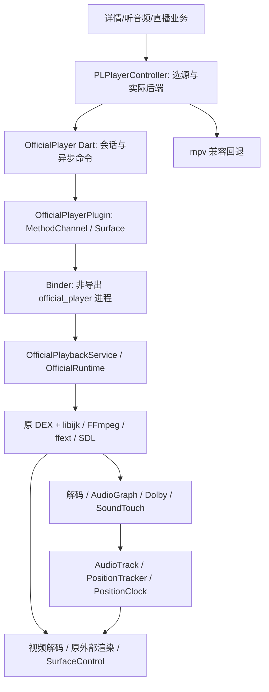

# PiliPlus 接入官方 libijk：原理、实现与验证指南

本文面向音视频及 Android/Flutter 工程师，记录本项目从最小宿主到实际应用的接入过程。配套文档：[视频首开优化](video-startup-optimization.md)。整理日期为 2026-10-17（东八区）；这是研究开发分支的工程交接，不是“所有视频与官方完全一致”的验收声明。

当前产品行为以候选 308/311 为准：311 撤除了临时 CPU 采样许可，150 项产品文件和 14 项运行资产与 308 对应身份相同。此前审查报告正文两处写成 151 项，是计数笔误；实际清单为 150。fork 中功能代码逐文件比对了该清单。构建脚本的路径参数及验证脚本的小修正单列提交，未改变播放器算法。首开审查中建议撤回的 C4/D3 **尚未撤回**，最终取舍仍由用户决定。

## 阅读与证据约定

- [研究证据库](research-evidence.json)保存结果报告的公开整理副本、原始相对路径、原始 SHA-256 与公开文本 SHA-256；个人目录和设备序列号脱敏。本文的 `E045` 等编号可在该文件中搜索。原始 PCM、Perfetto、反汇编、APK、签名媒体地址及私有会话留在研究工作区，不随源码发布；报告中引用它们，不代表这些原始文件已公开。
- [功能提交清单](module-commits.json)逐项列出提交、来源候选与改动文件。这些是从保全快照重建的模块提交，提交时间不是历史实验时间。最初 8 个提交拆分共同基础，需要合在一起才形成完整接入；不能假定任意中间提交都是可交付 APK。
- “官方”必须带版本和路径。早期 `com.bilibili.app.in` 6.6.0 / 9130300、国际版 3.83.0 / 3830100、后来手机提取的国内 9.14.0 / 9140400 不是同一参照物。当前主要目标是国内 9.14；投稿编辑、录制、通话处理链排除。
- 证据分为静态调用链、局部原库执行、最小宿主输出、真实 Flutter 应用、Android 内部捕获、物理屏幕/声学输出、用户听感。后一层不能由前一层自动推出。`prepared`、加载成功、UI 显示 Hi-Res 都不是实际输出证明。
- 会话与工作日志用于找回问题和约定；技术结论仍回到源码和实验报告。当前索引覆盖 465 条去重后的用户消息/最终报告、330 份初始结果报告，另补递归目录和专题证据；完整覆盖元数据见证据库，不公开原始私人会话。

建议阅读顺序：架构与版本锁定 → 音频算法 → 同步与生命周期 → 视频呈现 → 构建验证 → 54 项覆盖账。遇到具体故障可直接查后面的故障索引。

证据库较大，若网页不预览，克隆后可直接检索，例如读取122同步修复报告：

```sh
python3 -c 'import json; d=json.load(open("docs/research-evidence.json")); print(next(r["text"] for r in d["reports"] if r["id"]=="E129"))'
```

## 1. 为什么不是给 mpv 调几个参数

早期调音候选没有让用户感到明显改善。用户在同一条《渡口》上仍觉得官方更浑厚、立体，后来还发现实际后端是 mpv。这个过程暴露了两个不同问题：一是音轨、响度、解码/DSP、输出链并未真正对齐；二是实验开关与真实后端不一致。不能根据设置页勾选、AudioParams 的 `s32/48000/stereo` 推断已经使用官方库或 FLAC 音轨。（E001–E003、E049–E050）

`libijk.so` 不是纯音效插件。它管理媒体、音频/视频解码、缓冲、时钟与呈现调度，并调用同包 FFmpeg、SDL/网络和扩展 DSP 库。最终方案让同一个官方播放器实例处理音视频，Flutter 负责业务与交互；mpv 保留兼容回退。把音频单独接官方、视频继续由另一个播放器运行，会额外引入双时钟、seek、倍速、缓冲和结束状态的协调，现有证据不支持这样拆。

G0 先验证上游构建与既有回退，G1 用官方库最小宿主验证实际 PCM、结束和释放。随后才进入 Flutter 页面。最小宿主证明了组件可用，但没有证明 Flutter 纹理消费、系统路由或真实手机显示正确。多轮“原生提交齐全、屏幕仍缺帧”的失败正是这个区别。（E002、E030、E038、E077、E080）

最终用户反馈曾确认：官方路径比原 PiliPlus 听感明显改善、接近官方；122 的扬声器及蓝牙均主观同步。这是有价值的用户证据，但没有覆盖任意视频、任意手机和全部路由，不能据此承诺完全一致。

## 2. 架构、边界和代码地图



|层次|主要源码|职责与必须保留的边界|
|---|---|---|
|业务选源|`lib/http/video.dart`、`lib/pages/video/controller.dart`、`lib/pages/audio/controller.dart`|账号/资源权限、真实音轨与备用地址、响度归属、选择代际|
|Dart 播放门面|[controller.dart](../lib/plugin/pl_player/controller.dart)、[official_player.dart](../lib/plugin/pl_player/official_player.dart)|后端选择、准备/seek/倍速/取消、回退原因、用户播放意图|
|平台桥|[OfficialPlayerPlugin.java](../android/app/src/main/java/com/example/piliplus/official/OfficialPlayerPlugin.java)|会话、Binder 连接身份、Surface 所有权、过期回调丢弃|
|独立宿主|[OfficialPlaybackService.java](../android/app/src/main/java/com/example/piliplus/official/OfficialPlaybackService.java)、[OfficialRuntime.java](../android/app/src/main/java/com/example/piliplus/official/OfficialRuntime.java)|加载、控制串行化、原库对象生命周期、输出与错误诊断|
|音频适配|[graph_adapter.c](../android/official_audio/graph_adapter.c)、[dsp_adapter.c](../android/official_audio/dsp_adapter.c)|格式、所有权、DSP 注册/选择、供数时响度、时间线适配|
|同步|[clock_adapter.h](../android/official_audio/clock_adapter.h)、[clock_resume.h](../android/official_audio/clock_resume.h)、[timeline_reset.h](../android/official_audio/timeline_reset.h)|输出时间戳、暂停冻结、恢复重锚、seek/直播时间线重置|
|资源与格式|`DashSource.java`、`FragmentIndex.java`、`OfficialStream.java`、`media_index.c`、`media_metadata.c`|分片/索引合同、轨道 ID/码率、HDR 元数据、刷新与备源|
|呈现|`OfficialPlayerPlugin.java`、`OfficialHdrSurface.java`、`MainActivity.kt`、`widgets/official_video.dart`|SDR/HDR 输出、尺寸/裁剪/镜像、横屏与 Flutter 合成|
|验证|[android/validation](../android/validation)、[validation](../validation)|边界状态、时钟、选择、缓存、并发、Dart 控制契约；不代替真机输出|

### 2.1 为什么放进单独进程

mpv 与官方库都带 FFmpeg/相关 native 符号。直接混入同一 JNI 搜索空间会有同名库和 ABI 冲突，因此官方库是私有运行资产，而不是直接混入 mpv 的 `jniLibs`。服务使用应用自己的 UID、非导出 `:official_player` 进程；这里的“独立”不是 Android `isolatedProcess` 沙箱，也不是运行官方 APK 的完整应用。

原 DEX 保留所需类名，宿主包名仍为 `com.example.piliplus.audio.dev`。自有 DEX 桥把入口放到正确 ClassLoader/native 命名空间，确保 DSP 注册操作的是同一个 FFmpeg 实例。只在另一个 loader 中成功 `dlopen` 或注册另一个 FFmpeg 副本，不会让当前解码器自动得到能力。（E028–E031、E052、E055）

控制消息经 Dart/MethodChannel/Binder；PCM 和逐帧调度留在 native 内部。不要把高频音频数据搬回 Dart，也不要用 UI 轮询作为播放时钟。

### 2.2 版本锁定与安全失败

当前锁定的 APK SHA-256：

```text
7c82d171f1fb7681b4e2bdf35c4b0842376acd27da810e85e1229d2f4e3c53cd
```

`libijk.so` SHA-256：

```text
d3971ffa09006581cf612f4d803fc8fd1677fe687f3712ae6d64953e55db5bc2
```

完整来源、9 个原生库及哈希见 [official-runtime-manifest.json](../android/official-runtime-manifest.json)。准备脚本生成 9 个原始库、保留原条目内容的 DEX 运行归档、3 个自有桥/适配文件与 manifest，共 14 项。DEX 存储方式/对齐改变了归档字节，不能拿生成的 `official.apk` SHA 当原 APK SHA；33 个 DEX 和所有条目内容另行逐字节验证。

私有偏移、函数类型、结构布局、vtable 槽和原指令一起构成适配合同。文中的 ELF 偏移只适用于锁定样本，不能照搬到其他 9.14 安装包，更不能只看版本名相同就复用。升级库时先做身份核验和最小宿主回归，再更新 guard。失配应明确失败/回退，不能“试着写进去”。

小米上 `native process died / reason_5 / status_6` 的一类根因是已加载代码页 RX→RW→RX 触发 SELinux execmod 保护，不是自动证明厂商有反调试或授权自毁。处理方式是受控生成私有加载镜像，在加载前核原指令、应用必要改动；运行中只对允许的数据/GOT/vtable 做成对、可回滚修改。原 APK 与原 so 保持不变，派生镜像有独立身份。错误必须区分 ABI 失配、权限失败、对象生命周期和媒体格式问题。（E031、E054、E060）

## 3. 官方 Java → native 的分析方法

从真实播放入口向下追踪，而不是从库字符串猜功能：

1. APK 清单/DEX 定位 `IjkMediaPlayer`、新 AudioEngine 包装、播放服务、响度模型、`AudioFocusService`、资源与预加载调用者。
2. 对开关检查调用位置、默认值、服务端配置和实际选中的分支。9.14 同时有旧 SDL 和新 AudioEngine；官方 APP 实测常走旧 SDL，本宿主采用新 AudioEngine。二者不能混称完全相同。
3. JNI 注册表确认方法名、签名、接收者和 native 对象；在 ELF 中交叉检查符号、xref、vtable、结构读写和错误返回。
4. 用最小宿主确认输入实际到达哪个解码器/滤镜，输出有效长度、声道、格式、PTS、结束和释放，再与真实 APP 同素材比较。
5. 反编译器生成的伪 C 只是解释。结构体按值返回、借用指针、原子/锁、浮点/整数转换均用指令或运行对照确认。反编译失败保留未知。

典型误判包括：注册表有 `haas` 就以为官方默认扩展立体声；发现 `Spatializer` 查询就以为已空间化；端点属性发生变化就以为实际 AudioTrack 已切耳机；函数返回 0 就以为 native 工作已经完成。后续每个模块都按调用、参数、实际输出三层验证。

## 4. 响度与“浑厚立体”的来源

### 4.1 普通国内分支：受限固定增益

早期跨版本分析发现，同名 `ijkloudnorm` 不保证算法相同：国内 app.in 分支主要是受元数据约束的固定增益，intl 同名实现有动态行为。9.14 原库初始化与帧处理对照支持当前国内规则，不能把标准 FFmpeg `loudnorm` 或 mpv 的动态归一化直接当等价替代。（E003、E044、E053、E085）

元数据必须跟随实际选中音轨和当前 cid，而不是“最近一次详情请求”。Java 业务门槛与原滤镜数值算法分开：缺失、非有限、近零（绝对值≤0.0001）、范围错误、场景不匹配、低于门槛（默认 -28）时不要硬套。场景读取 `normal_target_i`、`high_dynamic_target_i`、`undersized_target_i` 等实际字段。

核心正增益约束可写成：

```text
requested_gain_db = min(target_I - measured_I, 10)
positive_headroom_db = max(max(target_TP, 3) - measured_TP, 0)
实际正增益不超过 positive_headroom_db；负增益按原规则处理。
```

这只是已验证核心规则的解释；完整哨兵、场景、元数据验证与参数顺序以 [OfficialLoudness.java](../android/app/src/main/java/com/example/piliplus/official/OfficialLoudness.java) 和测试为准。原滤镜直接调用的 `I=0` 哨兵与 Java 业务层拒绝零值不是矛盾：它们是不同层的条件。不要删掉业务 gate 后说“原算法允许”。

### 4.2 为什么当前没有逐帧完整调用原 loudnorm

原滤镜除固定增益外还执行 EBUR128 统计，单改打印格式不会停统计。实际渲染线程成本和解码预队列中的旧增益导致切换迟滞。尝试原 `volume` 路径又遇到未注册。当前对确认的国内固定增益语义，在 source 供数时调用原格式转换到 double、乘增益、回到 float，避免预解码队列滞留旧增益。（E044）

因此准确表述是“复用原解码/格式转换/输出，并适配已验证的国内响度语义”，不是“每个音效函数完全照搬官方”。如未来目标变成 intl 动态分支，需要重新实现/复用那条链；不能用当前固定增益声称对齐。

### 4.3 不叠加未经证实的效果

普通观看路径未找到默认通用 EQ、bass/treble、haas、crossfeed、reverb、amix 或独立 alimiter 的启用证据。库里存在这些能力不等于业务启用。没有依据时增加低频、扩大声场或硬限幅会偏离参照。真实差异可能来自不同音轨、响度、Dolby 参数、下混、重采样、倍速拼接或系统处理，应逐层比较。

系统媒体音量、应用 cubic 软件音量、响度增益和焦点 duck 是不同层。同 UI 百分比并不等于同物理增益；超过当前官方路径能力的设置仍需明确回退。原官方路径不经过 mpv ReplayGain，不要重复加一次归一化。

## 5. Dolby：注册、选择、端点与重复增强

### 5.1 注册成功不是实际选中

`libffext.so` 含专有 AC3/EAC3 解码实现。只注册后，按 codec ID 选择仍可能落到普通 FFmpeg 解码器。当前在严格匹配的 AC3/EAC3 ID 上转向 `ijkac3` / `ijkeac3`，其他编码委托原选择。诊断应同时记录请求编码、实际 codec 名、解码参数与输出，不拿“插件加载成功”代替解码证据。（E029、E086）

原扩展参数是借用的 9 个 int32，观察到初始化形如 `{2,1,6,-14,65535,0,0,0,0}`；各项意义与更新位置应以 `dsp_adapter.c` / `dolby_endpoint.h` 的当前实现为准。参数不能放在短命栈上，生命周期覆盖 decoder 使用；不能在全局公共 descriptor 上无条件改函数指针，让另一次注册把适配覆盖掉。

小米硬件能力报告与新 AudioEngine 实际协商曾得到 12 声道 `0xb58fc` 等不支持组合。当前针对该接入选择软件解码，但**先读取原硬件增强能力，再处理能力缓存**；原 `isEac3HwRender` 分支要求清软件 virtualizer/dialogue，避免硬件与软件双重增强。不是把所有 Dolby 效果都关掉。

### 5.2 Dolby 与普通响度互斥的条件

先前同 EAC3 叠加普通增益造成额外约 4.4dB 差异。按实际解码 AC3/EAC3/AC4 识别后，通用响度走 `dolby_codec_bypass`，保留原专有处理；不能只按 UI “杜比音质”标签判断，更不能全局关闭所有响度。（E086、E112、E137）

已有同 EAC3 样本约 55.28 秒有效立体声 PCM 与官方内部捕获完全相同；FLAC 约 55.7 秒对照中，5,347,840 个样本值里 514 个最多相差 1 LSB。它们是指定素材、参数、设备与内部采集链的证据，不是物理耳机或任意视频一致证明。

### 5.3 端点切换的正确粒度

官方旧 `IjkMediaPlayer.addEndpointChangeListener/updateEac3Endpoint` 设置端点属性 `30200`（1 扬声器、2 耳机），该回调没有重开整个播放器。122 宿主在路由变化时完整重开，用户反馈暂停数秒、偶发后续视频卡顿；128 改为 decoder 私有参数副本、版本号请求/确认与解码时重试，普通 AAC/FLAC 不因端点变化强制重建。（E114、E146、E163）

126 实验直接改公共解码描述符，被重新注册覆盖，因此未直接交付。128 复制受控私有 FFCodec 描述符，每个 decoder 拥有自己的参数；更新请求与解码器确认分开。参数更新失败不能假装已应用，暂停中尚未解码也不能报告已生效。

132 结合真实系统焦点和注入端点参数，确认同播放器、同 AudioTrack/clock 对象下请求/确认正确，恢复后的有限窗口保持 24fps；但物理路由一直是扬声器。这证明参数链，不是一次真实蓝牙切换实验。（E165）

### 5.4 AC3、AC4 的后续补证

152 用原 9.14 旧 SDL 参考宿主与当前产品同编码内容比较，AC3 17 秒有效段 1,632,000 个值完全相同，未调增益/伸缩时间。参考是原库宿主，不能冒称官方完整 APP 同源实验。

AC4 新 AudioEngine 仍缺 CodecId 映射，当前产品没有完整支持。旧路径曾因公开描述符 type=VIDEO、扩展实现 type=AUDIO 导致 `avcodec_open2=-22`；在研究宿主显式注册并校验 descriptor 后，32 秒样本实际有声完成，但有少量满幅值，缺可信无损参考。它证明条件下的解码能力，不证明观看业务会下发 AC4，也没有变成当前产品能力。（E100–E101、E160）

## 6. AudioGraph ABI、格式与精度

### 6.1 S32“准备成功但没声音”

原新图接受的格式集合包含 1/4/7/10，却不接受格式 2 的 S32。FLAC 可出现 prepared/completed 但 PCM 为零、内部错误 -22。适配把 S32 按 `2^-31` 转 float，使用原 Frame 工厂，保留格式、声道、采样率、PTS、有效字节及 side-data。（E043、E045）

ARM64 结构体返回使用隐藏 sret 寄存器 x8，不能按普通指针返回猜 JNI/C 签名。`graph_sret.S` 处理真实调用约定；引用计数和 side-data vector 复制必须保持原所有权。原始对象还活着不代表新对象正确拥有其内部存储。

### 6.2 重复 EOF 与帧时长

原图可能在 EOF 返回同一缓存帧。修正只针对同对象、相同来源/PTS/size/serial、当前队列 EOF 且无新内容的已确认条件，并持有强引用；不能用全局“相同 PTS 就丢帧”，那会误删合法重复时间戳或换流首帧。

另一个问题是 `nb_samples * 1,000,000` 的 32 位中间值溢出：8192 样本/96k 应约 85,333µs，却可得到约 40,594µs。通过版本/指令守卫改为 64 位计算，修的是时间长度，不是增大缓冲来掩盖。副作用应通过队列时长、重采样有效长度和完整输出检查。

### 6.3 真 24 位补证：不要把 16 位扩成 24 位当测试

150 对全部 16,777,216 个有符号 24 位码值（左对齐 S32）分别在主机、ARM64 执行生产转换表达式，恢复整数错误为 0。真实 24 位 FLAC 经官方解码后也逐值一致；真 32 位最大值负对照出现最低位误差，说明测试没有把所有整数一概判无损。（E172）

随后调用原 graph 的 float→S16 路径，确认默认无 dither、静音不添噪、有限超范围值饱和。**缓冲对齐会影响半格取整**：64 字节对齐的 NEON 路径与偏移 4 字节路径出现“中点向正方向”和“最近偶数”差异，最多 1 个 S16 LSB；原指令 `FCVTZS #31 + SQRSHRN #16` 与实验一致。最初假设所有路径 ties-to-even 的失败保留，没有改测试隐藏反例。

这些证明转换组件，不是端到端 24 位。96k/24 输入在该手机仍可输出 48k/S16；内部捕获 48k 也不能反推 AudioTrack 一定 48k（44.1k Track 曾被捕获链转到 48k）。没有证据支持为了“Hi-Res”盲换 double、加 dither 或改系统输出。

### 6.4 下混、空间化和倍速

六声道输入到双声道已实际验证，LFE 独立窗口可能为 0；原下混/重采样路径有 20 秒对照和后续原库参考补证。它不等于 5.1/7.1 物理输出，也不等于耳机空间化已开。系统 Spatializer 能力查询、缓存更新和实际启用仍需分开。（E093、E153、E171）

倍速复用原连续参数算法，不是每个 UI 小数对应一个单独实现。当前接受范围及实际 native 行为仍有约束：UI 2 映射到官方惯用的 1.99，SoundTouch overlap 从新图默认 8ms 对齐到官方使用的 16ms。有限样本包络误差从约 +0.336～0.378dB 降到 -0.005～-0.048dB，但严格全波形仍未一致；接口范围 0.25–4 不等于已证明每种素材的 4 倍有效能力。6 倍等超范围明确拒绝，不默默假成功。（E075、E095–E096）

131 修复长按加速的异步竞态（E193）：start 还在 pending 时 release 早退，随后迟到 start 把速率又设高。按会话/源代际串行提交，释放等待真实开始后的恢复，失效的旧命令丢弃。不能只改 UI 倍速数字，也不要靠额外 pause/play 遮掩切速问题。

147 真机又发现 0.25 倍“返回成功但约 1 倍播放”：原 renderer 范围 0.5–3，比上层声明窄。148 只在锁定私有镜像中将下限 0.5 改为 0.25，保留上限及 AICenter/多声道保护。真实六声道下混测试的进度斜率 0.2499696、有效声段约 68.19 秒、测试音音高保持；不是官方 APP 同源 0.25 倍对照。149 再补实际倍率反馈、弹幕速度和长按恢复，不能把 131 当全部倍速问题已经结束。（E183–E185、E192–E193）

4 倍仍受 AICenter 限 3，某些软件解码/慢解码策略还会限 2；实际多声道设备在非 1 倍可被引擎拒绝。原 JNI/core 返回成功未必传播 renderer 错误，因此看实际引擎速率、媒体进度和 UI 回执是否一致。不要为了支持 4 倍整体关闭原保护。

163 进一步做固定30秒 H264/AAC 的1倍与1→1.99→1对照：切速窗口最大帧间隔约25ms，5ms RMS窗无近静音；正常Flutter页两轮真实ADB长按也恢复原倍率，合成层窗口最大约41–50ms。但合成层含弹幕/控件，不能据此关闭用户在公网或其他设备上的偶发切速卡顿。（E184）

空间化分析也进一步明确：原 `QuerySpatializerAvailable` 要求 SDK≥32、`isAvailable && isEnabled`，失败也可能缓存；它未调用针对具体格式的 `canSpatialize`。小米样本实际是 available=1、enabled=0，故 ForceStereo；不是“手机完全不支持”，也不是“已启用空间化”。路由失效时该缓存的完整更新路径尚未查全。（E192）

151 补了真实 AudioTrack 与内部捕获的原 9.14 旧 SDL 参考：六声道 FLAC 17 秒 1,632,000 个值相同；真 96k24 输入的 20 秒 off 对照 1,920,000 个值里 115 个差 1 LSB，受控 -6dB 时 398 个差 1 LSB。-108dBFS 输入最终被 S16 量化为零，不能声称保留了超过输出精度的细节。参考宿主最初 attribution 错误导致 session=0/静音，即便 completed 也失败；改为实际 shell UID 的 attribution 后才有有效输出。它仍不是官方完整业务，也不能证明不同 UID 的厂商音效相同。（E171）

## 7. 扬声器、蓝牙与音视频同步

这是本项目最重要的故障链之一。**没有通过加一个固定“蓝牙补偿毫秒数”解决，也没有把根因归为库版本旧。** 两条路由延迟不同，只能说明需要检查各自的输出时间戳和处理链；“蓝牙看起来同步”不能证明扬声器算法必定正确或错误。

### 7.1 原时钟链

在锁定 9.14 `libijk.so` 中，已追踪：

```text
AudioTrackDevice.GetTimestamp (0x1b9e6c) / GetLatency (0x1b9ec8)
  → AudioDevicePositionTracker (0x18af28)
  → PositionClock.UpdateTimestamp (0x18b394)
  → PositionClock.GetEstimate (0x18b4f4)
  → AudioEngineRenderer.GetPositionInternal (0x15938c)
  → 视频调度/提交
```

这些入口组合使用输出帧位置、时间戳和延迟估计，不是单纯 UI position。200ms 设备 buffer 配置不能解释成专用蓝牙延迟补偿。在已审查路径没有发现耳机型号→固定延迟表，也没有发现 APP 强制 SBC/LDAC 的策略。蓝牙编码由系统协商；结论只覆盖已检查调用路径。（E106、E113、E145、E148）

### 7.2 连接状态不等于实际路由

旧 Java 监听 `HEADSET_PLUG` 和 `bluetooth.headset.profile.CONNECTION_STATE_CHANGED`；后者是 HEADSET profile，不能直接等同 A2DP 已接管音频。当前宿主 API 33+ 用 AudioAttributes 预测设备，其他情况下结合连接列表，AudioDeviceCallback 与 250ms 检查更新端点。它没有取得原始 AudioTrack 的 `getRoutedDevice()` 句柄，故诊断保持 `actualRouteVerified=false`。

路由预测用于端点参数，不是假装物理路由确认。系统 `dumpsys media.audio_flinger` 对 UID/PID/session/Track 的独立核对可提高研究可信度，但不能把外部研究观察改写成产品内部 API 已知。Track add/remove 也可能只是同一 Track 加入/退出混音活动列表，不是每次新建。

### 7.3 98 → 122：恢复时错误时间戳使扬声器不同步

用户报告 98 蓝牙已同步、扬声器反而不同步。调查沿原时钟和真实路由对照进行。旧负向跳变保护和暂停后的陈旧 anchor 会拒绝本应接受的移动时间戳；117 局部对照中有效时间戳拒收从 143 次变成 0，内部视频 PTS 相对 AudioTrack 外推偏差中位从约 +249.726ms 改到 -5.265ms。该数值是内部估算，不是嘴形/扬声器物理误差。（E109、E129、E148）

122 的处理：

1. pause 成功时冻结当前 clock，不让暂停时间被算成媒体已经前进。
2. play 成功后等待新鲜、确实移动的输出时间戳，再用它建立恢复锚点。
3. 拒绝零帧、过旧、倒退等输入；`now` 在 GetTimestamp 调用前采样，调用期间得到略“未来”的时间戳要在合理绝对窗口内判断，不能机械全拒。
4. 保留单调边界。生命周期操作只设置受锁保护的状态，实际时钟字段更新仍在原时钟线程。
5. 等待有界，沿原稳态 interval（该样本 500000µs）超时后使用原 GetLatency 路径，不能一直冻结直到声音恢复。

123 时间戳失败注入证明超时回退避免永久不前进，但该实验曾先禁用超时、再开启，因此记录约 12.96 秒的触发不是“自动 500ms 墙钟上限”测量。用户随后确认 122 两种路由肉眼均同步，仍不宣称所有设备已物理验收。（E108、E129）

### 7.4 122 → 135：拖动后约 500ms 一批赶帧

用户又报告 seek 后或耳机切换后偶发持续卡顿。核心可复现问题是状态机遗漏：Flush 后引擎从 Paused(3) 进入 Prepared(1)，旧恢复钩子只处理 Paused→Playing，导致暂停冻结标记仍留在 clock 中。视频反复按旧 anchor 估时，约每 500ms 批量提交。

135 把恢复判定扩展到成功进入 Playing 且同 clock 仍有待处理标记的情形；已经 Playing 的重复 play 不重置等待，失败/其他 clock 不误清。同步算法、原库、DSP 与增益没换，修的是状态过渡。（E191）

修前约 4.86 秒有效窗口最大提交间隔 489.90ms；修后 AAC 与 FLAC 各六轮 seek，观察窗口最大 46.02 / 44.94ms，无 >100ms 间隔和有效时间戳拒收增加。这证明有限稳态 native 提交，不含 seek 的网络缓冲等待，也不能解释所有真实耳机热切换故障。

### 7.5 不能关闭的边界

128 消除了端点变化整链重开的确定缺陷，135 消除了 seek 恢复状态遗漏；用户只发生一次的真实蓝牙热切换后卡顿没有完整复现闭环。暂停/Home 录屏有可见帧证据，但录屏采样间隙从几十毫秒到数秒，不能排除短闪黑。用户已取消专门的物理蓝牙 40ms/30 分钟专项，继续以官方路由代码对照为主；不把旧验收表自动恢复成新任务。（E158、E165、E191）

## 8. 视频：Surface、HDR、镜像和旋转

### 8.1 生产者提交不等于屏幕展示

早期 direct、SurfaceTexture、SurfaceProducer、Hybrid Composition 和原外部渲染做过多组对照。曾有 native 1800 个唯一帧全提交，Flutter 屏幕仅 1694 个；也有错误尺寸使原 FrameGraph pass 开销异常。不能因为 Surface 可创建、解码返回成功就宣称显示稳定。（E004–E006、E034–E038、E040–E047、E077–E080）

当前 SDR 使用已验证的原外部渲染与稳定窗口适配；HDR 在支持条件下使用 API 33+ 持久 SurfaceControl，保留 10 位/YUV、PQ/HLG 等路径，不绕进普通 8 位 GL 纹理。`colr/nclx/nclc/dvcC/dvvC` 和原 native 元数据决定输出类型；HDR 未知必须保持未知，不能先按 SDR 解码再碰运气改窗口。（E088–E089；准备顺序详首开指南 C5）

### 8.2 比例、裁剪、镜像

SurfaceView 的负 `scaleX/scaleY` 不保证变换独立 Surface 内容。改用可验证的 SurfaceControl geometry、正尺寸和 orientation/mirror 组合，并明确源像素、父视图、子 BLAST 层坐标。曾把子层 1×1 语义误套归一化矩阵，得到 0.3125 像素尺度；不能只看父 View bounds 正常。（E046–E047、E081、E087、E092）

已做指定样本的适配模式与 X/Y/XY 镜像组合，HDR 与窗口恢复也有限定回归。它不是所有 GPU/Android 版本认证，色彩管理、显示面板和系统 tone mapping 仍会影响观感。

### 8.3 加载中立即全屏残留简介/评论

用户复现条件不是“普通横屏”，而是点击播放还在加载时立即横屏。调查发现旧 FlutterSurfaceView pause 后残留 UI surface 仍可在 hybrid 视频下面看到。127 在官方构建中把 Flutter 根渲染模式改为 Texture，清除旧竖屏简介/评论残留；原视频 HDR 仍是 native SurfaceControl，没有被转成 8 位 Flutter 视频纹理。

旧评论矩形白色比例约 0.9343 的证据在修后消失（E187），属于具体合成问题修复，不是“全部 Flutter 更流畅”。GPU/功耗、更多设备和全屏交叉场景未全面测试。用户提到的整体 Flutter 卡顿仍是后续独立任务，不应混入音质对齐宣称。

### 8.4 Home、pause 和迟到 Surface

窗口、播放器和请求各有生命周期。旧 session 的 `surfaceDestroyed`、Binder 死亡或 resize 回调不能释放新 session 的输出。前后台保持用户暂停意图，后台播放与仅音频模式分别处理。

尝试 `setAudioOnly` 强行恢复画面曾造成音频重播，后台持续 drain 也没有通过音频节奏门禁，因此被拒绝。原外部渲染确有 clear/swap 的开关，但未证明官方实际配置前不能盲开“禁黑”绕过问题。（E008–E024、E061、E097、E158）

## 9. 资源、seek、直播与异常恢复

### 9.1 DASH 是容器合同，不只是 URL

普通 MP4 与 B 站分片 DASH 即使编码相同，也可能不满足原播放器的索引假设。缺 fragment/global_sidx 的输入曾造成 mov index=-1 或错误 -16。伪造文件大小回调不能修复索引；必须检查容器/fragment/index 或走明确兼容路径。在线已识别 DASH 后来复用 native 查流/索引，Java fallback 保留格式拒绝。（E025、E048、E130、E152）

实际选中的轨道 ID、码率、codec、主/备用 URL 随 `OfficialStream` 一起传递。Hi-Res/杜比资源由账号权限和服务器响应决定，不能仅凭理论支持就声称取到了。CDN 切换能改变可达性，不能凭空生成服务器没返回的无损音轨。

### 9.2 刷新与取消是完整状态机

主源 403/503、响应体停滞、全备源失效、打开前地址过期和播放中断流分别验证。刷新保持同一真实音轨/编码合同，带账号、源选择、session/请求代际；过期结果不覆盖新视频。不要把刷新超时一律当 native 崩溃，或没用完同轨备源就退 mpv。（E124–E149）

81–89 修复了纯音频页的错误后重播、加载中换源不等待旧开片、详情迟到、分 P 的 cid 查询迟到等问题。UI 的“选择完成”、Dart Future 返回、native ACK 和实际首音是四件事。停止/取消后迟到 play 不应复活旧声音。

独立“听音频”入口最初仍走 mpv，69 接官方；70 补上未先播放视频时的响度参数。不能只验视频详情入口后就认为所有音频功能已对齐。（E103–E105）

### 9.3 准确 seek、HE-AAC 与片尾

准确 seek 回调不是简单“位置数字更新”。起始 seek 精度超时可保留可播官方路径，但不能无限等待；片尾按有效目标处理，EOF 后缓冲缓存需重新检查。（E069–E072、E107、E147、E151）

HE-AAC/HEv2 的内部状态跨 seek 残留，单纯 flush 不够，需在正确所有权下重建 decoder context，保留错误传播。内部录音 pause 残音还受 Android 捕获模式影响，不能把采集残留全归为播放器继续出声。（E083–E084、E090、E128）

### 9.4 直播并不是把 isLive 改成 true

89 的旧覆盖账写直播未接入，后来 90–104 已推进真实直播页、403 刷新、重连、PTS 归零及 discontinuity。主链需要同时重置音频源、队列 serial、PositionClock 与视频调度时间域；只刷 URL 会留下跳变和持续断续。跨页面旧直播抢播也需要代际取消。（E111、E115、E117–E123、E154–E156）

这些验证不等于所有 HLS/FLV、网络断流、长时直播都通过。原89状态不能当当前状态照抄，后续未消除的网络供数/时间线边界也不能因点播已正常而关闭。

### 9.5 音频焦点与进程回收

焦点处理保留“原来想播放”和“现在底层正在播放”两个状态。临时失焦可恢复，但用户在失焦期间暂停后不得自动播放；永久失焦、duck 和系统媒体用途分别处理，duck 幂等，不能反复乘小音量。（E039、E067、E116、E165）

官方 `MEDIA/MOVIE`、`willPauseWhenDucked`、`acceptsDelayedFocusGain` 及前台永久失焦行为与本产品仍有差异，不能声称焦点策略全等价。

107 对系统 OOM/kill_bg_proc 做有界前台恢复，不对所有 native crash 无限重启。旧 Binder 的死亡回调按连接身份过滤；回退前确认旧输出停止。108 修复等待恢复/回退期间用户取消后仍下发迟到 play。（E132–E133）

## 10. 构建、身份核验与可回退交付

### 10.1 仓库包含什么

fork 只包含自有适配源码、测试和工程文档；官方 APK/so、签名私钥、账号信息、带授权参数的媒体地址不入库。上游 GPL-3.0 保留；官方二进制不因放在开发机里就自动取得再分发许可。本指南采用本地明确输入，不提供二进制下载镜像。

当前已验证宿主环境是 Linux x86_64、JDK 17.0.20.1、Flutter 3.47.7、Android SDK/build-tools 37、NDK 28.2.13676358、目标 ARM64；native helper 编译目标 android26。FFmpeg 7.1.1 配置头用于适配编译，不替换官方实际 FFmpeg。其他主机/ABI 需要重新验证，尤其含 AArch64 汇编的测试不能直接用 x86 `cc` 执行。

### 10.2 从 fork 准备

```sh
git clone --branch feat/official-player-alignment https://github.com/windddkz/PiliPlus.git
cd PiliPlus
# 以下路径是示例；换成自己的专用工具链目录和本地 APK。
export AUDIO_TOOLCHAIN=/opt/piliplus-toolchain
export FLUTTER_ROOT="$AUDIO_TOOLCHAIN/flutter-3.47.7"
export JAVA_HOME="$AUDIO_TOOLCHAIN/jdk-17.0.20.1+1"
export ANDROID_HOME="$AUDIO_TOOLCHAIN/android-sdk"
export PUB_CACHE="$AUDIO_TOOLCHAIN/pub-cache"
export GRADLE_USER_HOME="$AUDIO_TOOLCHAIN/gradle-cache"
export PATH="$JAVA_HOME/bin:$FLUTTER_ROOT/bin:$ANDROID_HOME/platform-tools:$PATH"
python3 scripts/apply_android_patches.py --toolchain-root "$AUDIO_TOOLCHAIN"
python3 scripts/prepare_official_audio.py \
  --apk /path/to/local/official-9.14.0.apk \
  --sdk "$ANDROID_HOME" \
  --ndk "$ANDROID_HOME/ndk/28.2.13676358" \
  --java-home "$JAVA_HOME" \
  --ffmpeg-headers "$AUDIO_TOOLCHAIN/ffmpeg-source/ffmpeg-7.1.1"
python3 validation/official_dex_archive_test.py --apk /path/to/local/official-9.14.0.apk
```

工具链需预先安装，FFmpeg 源目录需已配置并含 `libavutil/avconfig.h`；命令不自动下载官方 APK。`apply_android_patches.py` 读取上游现有 patch 列表（25 个 SDK、9 个 material_ui），只允许专用工具链根下的目录，已应用时逆向检查跳过，失配停止。避免直接运行会修改全局 Git 身份、reset SDK 或删除缓存的旧脚本。共享 SDK 不适合作为实验补丁目录。

准备脚本先检查必需文件与 APK 哈希，再生成资产；不能用 `python -O` 绕过其 assert 身份守卫。`--fixtures` 是可选 debug 样本，需另给 `--fixture-dir` 或研究工作区中的自制样本目录；普通 profile 打包不需要这些私有夹具。研究目录中的夹具/捕获工具并未全部随 fork 发布，不能把所有历史实验写成一键可重现。

### 10.3 打包与安装

```sh
ORG_GRADLE_PROJECT_officialAudio=true flutter build apk \
  --profile --no-pub --target-platform android-arm64 \
  --build-name=2.1.6-official-local --build-number=312
```

312 只是命令示例，发布时选择高于设备已安装值的自有版本号；本轮没有生成/安装 312 APK。profile 用 Dart AOT，且当前官方 profile 配置关闭 Android debuggable，以便动态 DEX 正常 ART 编译。debug 与 profile 的启动成绩不能混算；profile 也不等同最终 release 优化认证。

构建成功后再检查 `build/app/outputs/flutter-apk/app-profile.apk` 的签名、包名、versionCode、运行资产和 SHA。同包名保数据覆盖需要相同签名；新开发者的 debug key 不会自动匹配既有研究安装，不能为了安装成功而卸载用户数据。先安装到独立测试包/设备，或由持有原签名者构建。`adb install -r` 的成功不是加载资产身份验证；还应核安装路径和运行进程实际映射。

回退保留已验证 APK、源码身份、运行 manifest 和必要设置。相同签名下系统允许的降级可用 `adb install -r -d`，若设备不允许就使用旧源码前向版本构建；不把卸载清数据当默认回退。已有回退机制没变化时不机械重复覆盖降级。小米 USB 安装是否需点击取决于设备设置/系统策略，本项目已获得实机安装授权，但不向后来用户承诺所有小米免确认。

## 11. 验证分层与复现清单

### 11.1 主机可执行边界检查

例如时钟状态机：

```sh
cc -O2 -Wall -Wextra -Werror android/validation/clock_resume_test.c \
  -pthread -o /tmp/piliplus-clock-check
/tmp/piliplus-clock-check
python3 validation/graph_slot_test.py
python3 validation/decoder_reset_test.py
python3 validation/buffering_recheck_test.py
python3 validation/dolby_loudness_test.py
```

timeline、audio_buffer、media_adaptive、media_dash、Dolby policy、first_seek 也有独立 C 检查；Dolby endpoint 需配置好的 FFmpeg include。`network_read_test.c` 含 ARM64 汇编，应交叉编译后在适配的自有 ARM64 进程运行；TLS 测试还需锁定的原库，不能把主机编译失败误判产品故障。

本轮重新运行上述四个 Python 检查、8 个主机 C 检查与 DEX/资产核验，通过范围见证据库的 `publication_validation`。buffering 脚本最初截取了无关的 `previous_pts` 声明导致 `-Werror`，只修正测试截取边界；没有修改生产 gate。未重新执行全量 Android Lint、所有 Dart/真机测试。既有 Android Lint 27 错误/48 警告不在本轮宣称修复。

### 11.2 有意义的信号与样本

|问题|有效对照|不能替代它的检查|
|---|---|---|
|解码/响度|同编码包、同增益/音量、对齐后的完整 PCM，包含片尾|波形看起来大、试听一个短片段|
|24 位转换|真正使用低 8 位的全部码值、负对照、原转换函数|16 位素材重新编码成 24 位|
|下混|独立声道时间窗、LFE 单独段、原库同输入|UI 显示“5.1”|
|倍速|实际速率、输出时长、包络/波形、切速瞬态|设置方法返回成功|
|同步|校准时钟、真实 output frame/timestamp 与视频提交；物理另测|直接相减 PTS 与主机 wall clock|
|Surface|带帧号视频、屏幕逐帧/采样间隙、窗口生命周期|native submit 数量完整|
|路由|实际 AudioTrack 路由/系统 Track 对照与真实切换|连接列表或模拟 endpoint=2|
|取消/释放|迟到回调、同进程下一片、无旧声音/线程/对象|dispose 的 Future 返回|
|资源刷新|403、503、体停滞、全备源失败、取消与跨 cid|只改一个正常 URL|

真实页面优先覆盖：普通 AAC/FLAC/EAC3，AVC/HEVC/AV1，HDR/DV，视频/独立音频/直播，播放和暂停 seek，倍速长按释放，加载中切 P/横屏，Home 回前台，焦点丢失/用户取消，断网/过期/回收。样本独立记录版本、实际 backend、轨道、设备、路由、输出格式与测试窗口；无失败不等于穷尽。

### 11.3 采集工具也会失败

模拟器 ARM 转译、AudioFlinger 欠载、gRPC/宿主 monitor 可产生与手机不同的停顿；曾出现内部回调标记准确而宿主声音偏差约 60ms，不能外推真机。录屏是可变帧率，不按请求帧率强行生成时间轴。自动触控被系统丢弃、控件已隐藏、VM 脚本 late 字段未初始化，均属工具失败，不能写成产品回归。（E021、E027、E058–E059、E128、E158、E191）

日志隐藏凭据及授权媒体 URL，结束后恢复临时偏好，核对键原本是否存在，关闭采集与转发，检查是否还在播放。只清理列明的可重建缓存/重复文件，保留原始证据和回退产物。

## 12. 故障索引与已拒绝的捷径

|现象|优先定位|本项目教训|
|---|---|---|
|音效改了却听不出变化|实际 backend、轨道、响度 gate、decoder 名|设置开启与实际生效分开；mpv 回退不等价|
|官方开片崩溃 reason/status|退出记录、加载镜像、权限、guard、分片索引|execmod/ABI/容器问题不要统称“官方保护”|
|FLAC prepared 无声|格式/有效字节/S32 graph 错误|准备完成不是完整输出|
|EAC3 比官方明显更响|实际 Dolby decoder、通用响度、硬软增强|重复处理约 4.4dB，不靠总音量抵消|
|扬声器不同步、蓝牙正常|两路输出 timestamp、暂停/恢复 anchor|不加凭感觉的固定偏移、不归咎新旧库|
|seek 后半秒一批画面|Flush 后状态、冻结标记、clock 身份|Prepared→Playing 也需要恢复处理|
|路由切换暂停黑屏|端点更新是否重开全播放器|DSP 参数更新与系统焦点是两条链|
|加载时横屏残留评论|Flutter 根 surface 与 hybrid 层|不是视频解码坏帧，也不靠视频镜像修|
|彩色竖条/缺帧|源/有效尺寸、裁剪、stride、Surface 世代|native submit 成功不能验收显示|
|Home 回来数秒才有画面|窗口重绑、暂停意图、元数据/Surface 顺序|setAudioOnly 候选曾引起音频重播，拒绝|
|Hi-Res 不可选|账号响应、实际音轨 ID/codec、入口取流合同|CDN 改变可达性不等于解除资源权限|
|长按放手仍加速|异步 start/restore 顺序和源代际|不能只改 UI 数字|
|切片又播旧声音|旧详情/cid/打开/连接回调|代际保护覆盖整个链，而非某个 Future|
|片尾卡 buffering|EOF、accurate seek、缓存 gate、有效目标|不能全局降低水位或丢相同 PTS|

## 13. 54 项对齐覆盖账（当前校正）

下表延续 E330 的编号，但以之后的证据修正；“已接入/样本”表示有限范围，绝不等于所有内容完成。与首开有关的供数/缓冲/多档问题见第二份指南。

|#|对比项|当前实现与证据边界|
|---|---|---|
|1|播放内核|同 IJK 实例音视频，mpv 兼容回退；全部入口/格式并未统一|
|2|新旧官方路径|当前新 AudioEngine；官方常见旧 SDL，业务选核条件未全部恢复|
|3|解码默认值|普通音频软件、AC3/EAC3 专用；其他硬件组合未穷尽|
|4|普通编码|AAC/HE/HEv2/FLAC 等有输出；Opus/Vorbis/ALAC 不保证新核全部支持|
|5|Dolby 专用路径|EAC3 有官方同源证据；AC3 后补原库参考一致；AC4 新核仍缺|
|6|普通/Hi-Res/Dolby 资源|30251 FLAC、30250 EAC3 实际选轨；权限/语言/全部资源未穷尽|
|7|选轨与失败回退|同轨备源/刷新/取消；mpv 保可播不保听感等价|
|8|响度元数据归属|轨道/cid/选择代际绑定，防迟到覆盖|
|9|视频/离线/仅音频/直播|视频、独立音频和后续直播已接；离线元数据等价/全部直播未闭合|
|10|响度开关|默认 normal、显式 off 保留；不是官方所有远端配置的复制|
|11|场景目标|normal/high_dynamic/undersized 与 gate；服务端场景全覆盖未完成|
|12|国内响度|受限固定增益与原格式转换，普通样本/多声道对照|
|13|intl 同名算法|动态分支不同，当前国内目标不采用|
|14|动态压缩/AGC|普通不额外 dynaudnorm，Dolby 按原专用链|
|15|标准 loudnorm|不是 ijkloudnorm 等价物；不支持设置明确走兼容路径|
|16|峰值预算|原 10dB/余量规则；全素材无削波未证明|
|17|无效/过低响度|零/非有限/缺失/范围/门槛检查；坏元数据不能保证听感|
|18|软件音量|cubic 保留，默认音量有 PCM；官方完整 UI 曲线未恢复|
|19|系统音量|与应用增益分层；同百分比不代表同输出|
|20|ReplayGain|官方链不经过 mpv ReplayGain，回退状态单独清理|
|21|焦点 duck|幂等协调，后补 ARM 系统事件；与官方策略仍有差异|
|22|通用 EQ|普通观看默认启用未证实，未盲加|
|23|低/高音增强|未证实默认独立 bass/treble|
|24|扩展/交叉馈送/混响|未证实普通默认 haas/crossfeed/reverb|
|25|Dolby 虚拟化|原参数通路、硬件条件去重复；真实耳机全部分支未验|
|26|Dolby 对白|沿原参数与硬件条件；独立档位未穷尽|
|27|Dolby 参考/DRC|参考 -14 与专用参数，有样本对照；非全部预设|
|28|主伴音/presentation|AC4 能力研究有进展，观看启用和新核集成仍未知|
|29|避免双重增强|按原硬件能力清软件 virtualizer/dialogue，EAC3 对照|
|30|系统空间化|查询存在不等于启用，物理结果仍缺|
|31|空间能力更新|端点请求/确认已改原地；完整空间化缓存失效仍缺|
|32|多声道保留|六声道→双声道已测；7.1/物理多声道未验|
|33|下混顺序|六声道/原库参考补证，LFE 单独段可为零；非所有布局|
|34|amix|库能力，不据此增加普通观看混音|
|35|专用限幅|未证实普通默认 alimiter，不承诺全素材无削波|
|36|重采样器|原 graph/SoXR，44.1/96k 样本；并非所有参数|
|37|输出采样率|96k→48k、44.1k Track 与48k捕获区分；其他设备未测|
|38|位深/格式|S32适配、全部24位码值组件验证；非端到端24位|
|39|量化/dither/饱和|后补原转换对齐与取整证据；增益/重采样后全链仍未穷尽|
|40|倍速保调|原SoundTouch/16ms、2→1.99；严格全波形/4倍仍有边界|
|41|倍速队列|HE重置、长按异步恢复已修；所有切速瞬态未验|
|42|输出后端|AudioEngine/AudioTrack为主，回退不等价|
|43|用途/session|系统侧研究可核Track，产品无原Track句柄/真实session获取|
|44|直通/offload|未确认普通观看启用，不凭能力类加旁路|
|45|蓝牙codec|系统协商，未发现已审路径应用强选策略|
|46|音视频调度|同 IJK 时钟/Surface，HDR/回前台/切片样本；非所有显示组合|
|47|同步策略|122恢复重锚、135跨seek修复；用户两路主观同步，不等于全物理验收|
|48|输出缓冲|网络/EOF/decoded-frame计数修复；续播长尾仍有反例|
|49|OpenSL ES|当前主链不走它；mpv回退可能不同|
|50|旧官方时间戳|已分析参照，不能计作新链实际执行|
|51|时间戳异常|新鲜/移动/超时/单调/生命周期；真实重连全组合未验|
|52|路由端点|128原地DSP更新；实际路由仍预测，actualRouteVerified=false|
|53|seek/换轨/释放|HE、片尾、代际、135状态修复；所有网络/直播边界未闭合|
|54|长时/末端|用户取消专门蓝牙物理专项；未知继续标未知，不伪造完成|

## 14. 开发阶段、剩余工作与交接原则

|阶段|关键成果/失败|主要证据|
|---|---|---|
|G0/G1、早期调音|构建与最小宿主；用户否定无明显效果；转真实官方链|E001–E003|
|12–48|分进程、DSP、图格式、Surface、异步控制；多种显示候选未通过|E025–E081|
|49–68|小米14、9.14新库、前后台/镜像/HDR、响度/Dolby/倍速|E082–E097|
|69–89|独立音频、seek、网络刷新、资源代际、54项账|E098–E105、E107、E124–E153、E330|
|90–108|直播、时间线、焦点、回收、蓝牙/扬声器链对照|E106、E111–E123、E132–E133、E145–E156|
|118–135|暂停恢复重锚、横屏、原地端点、长按、seek冻结遗漏|E108–E109、E129、E158、E163、E165、E191及证据索引|
|149–152|真24位/原图量化、旧SDL多声道参考、AC3补证、AC4研究|E160、E171–E172|
|136–311首开专项|预热/预读、供数、缓存、呈现、自动画质；仍未稳定400–500ms|第二份指南|

还未完成的是：所有视频/设备/入口的听感与观感等价，真实空间化与物理多声道，部分新核编码（如 AC4），完整焦点策略、倍速严格波形/极端速率，HDR/路由/交互交叉组合，以及网络与切档连续性长尾。用户报告的偶发热切换卡顿不能用端点注入测试一笔勾销。

后续原则是优先查官方业务和底层真实实现，再选择复用、移植或适配；修改应落在共享根因，保留失败/取消/迟到/释放边界。局部指标接近、加载成功或一条视频通过，都不能缩小原目标。当前 fork 是可审阅、可本地构建的研究实现及证据交接，不是全量验收结项。

## 原始结果报告索引

以下条目均可在 [研究证据库](research-evidence.json) 按编号检索全文和 SHA；路径是原研究工作区 source_ref，不是本 fork 内文件。失败、撤回和诊断轮仍保留，不计作成功交付。跨主题证据可从另一份指南索引检索。

|证据|原记录|主题|
|---|---|---|
|E001|`analysis-20261009/audio-analysis-report.md`|PiliPlus 与 Bilibili 音频播放链路对比及改造方案|
|E002|`execution/20261010-g0-g1/RESULTS.md`|G0 / G1 开发交付与实测记录|
|E003|`execution/20261010-timbre/PLAYBACK-COMPARISON.md`|官方样本与 PiliPlus：观看／听音频播放链实现对比|
|E004|`execution/20261011-auto-output-size/RESULTS.md`|原Auto输出尺寸对照：修正接入尺寸，性能门禁仍失败|
|E005|`execution/20261011-auto-render-observe/RESULTS.md`|原Auto真正绘制入口与内部耗时|
|E006|`execution/20261011-auto-visible-crop/RESULTS.md`|官方硬件帧有效尺寸适配：实测改善，Auto显示仍未通过|
|E007|`execution/20261011-av-render-path/RESULTS.md`|官方新内核：显示路径与时钟回退修正|
|E008|`execution/20261011-background-audio-control/RESULTS.md`|无显示窗口 audioOnly 对照|
|E009|`execution/20261011-background-audio-track-control/RESULTS.md`|真正仅音轨 Home 对照|
|E010|`execution/20261011-background-drain/RESULTS.md`|后台持续消费研究26：拒绝合入|
|E011|`execution/20261011-black-screen/RESULTS.md`|手动开片黑屏与视频触摸被抢占|
|E012|`execution/20261011-buffer-release/RESULTS.md`|code42 Android 队列定位|
|E013|`execution/20261011-clock-callers/RESULTS.md`|code26：播放位置诊断与可安装实验包|
|E014|`execution/20261011-cold-page/RESULTS.md`|正常页面点击冷开片|
|E015|`execution/20261011-core-background/RESULTS.md`|Home/返回核心路径：基线失败|
|E016|`execution/20261011-core-background-audioonly/RESULTS.md`|原setAudioOnly候选：画面恢复，但音频重播，拒绝合入|
|E017|`execution/20261011-core-background-auto/RESULTS.md`|原Auto后台窗口恢复对照|
|E018|`execution/20261011-core-background-auto-light/RESULTS.md`|原Auto后台窗口恢复对照：移除持续截图|
|E019|`execution/20261011-core-background-external/RESULTS.md`|官方完整外部渲染：窗口恢复通过，音频节奏门禁未过|
|E020|`execution/20261011-core-background-oes/RESULTS.md`|原OES绘制对照：保留解码目标，音频节奏缺口仍在|
|E021|`execution/20261011-core-control-clock/RESULTS.md`|日常控制：采集时间校准|
|E022|`execution/20261011-core-controls/RESULTS.md`|核心日常控制验证（产品44不变）|
|E023|`execution/20261011-core-foreground-direct/RESULTS.md`|无Home前台控制：direct|
|E024|`execution/20261011-core-foreground-oes/RESULTS.md`|无Home前台控制：oes|
|E025|`execution/20261011-dash-io/RESULTS.md`|分片入口、最新基线及 E-AC-3 验证|
|E026|`execution/20261011-direct-integration/RESULTS.md`|核心试用版43验证|
|E027|`execution/20261011-display-observation/RESULTS.md`|显示观察校验|
|E028|`execution/20261011-dsp-bridge/RESULTS.md`|DSP桥异常清理与成对回滚|
|E029|`execution/20261011-dsp-routing/RESULTS.md`|原版 Dolby 解码与新 AudioEngine 的实际接通|
|E030|`execution/20261011-engine-routing/RESULTS.md`|新 libijk 两条输出分支的完整 PCM 对照|
|E031|`execution/20261011-execmod/RESULTS.md`|图适配阶段SIGABRT：代码页权限复现|
|E032|`execution/20261011-exit-record/RESULTS.md`|原生退出记录时机|
|E033|`execution/20261011-flac-boundary/RESULTS.md`|同次 FLAC PCM 输出边界定位|
|E034|`execution/20261011-flutter-consumption/RESULTS.md`|真实 Flutter 取帧定位|
|E035|`execution/20261011-flutter-producer/RESULTS.md`|固定 SurfaceProducer 对照|
|E036|`execution/20261011-flutter-surface-ui/RESULTS.md`|HC SurfaceView：实际Flutter控件与变换兼容性|
|E037|`execution/20261011-flutter-surfaceview/RESULTS.md`|真实 Flutter Hybrid Composition / SurfaceView 对照|
|E038|`execution/20261011-flutter-texture/RESULTS.md`|真实 Flutter 纹理与原 ARM 服务对照|
|E039|`execution/20261011-focus/RESULTS.md`|焦点管理与软件 duck：候选 code14|
|E040|`execution/20261011-frame-timeline/RESULTS.md`|逐帧时间线定位（研究中，不是 PiliPlus 发布）|
|E041|`execution/20261011-framegraph-passes/RESULTS.md`|原绘制pass实测，研究收尾|
|E042|`execution/20261011-framegraph-stages/RESULTS.md`|FrameGraph 耗时定位：瓶颈在 pass 执行|
|E043|`execution/20261011-graph-coverage/RESULTS.md`|新官方音频链路：扩展数据、多编码和六声道对照|
|E044|`execution/20261011-graph-loudness/RESULTS.md`|官方响度复用与供数时增益对照|
|E045|`execution/20261011-graph-s32/RESULTS.md`|官方 AudioGraph 的 S32 适配与 EOF 重复帧修正|
|E046|`execution/20261011-hc-external/RESULTS.md`|官方完整外部渲染组件：尺寸语义错误已定位，完整显示未通过|
|E047|`execution/20261011-hc-view-transform/RESULTS.md`|原生SurfaceView视图翻转：实测不生效|
|E048|`execution/20261011-hevc-flac/RESULTS.md`|HEVC/AVC + FLAC 核心验证（未全部通过）|
|E049|`execution/20261011-hires-ferry/RESULTS.md`|BV1Sc411U7m6 实际音轨与响度排查|
|E050|`execution/20261011-hires-qn/RESULTS.md`|相同FLAC不同音轨编号对照|
|E051|`execution/20261011-initial-position/RESULTS.md`|起始位置API对照：研究481被拒绝|
|E052|`execution/20261011-integration/RESULTS.md`|PiliPlus 官方内核集成候选 1|
|E053|`execution/20261011-loudness/RESULTS.md`|code15：官方普通响度接入与实际输出回归|
|E054|`execution/20261011-native-exit/RESULTS.md`|验证边界|
|E055|`execution/20261011-new-engine/RESULTS.md`|原版新 AudioEngine 的实际输出验证|
|E056|`execution/20261011-official-renderer/RESULTS.md`|官方外部渲染线程：最小宿主实播及输出替换|
|E057|`execution/20261011-open-lifecycle/RESULTS.md`|code17：开片、回退与销毁的异步顺序|
|E058|`execution/20261011-output-boundary/RESULTS.md`|完整音频供数边界：缺口位于 AudioSink 回调之后|
|E059|`execution/20261011-output-monitor/RESULTS.md`|完整Qt模拟器已接独立静音PulseAudio sink，宿主默认路由未改。研究27同次回调29标记均1秒，但宿主monitor最大误差60.3125ms、gRPC最大误差66.395833ms，均不|
|E060|`execution/20261011-player-image/RESULTS.md`|47验证范围与证据|
|E061|`execution/20261011-plugin-callbacks/RESULTS.md`|code29：旧连接与旧Surface回调的会话归属修复|
|E062|`execution/20261011-production-bridge/RESULTS.md`|code32：真实生产控制桥的启动停顿修复|
|E063|`execution/20261011-production-metadata/RESULTS.md`|生产元数据策略进入新音频链路（未封版）|
|E064|`execution/20261011-render-consumption/RESULTS.md`|原官方外部渲染的消费点对照|
|E065|`execution/20261011-renderer-boundary/RESULTS.md`|完整legacy输出边界与重采样有效长度修正|
|E066|`execution/20261011-restart/RESULTS.md`|更新上游与官方音效输出验证|
|E067|`execution/20261011-route-focus/RESULTS.md`|路由端点修正与实际输出对照|
|E068|`execution/20261011-runtime-cache/RESULTS.md`|code27：旧运行时缓存清理修复|
|E069|`execution/20261011-seek-boundary/RESULTS.md`|片尾有效目标匹配|
|E070|`execution/20261011-seek-control/RESULTS.md`|seek结果接入：候选48|
|E071|`execution/20261011-seek-result/RESULTS.md`|准确seek结果边界：官方回调与当前桥差距|
|E072|`execution/20261011-seek-ui/RESULTS.md`|真实 Flutter 控制验证（研究 UI48 / 服务28）|
|E073|`execution/20261011-service-clock/RESULTS.md`|服务时钟与开播供数诊断：仍未封版|
|E074|`execution/20261011-service-engine/RESULTS.md`|PiliPlus 新 AudioEngine 服务集成（进行中，未交付）|
|E075|`execution/20261011-shift-probe/RESULTS.md`|原版倍速处理与完整播放链分层对照|
|E076|`execution/20261011-source-lifecycle/RESULTS.md`|code16：音源请求生命周期与格式输出对照|
|E077|`execution/20261011-stable-texture/RESULTS.md`|稳定 SurfaceTexture 接入：部分通过，整段画面仍失败|
|E078|`execution/20261011-startup-buffer/RESULTS.md`|开播短空洞定位（研究中）|
|E079|`execution/20261011-stop-boundary/RESULTS.md`|legacy 空队列停止阻塞：根因与受控修正|
|E080|`execution/20261011-texture-frames/RESULTS.md`|逐帧定位：原生提交完整，纹理显示仍缺帧|
|E081|`execution/20261011-video-geometry/RESULTS.md`|比例修正版44验证|
|E082|`execution/20261011-xiaomi14/RESULTS.md`|小米14首次接入与49实播|
|E083|`execution/20261012-aac-parity/RESULTS.md`|AAC实际对照与seek旧音频反例|
|E084|`execution/20261012-aac-reset/RESULTS.md`|65：HE-AAC seek 状态重置与实际播放回归|
|E085|`execution/20261012-audio-parity/RESULTS.md`|小米14官方9.14与开发版61：标准响度与实际输出对照|
|E086|`execution/20261012-dolby-online/RESULTS.md`|68：真实杜比音轨、解码选择和响度规则|
|E087|`execution/20261012-fit/RESULTS.md`|60：官方内核的画面适配与镜像组合|
|E088|`execution/20261012-hdr/RESULTS.md`|用户指定HDR/杜比视界素材：66初测，显示对齐未通过|
|E089|`execution/20261012-hdr67/RESULTS.md`|67：HDR显示链、缩放翻转与窗口恢复|
|E090|`execution/20261012-hev2/RESULTS.md`|66：关闭确认修复与HE-AACv2真机验证|
|E091|`execution/20261012-media-controls/RESULTS.md`|61 扩展实机对照|
|E092|`execution/20261012-mirror/RESULTS.md`|55：官方内核镜像接入与真机验证|
|E093|`execution/20261012-multichannel/RESULTS.md`|用户新增《加州旅馆》：66与官方Hi-Res输出对照|
|E094|`execution/20261012-playback-boundaries/RESULTS.md`|官方自动连播的结尾归因|
|E095|`execution/20261012-rate-chain/RESULTS.md`|64：对齐官方库的倍速拼接参数（已交付）|
|E096|`execution/20261012-rate-parity/RESULTS.md`|63：官方倍速参数与 9.14 回调修复|
|E097|`execution/20261012-resume/RESULTS.md`|54：真机前后台画面恢复与片尾状态修复|
|E098|`execution/20261013-ac3-phone/RESULTS.md`|76 AC3 真机整链检查|
|E099|`execution/20261013-ac3-reference914/RESULTS.md`|9.14 独立原库参考宿主准备|
|E100|`execution/20261013-ac4-audit/RESULTS.md`|AC4 9.14 静态接入差距及真实样本基线|
|E101|`execution/20261013-ac4-normal89/RESULTS.md`|89 真机 Normal 入口：AAC 对照与 AC4 失败定位|
|E102|`execution/20261013-alignment-audit89/RESULTS.md`|89版54项审计与官方直播入口|
|E103|`execution/20261013-audio-metadata70/RESULTS.md`|70：未开播直接听音频时传递响度参数|
|E104|`execution/20261013-audio-page/RESULTS.md`|68独立“听音频”页：真实缺口与修复前记录|
|E105|`execution/20261013-audio-page69/RESULTS.md`|69：独立听音频页接入官方内核|
|E106|`execution/20261013-bluetooth-audit104/RESULTS.md`|官方9.14蓝牙处理与PiliPlus98/104链路审计|
|E107|`execution/20261013-buffer-recheck72/RESULTS.md`|72：修复片尾慢seek缓冲不退出，已装小米14|
|E108|`execution/20261013-clock-fault123/RESULTS.txt`|123为研究包，不交付。正常FLAC页面/扬声器，同一session原生AudioTrackDevice GetTimestamp回调注入返回失败。先临时禁用超时：页面position两次采样增量0；|
|E109|`execution/20261013-clock-resume118/RESULTS.txt`|118：暂停恢复后音频时钟重新校准|
|E110|`execution/20261013-controlled-io76/RESULTS.md`|76可控供数：定位完成后的缓存等待|
|E111|`execution/20261013-discontinuity104/RESULTS.md`|104 HLS discontinuity 下层定位|
|E112|`execution/20261013-dolby-rate/RESULTS.md`|68真实杜比音轨：1.5/2倍与官方重复对照|
|E113|`execution/20261013-endpoint-output108/RESULTS.txt`|耳机/扬声器优先：官方实际输出分支与PiliPlus108比较|
|E114|`execution/20261013-endpoint126/RESULTS.txt`|126 研究：输出端点更新不重开播放器|
|E115|`execution/20261013-flush100/RESULTS.md`|直播时间线跳变：98反例与100研究验证|
|E116|`execution/20261013-focus104/RESULTS.txt`|104：真实 ARM 焦点对照及后台回收反例|
|E117|`execution/20261013-live-buffer98/RESULTS.md`|98后续：HLS问题已缩小到网络失败与Flush期间时钟跳变，尚未修复|
|E118|`execution/20261013-live-hls95/RESULTS.md`|HLS：403换源与暂停恢复有实际输出证据；单分片起播仍有停顿|
|E119|`execution/20261013-live-page94/RESULTS.md`|94：官方内核直播页面接通，93真实失败已修复|
|E120|`execution/20261013-live-probe90/RESULTS.md`|新内核真实直播供流验证：可连续播放，业务重连未接入|
|E121|`execution/20261013-live-race98/RESULTS.md`|98：修复跨页面直播抢播、返回不播放和官方Surface回退|
|E122|`execution/20261013-live-refresh91/RESULTS.md`|91直播刷新合同：已接通，但PTS归零重连失败|
|E123|`execution/20261013-live-refresh92/RESULTS.md`|92修复直播刷新后的持续断续：三组真机对照|
|E124|`execution/20261013-midstream76/RESULTS.md`|76 播放中途主源断流恢复|
|E125|`execution/20261013-network-failure76/RESULTS.md`|全备源失效：网络上下文缺失与资源刷新链缺口|
|E126|`execution/20261013-network-wait76/RESULTS.md`|76高码率续播：真实手机下载与内核等待分段|
|E127|`execution/20261013-network77/RESULTS.md`|候选77撤回|
|E128|`execution/20261013-pause-capture89/RESULTS.md`|89 HE-AACv2 残音：分离系统采集/输出模式|
|E129|`execution/20261013-pause-clock122/RESULTS.txt`|122：暂停期间及恢复初段的时钟校准|
|E130|`execution/20261013-probe76/RESULTS.md`|76：首部就绪即结束探测，探测阶段支持同轨备用地址|
|E131|`execution/20261013-rapid87/RESULTS.md`|87追加实机验证：连续选择、业务下一P、前后台|
|E132|`execution/20261013-reclaim105/RESULTS.txt`|107：系统回收官方播放进程后的有界恢复|
|E133|`execution/20261013-recovery-race108/RESULTS.txt`|108：等待恢复或回退期间取消播放，不再下发迟到的播放命令|
|E134|`execution/20261013-resource-refresh/RESULTS.md`|播放资源刷新链核查（未发布新版）|
|E135|`execution/20261013-resource81/RESULTS.md`|81：资源刷新及纯音频 HiRes 取流（本轮回归完成，整体目标继续）|
|E136|`execution/20261013-resource82/RESULTS.md`|82：开片前地址过期及纯音频错误后重播（真机回归中）|
|E137|`execution/20261013-resource83/RESULTS.md`|83：初始过期、在线纯音频恢复及错误后重播（本轮验证完成，整体目标继续）|
|E138|`execution/20261013-resource84/RESULTS.md`|84：开片刷新超时被误判为内核失败|
|E139|`execution/20261013-resource85/RESULTS.md`|85：音频页换源不再等待旧开片|
|E140|`execution/20261013-resource87/RESULTS.md`|87：普通视频加载中切换与音频页交接|
|E141|`execution/20261013-resource88/RESULTS.md`|88：丢弃跨视频切换后迟到的旧详情|
|E142|`execution/20261013-resource89/RESULTS.md`|89：过期的分P编号查询不再改回旧视频|
|E143|`execution/20261013-resume-boundaries118/RESULTS.txt`|118恢复边界补测，2026-10-13东八区|
|E144|`execution/20261013-rotation124/RESULTS.txt`|124仅研究诊断，不交付。MainActivity在竖转横后直接对FlutterSurfaceView.surfaceControl依次hide(1.5s)/show(4.5s)/hide(7.5s)|
|E145|`execution/20261013-route-compare108/RESULTS.txt`|官方 9.14 与 PiliPlus 98/108：耳机接入、断开与输出时钟差异|
|E146|`execution/20261013-route-continuity125/RESULTS.txt`|本轮125为代码/指令研究目录，没有构建125 APK，没有修改产品源码。手机仍122。|
|E147|`execution/20261013-seek-investigation/RESULTS.md`|片尾seek：受控复现、原库缓冲分析及失败修正|
|E148|`execution/20261013-speaker-sync108/RESULTS.txt`|98/108 小米14扬声器时钟对照（2026-10-13T20:01:55+08:00）|
|E149|`execution/20261013-stall83/RESULTS.md`|83：纯音频中途恢复、响应体停滞与声音连续性|
|E150|`execution/20261013-start-buffer/RESULTS.md`|74起播等待：拆分定位和供数缓存，产品未改|
|E151|`execution/20261013-start-seek/RESULTS.md`|74：起播定位精度超时保留官方内核|
|E152|`execution/20261013-stream-metadata75/RESULTS.md`|75：传递实际选中的轨道编号、码率和备用地址|
|E153|`execution/20261013-surround89/RESULTS.md`|89 六声道下混与44.1/96k输入真机输出|
|E154|`execution/20261013-timeline103/RESULTS.md`|103未交付：真实页面回归，已转104修复|
|E155|`execution/20261013-timeline104/RESULTS.md`|104：时间线重置、暂停切轨和播放器界面|
|E156|`execution/20261013-video-clock104/RESULTS.md`|104 后续视频时钟与 CDN 真机对照|
|E158|`execution/20261014-black130/RESULTS.txt`|更新时间：2026-10-14T03:03:14.386402+08:00（东八区）|
|E160|`execution/20261014-codec152/RESULTS.txt`|152：AC3真实输出补证、AC4旧原库注册根因与有效输出|
|E163|`execution/20261014-endpoint128/RESULTS.txt`|128开发版：路由变化原地更新Dolby端点，保留127横屏修复及122同步时钟修复。|
|E165|`execution/20261014-focus-route132/RESULTS.txt`|更新：2026-10-14T07:35:27.448369+08:00（东八区）|
|E171|`execution/20261014-output151/RESULTS.txt`|151：官方9.14旧SDL真实输出对照；产品仍149，无新APK|
|E172|`execution/20261014-precision150/RESULTS.txt`|150：真正24位精度与官方914量化边界（研究轮，无新APK）|
|E183|`execution/20261014-rate-feedback149/RESULTS.txt`|149：倍率反馈、弹幕速度与长按恢复|
|E184|`execution/20261014-rate-transition163/RESULTS.txt`|163 变速连续性对照（产品仍158）|
|E185|`execution/20261014-rate148/RESULTS.txt`|148：修复0.25倍报告成功但仍按约1倍播放|
|E187|`execution/20261014-rotation127/RESULTS.txt`|127：加载中立即横屏的竖屏界面残留修复|
|E188|`execution/20261014-route129/RESULTS.txt`|129只读AudioTrack路由研究，非新交付版|
|E191|`execution/20261014-seek-clock135/RESULTS.txt`|更新：2026-10-14T08:04:34.035378+08:00（东八区）|
|E192|`execution/20261014-spatial147/RESULTS.txt`|147：空间化条件、能力缓存及倍速边界实测|
|E193|`execution/20261014-speed131/RESULTS.txt`|更新：2026-10-14T03:34:00.895478+08:00（东八区）|
|E330|`execution/ALIGNMENT-CURRENT89.md`|89版：54项当前证据与剩余工作|
|E331|`execution/20261011-hevc-flac/full-output/RESULTS.md`|AVC + FLAC 完整输出复验|
|E332|`execution/20261011-xiaomi14/official-live/RESULTS.md`|官方9.12.0真机同视频观察（阶段证据）|
|E333|`execution/20261011-xiaomi14/official912/RESULTS.md`|手机官方9.12.0静态分诊（未完成行为对照）|
|E334|`execution/20261011-xiaomi14/official914/RESULTS.md`|小米14官方9.14.0：已安装原生库提取与初步对照|
|E335|`execution/20261011-xiaomi14/upgrade50/RESULTS.md`|小米14同包同签名49→50覆盖安装实测|
|E336|`execution/20261011-xiaomi14/upgrade51/RESULTS.md`|51：手机官方9.14.0整套运行时迁移|
|E337|`execution/20261013-seek-investigation/failed-config-only71/RESULTS.md`|失败内部候选，不交付。SHA b2848b7913efa3a048e5f2cd009dfe99f8a2501aa9992039303b4ea7d91671c8。仅降低片尾seek缓冲门槛的假设被真机反|
