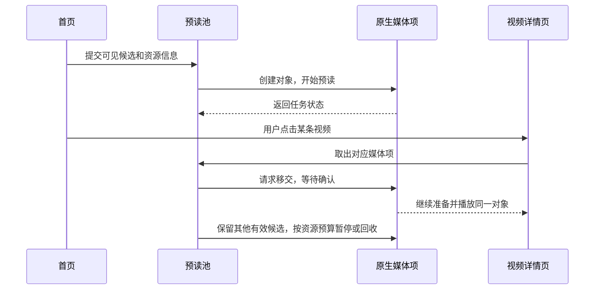

# PiliPlus 视频启动机制与优化验证

首开优化尚未稳定达到 400～500ms。最后一组首页随机三条测试，临时启用自动画质后，首视频回调平均为 767.1ms，首音回调平均为 694.1ms；另一组固定画质样本分别为 1139ms 和 2697ms，其中一条约 6.31 秒才出现首音。两组素材和实际档位不同，不能据此计算自动画质的净收益。用户反馈新版等待感仍重、甚至变差，与这些长尾现象并不矛盾。

这份文档记录官方客户端采用的启动机制、本分支借鉴或自行适配的代码，以及实验能支持到什么程度。它面向准备维护这段代码的 Android、Flutter 和音视频工程师。主要参照物是国内 B 站 9.14.0，性能审查基线为 308/311，预载留存改造从已同步上游的 317 开始，整理日期为 2026-10-18。**400～500ms 专项优化及 34 项代码取舍仍暂停，自动画质默认关闭。** 用户另行要求扩展预载覆盖、返回复用和断点留存，317–342 围绕这部分资源生命周期改造；343 补充首帧比例与拖动进度显示修复，344增加卡片转场和历史、收藏预载入口。

## 一、官方播放器的启动机制

官方客户端会把部分准备工作放在点击之前完成。首页预览、可见推荐和预读池能够提前取得资源、创建媒体项并读取部分内容；用户进入详情时，接管的是已经开始工作的媒体对象。这与点击后重新拿一条 URL 再从头打开，工作量不同。

研究追到 `PreloadPool/CacheElement`，以及 parse→createPreloadMediaItem→setIdleBufferInfo→MediaItem.start 的调用链。Java 任务返回并不代表 native 已达到 READY，媒体对象的创建、可移交、预读完成和释放各有状态。对接这个机制时，最重要的是复用已有对象及其读取结果，同时确认所有权已经交接。



预读提前消耗网络、CPU 和内存，只有命中且实际复用时，才能缩短点击后的等待。首页停留几秒再点击，与刷新后立即点击不是同一种测试。早期约 40～54ms 出声的样本，测量前已经停留至少 5 秒，属于媒体提前准备后的接管结果。

### 原生媒体探测与索引复用

官方媒体层本来就需要读取容器信息、索引和 DASH 分片。早期宿主为了先判断 HDR 和格式，在 Java 又读一遍音视频头部，随后 native 重新读取，形成了重复工作。后来改为对已识别的在线 DASH 读取原 native 元数据，复用同一个媒体项中的索引与 HDR 分类。

这项改动没有取消格式检查。未知格式仍要继续识别，不完整索引仍会拒绝；不能把缺少 fragment/global_sidx 的普通 MP4 强行当作 DASH。对 HDR 尤其要先确认输出类型，再把正确 Surface 交给解码器。曾经先给占位 Surface、识别出 HDR 后再重建，反而增加了 decoder 和显示配置开销。

官方缓存还可以复用已读的 Range 数据。另一个可减少的重复工作，是刚打开、尚未读取的非 DRM 点播 DASH 在零位置再次定位。当前只对符合全部条件的首次零 seek 省掉原调用，非零、直播、已读 context、普通拖动和错误路径仍保持原行为。

### 推荐首播档位及启用条件

Java 业务按模式、服务端 HighRatio/LowRatio 范围和开关生成推荐档位参数，观察到的兜底范围分别为 [32,116] 和 [32,64]。ratio 布尔值的上游语义仍待确认，VOD/STORY 等入口还需分别检查有效范围。

原 DASH options 中，`dash-use-recommended-qn`、max/min-recommended-qn、dash-start-screen-ratio 对应锁定布局 +0x724/+0x728/+0x72c/+0x734。native 还检查实验组字节 +10、真实梯度列表和其他条件，并构造 0x120 字节输入调用 `GetAICenterOutput(4)`。策略启用取决于这一整组参数和分支条件。

研究实际执行了原选择 helper（ELF 0x1f6478）和 cost helper（0x1f5f04）。它们会在预算内选可用的较高档，保留严格阈值、最低档兜底和空列表行为；预算为 0 时使用缺省 9,900,000，外层 origin qn>120 的条件也保留。代价计算包含 `bandwidth * clamp(0.9 + 0.4*bandwidth/1e6, 0.9, 1.4)`。当前已复用原选择 helper；在线模型和网络预测输入仍有待恢复的部分。

首播音频还有独立的 `enable_change_start_audio_qn` 开关。本分支的自动视频模式保留用户选中的音轨，没有为了视频先出画面，把无损音频暗中换成 AAC。自动模式显式可选、默认关闭；固定模式按用户选定的档位起播。

### 编码选择、CDN 与封面呈现

同样的分辨率，不代表需要下载同样多的数据。后续同片研究中，官方 4K 采用 AV1，开发版无显式偏好时曾选 AVC；同为 4K60，码率示例从 AV1 约 6.283Mbps 到 AVC 约 23.890Mbps。当前在用户未明确选择、硬解可用时，按设备能力尝试 AV1→HEVC→AVC，预取和前台共用，手动偏好保留。这项选择有减少传输量的依据，实际收益仍取决于设备的 AV1 解码启动、温控和能力报告。

CDN 方面已确认主地址、备用地址、重试及原网络缓存和连接复用条件；同片同轨对照没有证明某个固定主源或备用源总是最快。当前复用主备源及原网络机制，并发测速选源、官方服务端调度和完整网络预测仍属未实现部分。

HTTPS 同样不能靠端口猜。官方开关会影响 `forceHost`，观察到关闭为 0、开启为 2、空值为 false；PiliPlus 请求使用 `force_host=2/https_url_req=1`。同一 UID 同时连接 80/443 不能定位某条媒体请求，所以没有据此关闭 HTTPS。曾猜测的 `new-network-enable` 在实际注册表返回 Not found，未继续堆叠无效参数。

官方详情会在播放区域保留封面或预览，以减少黑屏。262曾复用首页封面及quality10缓存，在当前视频首帧后撤下；用户后续实测发现封面与视频比例切换时拉伸跳变。327按用户要求撤回自动播放前的封面覆盖层及专用状态、回调，恢复原有黑底加载画面，手动播放封面保持原实现。此次取舍以实际视觉稳定性为依据，回滚验证见E343。

### 首帧窗口与连续操作验证

343 再次复现的比例跳变来自真实视频帧：源尺寸尚未传到 Flutter 时，原生渲染器把 4:3 内容填满了临时 16:9 窗口。此次保留封面撤回决定，改为原生侧先按源比例适配，并立即通知媒体尺寸。窗口从占位尺寸变为实际尺寸时，内容仍保持自身比例。具体 SDR/HDR 变换和 seek 显示修复见[接入指南](official-player-integration.md#首帧比例与定位进度显示)。这项修改改善首画呈现，未作为首开耗时下降的证据。

快速进出采用三组操作：首页交替点选、多层推荐进入返回、短间隔点开后立即返回，每组 30 次进入或返回指令。先核实起始页面，再记录屏幕、应用日志和最后的实际播放身份。期间一次脚本仍停留在详情页，却按首页卡片坐标点击；这组记录被剔除并补测。快速输入中并非每次点击都来得及形成完整画面，因此操作次数与已经出画的视频数分开报告。此次沿用 30 项预载和现有回收策略，未扩改队列容量或预读量。加载期全屏另用仅延长原生准备两秒的实验包固定时序，三个画幅各3次通过；交付包和正常首开测量均使用无延迟版本。原始记录见 E346。

### 卡片到详情页的展开过渡

官方 9.14 在小米14上的三个首页样本采用右侧滑入，逐帧观察到的运动时长分别为188.2、190.5、188.5ms，均值189.1ms；资源配置是200ms。用户在一加13、ColorOS16上看到的是卡片展开，两台设备的表现有差异。目前没有一加真机证据能够确认该分支的精确实现。静态分析另在Story进入详情的路径中发现位图快照、起止矩形插值和结束清理：从拖拽入口进入时为200ms，其余分支为80或120ms。该发现提供可移植的实现思路，所属入口仍应与首页区分。

344采用200ms卡片快照展开。点击时只复制已经绘制的封面，随后立即建立真实详情页和播放器；动画中的图片以等比方式移动到播放区域，真实页面同时淡入。播放器始终按最终布局准备，避免在动画每一帧改变视频Surface尺寸。结束、返回取消或屏幕尺寸改变时释放图片；无有效封面、关闭页面动画或系统要求减少动画时，沿用普通导航。实现入口为`VideoEntrySnapshot`、`VideoEntryTransition`及现有`VideoRouteApp`，公共横纵卡片、历史与收藏卡片共享同一生命周期。

这200ms只能覆盖与播放器准备重叠的等待。若准备超过动画时长，之后仍显示加载；因此不能从动画结束时间推算真实首画，也不能把它计入内核提速。327撤回的长期封面覆盖层仍保持撤回，本次图片只属于页面过渡。官方样本、DEX常量、录屏和产品验证见E347。

### 观看历史与收藏夹的预载

344把观看记录、收藏夹内视频，以及两者的搜索结果接入现有`VideoPreloadScope`。列表按实际布局计算可见顺序，当前页面的可见及即将可见条目优先；返回页面时保留有效任务并重新补缺。历史标签切换后由当前标签接管调度，进入多选编辑时暂停安排。共享池仍为30项，Wi-Fi条件、后台准备额度、磁盘预算和回收期限沿用既有实现。

历史预载必须同时传递视频、分P和进度。列表中的进度只是首次准备的提示；本次运行已播放到的新位置优先，防止返回后用尚未刷新的列表进度覆盖实际断点。已看完的条目从0开始。收藏夹使用实际UGC首P信息和现有播放响应中的位置；删除项、音频、番剧及缺少有效分P的条目跳过，继续走各自原有点击流程。

小米14上，历史和收藏各做三轮同片进入、播放、返回。六次原生`OPEN`均报告`retained=true`，实际播放正常，后续起点跟随本地进度更新；历史样本从155.2秒推进，收藏样本从3756秒推进。每次返回后列表重新提供候选，原生驻留峰值为30。该结果证明本轮入口的预载交接有效，未据此推算所有收藏、网络条件或素材的总体命中率。完整记录见E347。

## 二、启动耗时分布与测量口径

用户曾要求两边各从首页随机选三条取平均，195 轮据此做了对照。设备是小米 14、扬声器输出，同时采集 Perfetto 和 600×1336 录屏，以 trace 中 `dispatchMotionLocked` 的第二次 UP 作为点击零点，通过同一 trace 的 `clock_snapshot` 将 REALTIME 映射到 BOOTTIME；六条 trace 的校验错误均为 0。

两边都能观察到 AudioTrack 创建和 start，因此这轮使用它们作为共同终点。下面的数据将主要等待定位在创建 AudioTrack 之前，排查重点由此转向上游准备过程。

|样本|点击→AudioTrack 创建 ms|点击→AudioTrack.start ms|
|---|---:|---:|
|官方 1|448.8|549.8|
|官方 2|269.2|365.2|
|官方 3|308.9|428.9|
|**官方均值**|**342.3**|**448.0**|
|PiliPlus 194：4K HDR|1881.7|2031.7|
|PiliPlus 194：1080p|927.2|981.2|
|PiliPlus 194：1080p60|886.6|911.6|
|**194 均值**|**1231.8**|**1308.2**|

从点击到 start 的平均差约 860.2ms，其中创建 AudioTrack 之前的差约 889.5ms。创建后到 start，官方平均 105.7ms，开发版反而是 76.4ms。这一分段将调查方向指向取流、媒体准备和调度。860.2ms 同时包含素材差异，以及开发版第一条重新创建服务和 ClassLoader 的开销。

官方的 448.0ms 是 **AudioTrack.start 调用时刻**，不是屏幕首画，也不是扬声器物理首音。官方没有暴露与本宿主相同的 `first_audio` 回调，后来的 577ms、767.1ms 不能直接与 448ms 排名。开发版那组三条还可以继续拆成：

|194 样本|点击→player 创建|创建→准备/switch|点击→first_video|点击→first_audio|
|---|---:|---:|---:|---:|
|4K HDR|774.7|1060.0|2156.7|5201.7|
|1080p|298.2|572.0|1080.2|967.2|
|1080p60|384.6|457.0|957.6|902.6|

两轨从 network_open 到流信息就绪，分别约为 465/842、263/373、214/329ms，而 `findstreaminfo` 自身日志接近 0ms。说明这段“媒体准备”包含供数、读取、定位竞争和线程等待，不能统称为 CPU 花了 800ms 分析文件头。准备完成后，还有约 145～189ms 才进入播放准备；4K 样本的水位从 500 升至 1000/2000/4000/5000ms，首音因而明显落后于首画。

官方前两个样本已有预览播放器和活跃线程，第三个是普通卡片。原线程名显示旧 SDL 相关路径，但那次没有确认全部实际轨道和清晰度，AV1 探测日志也不等于最终采用 AV1。不同路径可以作为调查线索，不能用“旧库、新库”直接解释耗时差。官方素材还包含深色渐入，按非黑像素阈值寻找首画会引入偏差。

### 历史样本的条件差异

下面保留不同阶段的原记录，主要用于解释测试条件差异。各组结果应连同素材、画质和缓存条件分别解读。

|阶段|有效观察|不应作的推广|
|---|---|---|
|157/158|先停留≥5秒让详情准备，点击后首音约40–54ms|不是首页自动播放冷开；预览首图已经在点击前|
|203|三条首音约457ms、首画557ms|素材、命中状态不同，不能只看版本号比较|
|204|已预读三条首画约396ms|新鲜素材仍有再缓冲|
|206|普通三条平均389ms，刷新三条约648ms|刷新即点与已停留首页不是同一分布|
|后续口头约577ms|特定当轮样本统计|不是当前产品恒定耗时，更不能一直复用作进度|
|305 固定偏好|三条首画1139ms、首音2697ms|其中一条首音6311.9ms，不能被首画均值掩盖|
|309 / 产品308，临时自动|首画544.5/953.7/803.2，均767.1ms；首音413.5/863.7/805.2，均694.1ms|实际一条4K、两条1080p；不能称三条同品质AB|

早期好结果、后期长尾和用户感到等待变重，可以同时成立。问题在于样本、画质、缓存命中和点击时机不断变化，有些实验又叠加多个改动，无法从一次均值下降判断哪段代码有效。后续判断代码净收益，需要同素材、同编码包、同实际档位、同网络和缓存条件的 AB/ABBA；首页随机抽样则用于观察真实体验分布，两者目的不同。

## 三、宿主实现与验证结果

### 提前初始化与进程复用

动态 DEX 的 33 个条目改为 STORE、4 字节对齐，条目内容保持不变，三次冷类加载从约 2.1 秒降到 0.8～1.0 秒。平台父加载器和非 Android debuggable 配置又消除了 `Unsupported class loader context`，让 ART 正常处理动态代码。手工强制 secondary AOT 曾耗时约 102 秒，没有稳定增益，因此没有列为日常流程。交付测试使用 Flutter profile/AOT；debug 开销、网络和媒体准备分别评估。

详情请求 playurl 与运行时预热并行。主页首帧后、返回主页和恢复前台时也可空闲预热；原先正常释放后保留原生进程 30 秒；跨页留存改造后延长为 20 分钟，让下一条视频复用 ClassLoader 和仍有效的预读对象。保留的是空闲进程，不是继续运行的播放器，检查确认空闲没有活跃 AudioTrack，异常释放仍会终止回收。代价是进程驻留及提前发生的 CPU 工作，长期主页负载和功耗仍待测量。

### 播放资源快照与媒体预读

原实现只保存 3 项、30 秒的单次消费快照，进入播放后会取消其余候选。用户连续返回首页或上一级详情页时，这种留存方式会重复获取资源。本轮改为可多次使用的快照、页面候选队列及有界媒体缓存，具体生命周期见下文。

native 媒体项另有 ADDING、READY、DETACHING、REMOVING 状态。READY 通知的 request=0，与 ADD/DETACH/REMOVE 命令确认不同；早期若要求 READY 的 request 等于 add request，条目就永远不能就绪。通知处理同时核对 task、代际和合法状态，已取消对象的迟到通知直接丢弃。

用户点击后优先接管选中的 item；其他有效候选继续留存，必要回收在所有权确认后进行。早期调整接管顺序，曾避免其他 close 所花的 193～228ms 挡住前台。缓存身份同时包含账号、轨道选择和梯度，键、轨道模型和刷新请求从同一资源描述生成。

后台 2000ms 指的是媒体预读目标时长，不是必须等待两秒墙钟。未达到水位的原 item 也可以移交；若 HDR 或流信息尚未识别完，前台继续准备同一个对象。前台元数据目标 1 同样表示媒体时长，prepare 的实际墙钟耗时仍由读取和准备过程决定。

取消时必须等准确的 REMOVE ACK，才释放对象和目录。原 Open 会重置 IO interrupt 位，一次取消可能失效，所以只在 REMOVING 状态每 20ms 重提中断，最多等 5 秒。受控取消耗时从 1269.7ms 降到 64.1ms，30 秒完整输出和 PCM 一致；实际点击收益取决于当时是否存在相同取消阻塞。

早期未命中路径将前台元数据准备放到独立单槽队列，当时后台池为 8 项、最多 2 项并行准备；当前容量和并发见下节。受控实验让后台断流 4 秒，共享队列约等 4126ms，独立队列约 86ms。这组实验验证了本宿主的队列隔离效果；线上收益和官方内部队列设计需要各自的证据。

### 全量候选调度与返回补缺

首页刷新、加载更多得到的可播放视频、详情页的相关推荐，以及热门和分区中的普通投稿视频，均进入页面所属的去重候选列表。可见卡片、下一屏及返回页面中的候选排在前面，每次最多向下游提交 64 项。64 是本轮调度窗口；列表中其余项仍保留，滚动后可以进入优先窗口。官方内核、预初始化播放器和 Wi-Fi 条件沿用已有设置。

页面通过 `PreloadQueue` 提交优先顺序，URL 请求最多同时进行 3 个；原生池最多驻留 30 个媒体项，无前台播放器时最多同时准备 4 个；播放期间最多新开 1 个后台准备任务，已经开始的任务完成后收敛到这一额度；备用 Java 探测沿用单 worker，等待队列纳入同一准备额度。前台尚未准备好、正在缓冲或包队列不足 5 秒时，后台预读暂停。页面每 10 秒补缺，原生侧每秒检查网络和 15 秒许可期限；离开前台或失去 Wi-Fi 后停止继续预读。返回页面重新检查候选，保留有效项，再补缺失、过期或配置失配的部分。

播放资源快照上限为 128 项，单份原始 JSON 上限 512KiB。每次取用都生成独立模型，避免前台选轨、补档或移除列表元素污染下一次播放。快照闲置 20 分钟失效，真实播放进度会续期；URL 中的 `deadline` 还要单独检查，并预留 5 秒。检测到账号变化时清除快照并更新原生缓存范围。后台查询有效条目会更新使用顺序，但保留原过期时间；持续播放才更新本地断点并续期。快照数量达到128项时，优先淘汰尚未点开的旧条目，随后才考虑已点开的条目。这样可以保留多层推荐浏览期间的本地断点和资源身份。已观看快照超过30项时，容量淘汰改按整体最近使用顺序处理；降至30项后再给予观看记录优先保留，避免历史记录挤占新页面的候选窗口。

进入详情时，选中的未播放媒体项继续使用原有移交协议；其他候选保留在池中或转为磁盘缓存。返回首页或上一级详情页后，原页面重新提交候选顺序。`ready` 表示原生媒体项就绪，`stored` 表示已完成预读且仍有有效磁盘文件；排队或探测中的请求另返回 `queued`。这些状态供调度使用，实际播放和媒体复用仍由运行结果核验。

### 页面优先级与容量淘汰

`VideoPreloadScope` 共用当前页面、应用前后台、滚动和周期补缺逻辑。停止滚动 250ms 后按 Sliver 实际布局重排：当前可见项及下一屏在前，列表中其余项随后。首页初次刷新时，前 6 个有效候选获得较高优先级；布局同时显示超过 6 个时，较高优先级覆盖全部可见候选。热门、分区和详情推荐使用相同规则，切换主导航或分区标签后由当前页面接替调度。搜索结果页目前尚未接入主动预载；从搜索页进入详情后，可以复用与实际资源身份匹配的既有缓存。

优先级主要作用于尚未开始的准备任务和容量淘汰。已经开始的任务沿原有完成、暂停及释放协议处理；切换页面后，新顺序在后续任务进入时生效。当前集成使用官方 `addTask`、暂停、移除和移交接口，未实现对每个在途任务即时重设 native 优先级。

候选顺序在媒体请求前送到原生进程，`bvid:cid` 只负责表示页面候选。底层缓存仍按账号、资源地址、轨道及配置建立精确身份。内存池满时，选择当前顺序中优先级最低、且未被播放器接管的项；同优先级先选已准备完成的项，再比较最近续期时间。移除完成后才能复用槽位，已准备数据沿原有流程保存为磁盘片段。

满池后的准入还需要比较新候选与待淘汰项。若待淘汰项仍在准备，同级或更低优先级的候选先等待；更高优先级的前台页面候选可以打断它。准备完成后再轮换，已读片段能够按正常释放流程保存。340的扩展测试曾在返回首页后、尚未滚动的5秒内观察到27个任务创建不足100ms就被撤销，均未收到READY；根因是大候选窗口连续争用同一个槽位。341针对这条路径补上准入比较，受控失败已转为通过。三轮满池测试共记录521次新建和482次READY，全采集没有再次观察到这类百毫秒内的未完成撤销；三次返回的固定五秒窗口也均为0。第一、三次返回更换了进程，同进程对照采用第二轮及填池后的静止窗口。

磁盘容量淘汰有额外的观看历史保护。当前靠前或可见的候选优先于已观看片段，已观看片段优先于更远的普通候选；同级再按最近使用时间排列。正在使用的独占租约受所有权保护，等待原生释放后才参与回收。有效期、总预算和目录数量同时生效，优先级只是资源不足时的选择顺序。

以首页→A→推荐B→返回A→返回首页为例：进入A后，后台优先准备A的推荐列表；进入B后，顺序切换到B的推荐列表。返回A时重新提交A当前可见的推荐项，返回首页时重新提交首页返回位置的候选。每次重排保留仍有效的原生任务和磁盘片段，缺位继续准备。A和B正在播放时由前台供数规则保护；退出后留下的片段参与已观看优先级排序。

30个位置是共享原生媒体池的驻留上限。可选清晰度列表可能包含多条码流，实际预读由内核选择视频流和音频流；候选轨道数用于最坏占用计费，不能直接换算成实际下载量。实际占用按文件逻辑长度和已分配磁盘块分别测量，并注明是否包含旧缓存及播放过程追加的数据。

### 复杂往返与连续播放验证

本轮在小米14执行首页交替、四层推荐逐级返回、加载中立即退出、热门与分区切换、前后台与Wi-Fi变化，以及断点更新和完成重播。部分早期样本能够正常播放，但媒体计量发现快速返回的5个窗口重复读取了89,582,133字节。关联任务与目录租约后，确认旧断点任务仍占用缓存，新任务绕开该目录另行下载；具体交接修正在下一节说明。

修订后的四组诊断回归包含首页12、快退12、四层推荐24、断点与完成13个状态，另有12次加载中取消。已选媒体窗口实际读到的旧片段累计分别为118,536,681、162,286,937、332,739,168和102,937,693字节，跨实例重复网络读取量均为0。测试分别核对视频身份、实际官方后端、音轨和位置；新加入的短片首次冷开按首次下载处理。前后首页素材有变化，因此这些结果用于确认修复后的复用行为，提速幅度仍需同条件配对测量。

同一条长视频另做20分钟开启后台预载、10分钟关闭对照，两组官方内核缓冲次数和总时长均为0，媒体时间分别推进1202.629秒和602.429秒。开启组记录42次预载就绪，两进程PSS约1.19–1.23GiB；混合缓存实际磁盘分配峰值约277MiB，结束时回落至245MiB。磁盘记录包含旧文件和主视频继续写入，适合评估本轮使用成本，单独30项首次填充的净增量尚未隔离测量。原始失败、修复验证及测量范围见E344。

### 应用后台通知与预载保留

Android 的 `TRIM_MEMORY_UI_HIDDEN` 表示界面已经不可见，数值为20；`TRIM_MEMORY_RUNNING_LOW` 的数值为10。旧服务以“等级大于等于10”为回收条件，因而把界面隐藏也当作内存压力。页面层虽然暂停预读并保留候选，服务层仍可能随后移除这些候选。

小米14的337研究包中，向后台进程发送一次HIDDEN通知，回到前台约97ms后观察到30个旧预载任务被逐一移除。通知的执行晚于发送时刻，原因尚未单独确认。338在原有判断中排除UI_HIDDEN；三个退桌面再返回的对照窗口中，原有16、19、19个任务的身份全部保留，其中第一轮同样发送了HIDDEN通知。另用实际Service回调及Runtime检查7种通知等级，确认内存压力等级的通知仍移除闲置项，正在交接和准备的前台项能够继续完成。普通后台通知与内存压力需要分别测试。

342从新进程开始完整记录了三次满池短后台：每次退桌面约12秒，返回后30个原生任务ID全部保留，未发生移除。较长后台仍受系统杀进程及20分钟空闲规则影响。

### 系统回收后的缓存恢复

普通界面隐藏、内存压力通知和进程被系统终止是三种不同情况。小米14的一次五分钟后台测试中，系统在退桌面约30秒后结束了官方播放子进程，退出记录为`OTHER KILLS BY SYSTEM / kill_bg_proc state=empty`。返回时创建了新进程，原有30项内存驻留均已失去；UI_HIDDEN修正只能处理应用收到回调时的误清理。

同轮六条反向重访都恢复了正确视频和断点。媒体地址及磁盘身份完全相同，其中一条已正常释放并保存完成标记的缓存实际供数20,819,510字节；另五条仍由原生预载项持有写租约，目录没有`.complete`，重启时按未完成写入清理，因而重新读取。这样的清理保护了索引与媒体数据的一致性；后台恢复命中还取决于进程存活、索引是否完成保存，以及重新请求的资源身份。当前测试机可见物理内存约14.8GiB，取样时仍有约5GiB可用，本次退出记录未将原因标为低内存。

第二次五分钟后台保留了同一原生进程，返回后29个原任务继续驻留，另一项在页面补缺阶段被撤换。六次反访实际读取旧片段222,507,582字节，重复网络读取为0。第三次实际后台停留1230.939秒，触发应用自己的空闲进程退出；日志调用栈指向TERMINATE_IDLE分支。该轮完整媒体地址和请求token也已更新，六个窗口旧片段供数为0。进程、请求和缓存同时过期时，需要分别解释每种状态变化。

三份独立缓存的完成时间保持不变，最后存在采样在1195～1199秒，首次缺失采样在1202～1204秒，验证了真实20分钟闲置清理。三轮测试的原生驻留峰值为30、磁盘目录峰值为64；混合缓存实际分配峰值约514MiB，两进程PSS最高合计约1.13GiB。占用包含旧文件、预载和主视频追加；单独30项首次填池的净增量仍待隔离测量。

### 长进度往返的连续性观察

以337为基线，两条视频各实际连续播放185秒后，再做三轮、共18次A/B切换。所测窗口实际读取旧缓存198,992,801字节，跨实例重复网络读取为0，返回位置随观看进度推进。7个独立画面观察窗口共采到官方进程1742次EGL提交，最大提交间隔48.64ms，没有超过100ms的间隙。这组记录覆盖画面提交层；面板最终显示及不同素材的偶发卡顿仍需各自验证。341已完成三轮满池反向重访，共36个状态点，视频、音轨和断点检查通过；随后三轮混合操作60步、33状态也通过。最终长进度A/B却在第一次返回B时出现准备回调丢失，约20秒后回退mpv，341因此停止交付。342补接状态通知后，同素材三轮18次往返通过，实际读取旧片段197,936,088字节，重复范围为0；六段画面提交采样最大间隔45.796ms。具体通知差异与验证范围见[准备状态处理](official-player-integration.md#原生准备状态的通知处理)。

342的三组混合操作另覆盖60步、33个播放状态，实际包含AAC和FLAC音轨，三次真实手势定位均推进约52～53秒。所有返回或重访点均读取到旧片段；两次首次点击因不同资源身份出现少量同路径范围重复，后续重访重复为0。完整失败、通过记录与范围见E345。

### 已播放视频的断点缓存

官方旧观看分支的 `PreloadPoolImpl` 具有场景优先级、容量淘汰和 `putBackPlayerItemCache`。当前接入使用现代 `AndroidNativePlayerItem`，两者的所有权契约不同：播放器释放会经 `ReadLooper::StopRead` 关闭媒体输入。独立宿主保留已播放 item 再次接入时返回 20001104；重新创建 item 的对照正常。因此已播放视频采用“释放播放器、保留媒体片段及索引、返回时新建对象”的方式。

`libijkffext.so` 的 `ijkio_manager_io_open` 支持 `cache_file_path`、`cache_map_path` 和 `parse_cache_map`。DASH 采用 `create2/destroyp2` 管理共享读线程池，其中 `destroyp2` 省略了普通 `destroy` 的索引保存。适配仅对自有私有缓存目录接入原 `destroy` 保存分支；已核对其保留共享线程池的条件。所有其他 manager 沿原路径释放。

原生任务按请求 token 和起播位置区分，磁盘片段按稳定账号范围、完整音视频主备地址、轨道描述、梯度及请求头区分。340 将瞬态请求 token 从磁盘身份中移出，使同一账号、相同资源重新请求时可以找到原目录；没有账号范围的旧调用继续使用 token 隔离。播放位置单独记录。同一目录只允许一个原生写入者，取得租约时移除 `.complete`，原生释放完成后才写回完成标记。未确认释放、崩溃残留、无效索引和超限文件会进入清理流程。账号变化后立即停用旧预读；下一次带新账号范围的播放或预读请求先清理旧空闲缓存，在用目录标记为释放后删除。

跨进程重启还存在地址变化这一条件。340 的三次重启、九个播放窗口中，视频可以正常恢复，但服务端重新返回的完整媒体地址哈希发生变化，旧文件仍在也会得到新缓存身份，实测旧片段供数为0。当前保留完整地址校验，跨 CDN 或授权参数变化后的内容等价性尚未验证；这类未命中应单独计入重新加载。

索引先保存到 `.map.next`，完成边界检查后原子替换 `.map`。校验覆盖私有目录、普通文件、符号链接、索引长度、区间数量、逻辑顺序、整数溢出及物理范围。官方缓存写满回卷时会将 `tree_file_size` 清零，但新写入片段仍有效；该零值应按“总长度未知”处理，继续严格验证每个物理区间。早期候选把零值当作损坏，导致高码率视频退出后丢失可复用片段，这一检查现已修正。

播放进度更新同时决定后续预载目标。未播完的视频使用最新播放或拖动后的断点，完成事件将目标重置为0；页面补缺读取最新快照，再生成包含目标位置的原生任务键。磁盘身份省略播放位置，因此同一资源在多个断点间切换时仍可读取已有片段。

同一媒体在不同断点上的预载任务需要串行交接。快速退出或拖动后返回时，旧断点任务可能仍持有目录租约；早期实现直接创建新任务，拿不到租约便转为无磁盘缓存的播放，因而重复下载。修订后先撤销同一媒体的旧位置任务，等待匹配的 `REMOVED` 确认释放，再以新位置创建任务。待处理队列也只保留该媒体的最新位置，正在播放的媒体由前台继续供数。其它媒体及已被播放器接管的任务按各自的所有权协议保留。

旧实现的磁盘就绪标记只确认目录有效，存在另一种过期情况：同一视频后续写入并回卷，目录仍有效，但标记所对应的位置可能已被覆盖。修订后取得新写入租约时，立即撤销同一媒体的旧位置就绪标记；重新准备时由内核读取现有区间，并补充目标位置所缺的数据。其它视频的标记及未取得租约的请求保持原状。这项修复针对准备状态与实际缓存内容脱节，实际复用仍按媒体读取计量验证。

返回播放同时使用记录位置构造媒体项，并保留 prepared 后的精确 seek。单独设置 `accurateStart=true` 在非关键帧断点仍可能提前约一秒起播。生产适配的受控样本请求 2978ms，随后从断点附近连续输出到 4945ms；再次进入已播放完的视频则从头开始，缓存身份仍可复用。

|资源|当前限制与回收条件|
|---|---|
|页面候选|完整去重列表；每轮优先提交 64 项，滚动和返回时重排|
|资源快照|最多 128 项、每项 512KiB、闲置 20 分钟；账号变化及 URL 到期失效|
|原生预读|最多 30 个驻留项；无前台播放器时最多 4 个准备任务，播放中最多新开 1 个；内存压力释放后台项|
|磁盘媒体|每轨128MiB；在用租约按候选轨道数预留额度，另留1MiB索引；闲置按实际大小计费，总量上限32GiB且受可用空间一半限制，最多64目录|
|低空间保护|可用空间不足 200MiB 时停止分配；实际预算还受可用空间一半限制|
|空闲回收|磁盘项闲置 20 分钟后回收；容量淘汰按当前候选优先级、已观看标记及闲置时间排序；在用租约等待原生释放|
|后台网络|前台许可 15 秒，页面每 10 秒更新；退后台、失去 Wi-Fi 或前台缓冲时暂停|

这组预算面向用户提供的大内存、大存储使用条件。页面往返已在小米 14 上验证；低内存手机、长期功耗以及更多网络条件仍需额外测试。原生进程空闲保留时间同步延长到 20 分钟，以承载未播放候选；这也增加了进程驻留的内存成本。

### 跨页留存的验证结果

317 基线、318 候选及修订后的 319 均保存了页面采样。319 在首页 A→返回→B→返回→A 共 9 次打开、详情 A→推荐 B→返回 A 共 6 次打开中，均使用官方内核，视频身份正确，断点持续推进。内存压力命令后仍能打开视频；21.933 秒短片播放结束后重新进入，4 秒观察点处进度为 4.288 秒。

独立生产缓存宿主在返回阶段停止提供媒体响应体，仍取得 120 帧真实图像；无缓存负对照失败。回卷边界另用 64KiB 缓存和高码率自制素材复现，修正后的两个视频索引区间共 98,198 字节逐字节匹配原素材，保存和恢复均成功。该小容量实验的网络请求量并未下降，其用途是核验索引语义和数据正确性。

319 真机日志中的首页索引恢复事件为 24 次、详情推荐为 14 次，两组均未出现索引保存拒绝。后台候选也会产生这些事件，因此它们只证明实际发生过恢复，该阶段尚未将事件关联到每次点击；后续 E340、E341 已补充实际媒体供数计量。退后台和关闭 Wi-Fi 后，各等待 20 秒，再观察 5 秒，应用 UID 收发字节均为 0；Wi-Fi 随后恢复。两进程 PSS 合计：首页约 1057MiB，后台约 954MiB。该数值包含动态运行库和预读对象，适用范围为本轮设备与配置。

启动时间采用设备日志中“发送点击前标记→原生首音/首画事件”的同钟统计，包含输入命令开销。317 首页均值为 1359/1096ms，319 为 1093/939ms；详情往返分别为 2003/1905ms 和 1084/920ms。各轮素材、档位和断点有所差异，这些数值用于检查是否持续出声出画。该阶段尚缺媒体字节计量，后续结果见下节；精确触摸到物理输出的性能收益及 400～500ms 首开目标，仍按原验收口径单独验证。

E339 汇集本轮机制、页面回归和状态隔离结果。原始证据位于研究工作区 `execution/20261017-preload318/`：页面结果见 `page-rounds-summary.json`，回卷校验见 `reuse-wrap64k-high-fixed/extent-verification.json`，网络和内存见 `boundaries319/result.json`。源码入口为 `PreloadQueue`、`PlayUrlPrefetch`、`OfficialPreloadCache`、`OfficialMediaCache`、`OfficialRuntime` 及 `media_cache.c`。

### 实际媒体供数与容量限制

进一步计量把当前视频媒体、其他候选媒体和UI流量分开。317与321各完成首页9次、推荐往返6次打开；321推荐返回A的三个观察窗口由旧缓存实际供数约14.76、20.64、4.98MB，第三次B窗口的媒体网络读取为0、旧缓存供数约14.51MB。这些数字来自官方cache read返回的逻辑区间，与打开时的旧索引对应，并扣除了本次重新下载的部分，已经验证真实页面在复用媒体片段。

全量候选覆盖也带来了额外网络成本：321首页9个窗口中，其他候选共读取约47.84MB；推荐6个窗口中约26.53MB。两进程PSS约1.17–1.40GiB，含诊断构建开销。退后台及关闭Wi-Fi后的停止行为仍以E339中的独立检查为准。首页素材及各轮恢复位置存在差异，跨版本加速和节流比例需要更严格的配对采样。

本轮同时暴露了4K缓存配额不足的问题。一条含7个可选轨道的视频将127MiB平均分配后，实际视频轨只得到约18.14MiB。官方缓存填满会清除整棵区间树，返回时刚才的断点片段已经被后续预读覆盖。相同视频的两次返回分别重复读取约45.94、43.35MB；仅在研究包把该资源容量调至64MiB后，两次重复读取均为0，旧缓存实际供数约46.96、55.95MB。

324阶段将每轨额度固定为128MiB，在用租约按全部候选轨道数预留最坏占用，闲置后归还未使用额度；总量上限改为8GiB。常见7轨、8个驻留任务的最坏预留约7GiB，余量用于闲置数据。128MiB覆盖此前64MiB对照及实测约40–60MB的返回读入窗口，仍低于锁定官方ffext的512MiB原生默认值。磁盘额度不会预分配成内存，也不会让每个候选下载完整视频。

大量新推荐还暴露了另一项淘汰问题：普通LRU会把几分钟前看过的视频与未观看候选一起挤出。现在播放器接纳媒体后会标记已观看，成功释放时将标记随索引保存；淘汰先选未观看项，再选最久闲置的已观看项。64目录、全局预算、20分钟闲置过期和账号清理共同限制留存，已观看标记不会使缓存永久驻留。

最终324在4K与普通视频的三轮往返中，旧缓存实际供数约369.39MB；详情推荐三轮约94.44MB，两组测量窗口内可确认的跨实例重复字节均为0。随后让其它66个不同缓存目录参与预读，再回4K，仍从旧缓存交付约72.98MB。相应两进程PSS约1.17–1.41GiB，额外候选读取是这项策略的实际成本。初始容量对照见E340，最终分配、已观看优先级和验收范围见E341。

容量边界用同一4K视频依次进入0、240、120、300秒后返回验证。128MiB缓存确实发生回卷，五次播放均正常，但最后返回时重新读取了约15.37MB已出现过的区间。优先级保护解决候选挤出，单轨容量耗尽仍按官方回卷规则释放旧片段；用户在多个远距离断点之间往返时，可能再次加载。洁净324另通过FLAC播放和后台停止检查，退后台、关闭Wi-Fi后的稳定5秒窗口收发字节均为0。

### 驻留容量与准备并发的历史验证

326按用户的大内存设备使用需求，将共享预载池扩到20项，同时准备4项。已准备好的视频继续占用池位，首页和多层详情推荐共用该池。20GiB磁盘预算覆盖20组常见7轨约17.5GiB的最坏预留及常见前台任务，实际额度仍受可用空间一半限制；单轨容量、闲置过期和已观看优先级沿用上一阶段。

小米14各一次首页采样中，2准备任务使18个候选在28.033秒全部就绪，4准备任务为22.972秒，原生进程峰值PSS分别140.19/154.35MiB。首条就绪时间为4.613/5.167秒，说明更高并发的收益主要体现在本次整批准备。样本素材与网络可能有差异，当前选择4作为默认值，6和8仍未测试。

真实卡片路径A→推荐B→推荐C→返回B→返回A中，实测同时READY20项、准备中最多4项；五个播放检查点均为官方内核，位置继续推进，未处于缓冲状态。后台和关闭Wi-Fi后的稳定5秒窗口收发均为0。过程、所有权检查及测量范围见E342。

### 媒体准备与窗口创建并行

旧流程先等 Flutter 窗口，再创建播放器并打开媒体。194 改为同时进行媒体准备和窗口创建，真正启动 decoder 前仍等正确输出目标，create 从晚于 Surface 22/35ms 变为提前 188/82ms。201 又只对 Android 视频详情关闭 route snapshot，避免转场快照冻结真实视频绘制；受控窗口中 create→attach 从 278ms 变为 67ms，转场期间能够继续 paint。

这些改动依赖 session 和 Surface 代际保护，旧页面或迟到窗口不能接管新视频。185 的占位 Surface 曾导致 HDR 重建退步，187 才改为先确认原生元数据、再选择 Surface、最后实际播放。127 的 Flutter 根 Texture 用于修复横屏残留，撤回首开策略时应保留这项显示正确性修复。

仍需要 Java 探测的回退路径，保留了先 disconnect 再关流、音视频并行读取等改进。前台接管未完成 Java 探测 Future 时最多等 300ms 的做法，当前缺少有效整机收益证据，已列为 C4 撤回建议；本轮尚未执行。

### 磁盘缓存与播放缓冲

原 `OfficialMediaCache.java` 仅管理最多 4 项临时目录；本轮接入稳定片段索引，扩为有界跨页留存，预算和回收规则见前述表格。受控请求数曾从 6 降至 5，完整 PCM 也相同；真实冷热首开有升有降，整体启动收益仍待同条件对照。

首次零 seek 的省略也严格限定为刚打开、未读、非 DRM 的 VOD DASH 和精确参数。8 线程、8 万次生命周期检查及完整输出已通过，当前整机净收益仍缺同条件 AB。普通拖动继续调用原 seek 路径。

缓冲方面，曾有已解码音频帧没有计入可播水位，packet 队列减少后误判缺数据。231～240 沿原计数单位、stream 顺序及 frame/packet 关系补计真实解码帧，防止重复计算，并补上 video packet 为空而 decoded frame 非空的条件；seek、EOF、live 等不安全状态排除。

同输入受控测试中，prepare 后首音从约 5.1 秒降至 0.43 秒，完整帧和 PCM 检查通过。只补时长、不补数量的 232 候选失败，237 的局部成功也没有直接当整机验收。真实样本后来仍有 4.53 秒再缓冲和约 6 秒首音，原 500/1000/2000/4000/5000ms 策略没有全局删除。153 曾关闭自动水位升档，后续播放出现反例，因此没有采用。验收同时检查首帧和后续连续播放。

### 网络读取与 TLS 适配

旧 SDL 参照路径的读重试等待上限为 10ms，新路径观察到 100ms。当前把 EAGAIN 累积等待上限降为 10ms，保留前 11 次立即尝试，以及 EOF、错误、背压和水位规则。原读取等待缩短，受控 PCM 相同；更多唤醒的能耗，以及它在 206 整体变化中的贡献，仍需分别测量。

D2 只绕过一个已定位的成功读取调用点每次 1ms 休眠，错误重试和写等待保留。最初约 3 秒的失败还混入了测试服务器问题：TLS wrap listener 串行握手，阻塞其他 accept。258 改为每连接在线程中握手后，才在相同 40ms 请求延迟、8MiB/s 及 20Mbps 输入条件下得到 ABBA 结果，两次每组均值从 507.6ms 到 436.8ms。这里要保留原失败，因为修好工具后得到的局部对照，才是有效证据。

D3 从同包 `libcrypto` 找到硬件 AES/GCM，把原 SDL 软件 GCM 转接到 EVP。2MiB 微基准从 92.6ms 降至 0.785ms，长度、密钥、边界等 11,520 项检查以及并发、认证错误和原调用约定均通过。实现仍保留 TLS 认证、证书验证、errno/ERR queue 语义，用 scratch 先认证再拷贝，并处理私有 SDL 镜像及 GOT 分流。

这项微基准很明显，但真实首页三条首开仍然慢，没有证明默认链增加的私有 ABI 复杂度值得。审查因此建议优先考虑恢复 D3，而非宣称它造成了用户卡顿，或者保证撤回必然变快。当前仍未执行恢复。

### 自动画质与切档连续性

自动模式的梯度必须属于同一 codec 和色彩组，HDR125、DV126 等特殊档不能随意与普通 SDR 混合。首播推荐后，当前 qn 由实际 native 事件更新，不能把界面请求值或预载快照当成当前码流。补档请求需维持已有预读的精确身份，资源刷新同时带上完整梯度。

换档涉及容器时间域和对象寿命，不只是换 URL。实际遇到过 MOV timebase、`min_corrected_pts + dts_shift`、SAP 固定 +1 秒、DTS 段标签、queued=1/dispatch=2 移交以及 EOF 读锁问题；只删除 1 秒 seek 偏移，仍会提前裁剪旧 B 帧。284/285 补全这些处理后，受控逐帧、PCM 和真实三种编码的限定窗口通过。

307 又发现 AV1 升到 4K 后，出现 6870 次空 bsf 错误。308 在原 adaptive flush 后增加有效性检查，关闭失效的 bitstream filter，保留有效对象和失败返回，限定 AV1 升档恢复送包。它是播放正确性修复，没有证明首次启动更快。关闭自动策略时仍需保留共用的尾包处理和滤镜生命周期保护。

## 四、官方机制与宿主适配的分工

原媒体预读、同 item 移交、IO 中断、缓存、DASH 元数据和推荐首播档位，都有官方 Java 或 native 机制作为依据。本项目主要负责把这些能力接到 Flutter 的页面和资源选择上，同时处理账号切换、取消、迟到回调和资源所有权。原 helper 已执行的部分与尚未恢复的模型输入，必须分开表述。

前台独立元数据队列、转场 snapshot 限制和 Surface 并行，则主要解决这个 Flutter 宿主自己的阻塞或呈现问题。官方原生 UI 不一定有相同问题，因此没有把这些说成照搬官方。首次零 seek、decoded-frame 水位补计和切档时间域修复，是根据原调用语义和实际失败做的适配。

TLS 成功读等待和 GCM 分流也来自真实代码分析，但其局部收益不能替代整机收益。这里不把自行写了多少代码当作成绩；需要判断的是，它解决了什么已证实的问题，增加了哪些依赖，怎样撤回而不破坏播放正确性。下方 34 项清单保留了逐项建议、反例和代价。

## 五、性能缺口与代码取舍

最新 309 在初次缓冲附近发现呈现线程 CPU 热点。310 对同片两次观察到 create→prepare 为 1429/1171ms，初次 buffer 均 1ms，prepare→首画为 125/140ms，render CPU 约 111/110ms。栈包含 `clock_gettime`、取帧、等待、消息投递、引用和锁；原 render 消息 3 在空队列时按 context+0x20 延迟重投，构造初值为 0。后续设置调用者尚未追完，因此不能断言宿主漏了参数，也不能断言当前补丁造成忙循环。309 的 238ms 首次缓冲仍待复现。

继续研究时，可先拆真实双轨打开 241～480ms 等长尾，区分网络、解密、读包锁和排队；再检查 decoder 创建约 69～103ms 和呈现尾段约百毫秒的调用条件。这些阶段提供后续调查入口，能够减少多少耗时仍需单因素实验确认。

仍需理解刷新立即点击时预读为何不够、多个候选是否争抢资源、初始水位为何仍出现长首音，以及自动画质策略的模型输入。低端设备、功耗和多设备代价依赖额外条件，本轮暂缓。整体 Flutter 界面流畅度另行保留为后续任务。

当前收敛建议仍是优先考虑恢复 C4 的旧 Java 探测接管等待和 D3 的 GCM 转接，自动画质保持默认关闭。若保留标准进一步收紧到“必须有当前整机同条件净收益”，A5/A7/B3/B9/C3/C7/C8/D1/D2/G1/G2 都需要补证或进入恢复候选。这些取舍仍由用户最终决定。

回退也应按依赖做。D3 涉及派生镜像、初始化、JNI/GOT、打包和测试，不能只删安装函数；C4 撤等待仍要释放后台 probe，保留 C1/C2 和坏索引拒绝；B 组跨 Dart/native 及账号缓存；G1 可以撤策略入口，但不应把共用的正确性修复退回去。直接回到 122/135 会同时撤掉后续独立的 seek、路由、倍率、资源和显示修复；旧网络成绩还需在当前环境重新测量。

## 六、性能复测方法

先写明比较终点，再选择工具。点击到页面或封面表示交互反馈；点击到 AudioTrack.start 表示输出启动调用；`first_video/first_audio` 是当前应用内部回调；面板扫描和耳机出声又是更晚的物理过程。400～500ms 必须说明对应哪个终点，以及冷暖进程、网络和预读命中条件。

一次有效采集应串起触摸 UP、页面进入、playurl 请求与响应、预读提交及确认、命中对象、player 创建、各轨 open/first packet、metadata/prepare、Surface 创建和附着、decoder 创建、AudioTrack set/start、首音首画及 buffer begin/end。每个事件带 session、task 或 source 身份，避免把旧视频混进来。双轨、窗口和网络存在并行执行，应按事件时间线计算关键路径。

比较墙钟等待与线程 CPU 时也要分开：open 到 metadata 慢可能在等网络或锁，CPU 采样比例不等于准确墙钟占比。校准主机、设备 monotonic/boottime 和日志时间后才能相减，PTS 不能直接减主机时间。录屏采用可变帧率，应披露最大采样间隔，并分别处理深色渐入、封面和真实视频帧。

真实首页三条可以报告均值和单条结果，用于观察体验；改动归因则用受控 AB/ABBA，保留失败、最大值和长尾。URL 路径哈希相同不等于媒体字节相同，声明码率不等于实测吞吐。首画之后继续检查首音、持续供数、再缓冲、实际档位和切档，以完整播放过程评估收益。

研究工具本身的失败也有记录：自动 DOWN 被系统丢弃时手动点击正常，未打开的样本不能算官方慢；IgHttp 回调未经过，不等于网络耗时为零；TLS 串行握手污染过测试；render 分析器要求固定结束字符串，但实际是 `end_with_prepare`，修分析器后应继续用原数据；诊断版 300 采集失败，没有有效新增测量。这些都保留在证据库中，避免以后把工具问题重新归因到产品。

设备采集命令和逐项代码审查在附录。首开恢复研究前，应先选定要验证或撤回的单项，重新确认运行版本和条件；当前主线仍是官方音视频播放功能及体验对齐。


## 附录：证据的范围

[research-evidence.json](research-evidence.json)保留报告原文、原始相对路径和哈希，[module-commits.json](module-commits.json)连接整理 fork 时的模块与代码。原始账号、带签名媒体地址、官方 APK/so、录像、trace 和 PCM 不随公开仓库提供。下方 E 编号用于定位报告，完整实验输入另按各报告的来源准备。

官方机制主要见 E168–E169、E175–E177、E208、E225–E227、E242、E304；共同终点 profile 见 E209；历史耗时差异见 E173–E174、E199、E204、E230、E327、E329。具体改动的证据和反例在 34 项清单逐项列出，文件头、缓存、TLS 等原技术参数也在正文保留。

## 附录：34 项代码改动及取舍建议

下表固定保留 311 审查时的实现及决策编号，用于追溯历史取舍。本轮已按用户新要求改造 A6、B1/B3/B4/B6/B9 和 C8 涉及的留存策略，当前行为以第三节为准；其余撤回建议仍待用户决定。证据等级：**直接**指具体步骤或行为的因果证据；**局部**指组件/受控宿主有效或实装生效，但缺当前整机AB；**功能**指正确性/体验；**不足**指未证明收益。表中保留历史审查建议，具体执行状态以正文最新说明为准。

### A. 构建与初始化（7项）

|编号|311 审查时的改动、作用|证据与反例|建议及代价|
|---|---|---|---|
|A1|从 debug 改为 Flutter profile/AOT 交付|[175 · E157](research-evidence.json)：同 FLAC 冷开历史 4647/4686→2932/3328ms，热开差值较小；不是全部慢开原因|**保留，直接。** 不恢复 debug 作为测试交付基线；profile 尚不等同最终 release|
|A2|官方 DEX 以 STORE、4字节对齐打包，保留原条目内容|[172 · E162](research-evidence.json)：冷类加载三次约 2.1s→0.8–1.0s；全条目内容核验。整机总耗时并非等幅下降|**保留，直接。** 包体/私有代码文件变大；不是每条视频都省 1s|
|A3|平台父加载器及非 Android debuggable，允许正常 ART 编译|[189 · E200](research-evidence.json)：解除 Unsupported class loader context，冷 CPU 明显降低；手工强制二次 AOT 没有稳定收益|**保留标准加载方式，直接。** 不继续手工编译流程；后者不是当前需撤的产品代码|
|A4|详情取 playurl 与官方运行时预热并行|[142 · E179](research-evidence.json)：真实重叠执行、同 PID 复用，不创建活跃 AudioTrack；单例冷开下降不当受控净收益|**保留，直接减少串行依赖。** 真正冷加载仍需完成，默认编码探测会等它|
|A5|主页首帧后、回主页和恢复前台时预热|[167 · E167](research-evidence.json)：点击前完成加载并复用；未证明全设备平均净收益|**建议保留，有条件。** 把 CPU/内存工作提前，可能影响低端机主页负载，尚无功耗结论|
|A6|成功完整释放后保留空闲原生进程 30s|[166 · E190](research-evidence.json)：多次退出/重进同 PID，空闲退出，无活跃音轨；异常释放仍终止回收|**保留，直接避免重复初始化。** 短期占内存；不能把进程保留误写成播放器未释放|
|A7|Android 官方后端下 preInit 默认开启，用户显式设置优先|当前 `storage_pref.dart`、主页/推荐调用；这是 A4/A5/B 组的默认触发策略，没有独立性能 AB|**建议保留，策略项。** 可选择恢复默认关闭，但会同时关闭大部分提前准备收益|

### B. 首页预取、预读与移交（9项）

|编号|311 审查时的改动、作用|证据与反例|建议及代价|
|---|---|---|---|
|B1|账号绑定的 playurl 单次消费缓存，最多3项、30s有效期；预取2s取消且不额外重试|[173 · E168](research-evidence.json)及当前 `play_url_prefetch.dart`/`video.dart`/账号切换清理：命中时同卡只有一次 playurl 请求|**保留，直接减少重复请求。** 未点击卡片会多发请求；只能承诺限定 UGC/WiFi/前台范围|
|B2|调用官方 native preloader，播放直接接管同一个 item|[173 · E168](research-evidence.json)、[187 · E237](research-evidence.json)：ADDED/READY/DETACHED 与真实同 item 播放；不是拷贝 URL 后重建|**保留，直接复用工作。** 状态机/精确 ACK/代际保护是必需依赖|
|B3|预读从固定首卡改为最多3个当前可见候选，滚动防抖250ms|[198 · E240](research-evidence.json)：9轮替换、上限3、选中对象复用；高码率短窗口仍有约4.27s首音反例|**建议保留，有条件。** 多候选可争抢网速/CPU；未量化不同网络下的命中收益与代价|
|B4|前台可见候选每10s续租，延长30s TTL|[197 · E228](research-evidence.json)：8/35/65s同任务，无额外媒体下载，久停后仍复用|**保留，直接。** 定时器及资源驻留依赖 B3；离开前台/可见范围应清理|
|B5|推荐列表新数据到达即启动预取，不等滚动防抖|[215 · E236](research-evidence.json)：feed完成→playurl发出原287.8ms，新样本32–69ms|**保留，直接减少人为延迟。** 不是整机必省约250ms，用户点击时机不同|
|B6|先接管用户点中的 item，再取消其他候选|[204 · E199](research-evidence.json)：原其他 close 193–228ms排在前面，新顺序选中 prepare 不再被这些 close 挡住|**保留，直接。** 需与 ACK 所有权处理一起保留|
|B7|已有预读还没达到目标水位也允许移交；元数据未就绪时继续准备同 item|[180 · E208](research-evidence.json)、[203 · E204](research-evidence.json)：真实未完任务接管，未知HDR保持未知；不等后台2000ms预读目标|**保留，直接消除非必需等待。** 不能去掉未知元数据重准备及过期回调防护|
|B8|取消任务反复提交 IO interrupt，直至准确移除 ACK 或5s失败|[214 · E227](research-evidence.json)：同条件旧1269.7→64.1ms，30s输出/PCM一致；20ms重试只在 REMOVING|**保留，直接。** 原Open会重置中断位，单次中断不足；不得提前释放原生所有权|
|B9|未命中时前台元数据准备使用独立单槽队列，后台最多3槽|[264 · E295](research-evidence.json)受控断流 ABBA：共享约4126ms、独立约86ms；[265 · E296](research-evidence.json)实装队列隔离。人为4s阻塞不是线上可省4s|**建议保留，局部因果明确。** 是本宿主HDR准备的适配，不声称官方也双队列；额外固定实例占资源|

### C. 文件头、媒体准备与缓存（8项）

|编号|311 审查时的改动、作用|证据与反例|建议及代价|
|---|---|---|---|
|C1|Java文件头探测先 disconnect 再关闭流|[136 · E197](research-evidence.json)、[146 · E161](research-evidence.json)：局部关闭中位约100.35→1.07ms|**保留，直接。** 现在主要是回退/离线路径，不能当在线主路径持续收益|
|C2|仍需 Java 探测时音视频头双线程并行|[146 · E161](research-evidence.json)：服务器屏障验证旧串行失败/新并行通过，4样本探测相关中位753→474ms；同时含C1，不能各自重复计功|**保留，直接。** 当前在线主路径已不重复Java探测|
|C3|必要的 Java 探测也可提前放入后台|[178 · E178](research-evidence.json)：历史真实预读成功；当前已识别在线 DASH 直接用 nativeMetadata，覆盖面缩小|**可保留回退支持，局部。** 不再作为主要秒开成果；若精简，需与C4/离线错误处理联合审阅|
|C4|前台接管未完成 Java 探测 Future，最多等300ms|[181 · E229](research-evidence.json)：单测通过，但当轮两次真实APP未命中新路径；当前 `open→takePreloadProbe→await` 仍存在|**建议优先恢复，证据不足。** 最坏增加等待，且主在线路径不用它。只撤接管等待，不随手删掉C1/C2或索引保护|
|C5|已识别在线 DASH 用官方原生元数据与索引，不再Java额外下载头部；读取同 item 的HDR分类|[183 · E216](research-evidence.json)、[184 · E215](research-evidence.json)、[187 · E237](research-evidence.json)：原native仍正常查流；坏索引拒绝；避免重复请求。185占位Surface导致重建反例促成187修正|**保留，直接+功能。** HDR准备顺序、索引校验、未知格式回退不能拆掉；不是跳过媒体格式检查|
|C6|媒体打开与 Flutter Surface 创建重叠，真正解码前等正确Surface|[194 · E224](research-evidence.json)：原create晚于Surface22/35ms，新提前188/82ms；小样本首画下降，非稳定总体AB|**保留，直接减少串行依赖。** 旧页面/迟到Surface隔离必须保留|
|C7|只跳过未读、非DRM点播 DASH 首次零位重复 seek|[213 · E206](research-evidence.json)：30s输出/PCM一致，8线程8万生命周期；非零、已读、直播等保持原调用|**建议保留，局部。** 原生守卫严格，未证实整机平均节省；不会用于普通拖动|
|C8|复用官方媒体磁盘缓存，每轨64MiB、最多4项、低空间保护|[191 · E211](research-evidence.json)：受控6→5请求及完整PCM；真实冷/热首音首画涨跌都有，未见稳定总收益|**条件保留，可由你选精简。** 占磁盘并增加IO；不是跨视频永久缓存，也不等于加大水位|

### D. 原生读取与TLS（3项）

|编号|311 审查时的改动、作用|证据与反例|建议及代价|
|---|---|---|---|
|D1|ReadLooper EAGAIN累积等待上限100→10ms|[205 · E233](research-evidence.json)、[206 · E230](research-evidence.json)：实际等待降到10ms，受控PCM相同；真实6样本普通均389ms、刷新均648ms，但不同素材不能归因全给它|**条件保留，局部。** 参照官方legacy分支10ms，并非官方当前所有分支都这样；增加唤醒，功耗未做对照|
|D2|只在指定TLS成功读路径跳过每次1ms休眠|[258 · E305](research-evidence.json)：修复服务器串行握手干扰后 ABBA，均507.6→436.8ms；2次/组，30s候选输出通过；[259 · E287](research-evidence.json)实装未证实整机净收益|**条件保留，局部。** 错误重试/写等待保留，仍有私有调用点守卫成本。257约3秒反例含工具干扰，不能直接归罪最终候选|
|D3|将原软件TLS GCM转接同包libcrypto硬件EVP|[305/306 · E329](research-evidence.json)：2MiB约92.6→0.785ms，11520项与边界/并发/认证验证通过；真实三条首开仍1139/2697ms|**建议优先恢复，整机收益不足。** 微基准是真收益，但当前证据不够支撑把私有SDL镜像/分流长期留在默认播放链；未证明它引起卡顿，也未关闭认证/证书验证|

### E. 缓冲正确性（1项）

|编号|311 审查时的改动、作用|证据与反例|建议及代价|
|---|---|---|---|
|E1|水位计算考虑已解码帧，先帧后包避免重复/漏计；补初始视频包空但解码帧非空分支|[234 · E248](research-evidence.json)、[235 · E249](research-evidence.json)、[240 · E252](research-evidence.json)：受控同输入 prepare后首音约5.1s→0.43s，完整PCM/帧检查；真实仍有4530ms再缓冲以及后续6s首音反例|**保留，功能正确性+局部时延收益。** 不是全局调小缓存；原500/1000/2000/4000/5000ms水位策略仍在，不能宣称所有缓冲问题解决|

### F. 画面与感知（2项）

|编号|311 审查时的改动、作用|证据与反例|建议及代价|
|---|---|---|---|
|F1|只对Android视频详情路由关闭转场快照，允许视频实时绘制|[201 · E239](research-evidence.json)：受控开关下窗口create→attach278→67ms，转场中从0次paint变为可绘制|**保留，直接。** 不恢复全应用统一关闭快照；普通页面及其他平台保持原策略|
|F2|首视频帧前显示对应封面，按播放区域适配，首帧后撤掉；切视频防串封面|[262 · E271](research-evidence.json)：真实画面由长黑屏变成封面→视频，封面复用首页质量与缓存|**已按用户要求撤回（327）。** 真机反馈比例拉伸跳变，改回黑底加载；E343记录回滚范围与验证|

### G. 画质与编码（4项）

|编号|311 审查时的改动、作用|证据与反例|建议及代价|
|---|---|---|---|
|G1|同编码/色彩组多档梯度、原AICenter起始选档与自动升降，保留独立音轨；显式“自动”默认关闭|[273 · E242](research-evidence.json)、[287 · E298](research-evidence.json)、[290 · E311](research-evidence.json)：真实低档起播/升4K成功；自动/固定三条不同视频不能证明净收益，15.4s再缓冲反例仍开放|**建议保留为可选功能，不默认开启。** 官方在线输入/远端策略尚未完全复现；降低起始视频码率有画质代价，不降低音轨来冒充音质一致|
|G2|无手动编码偏好且硬解时，按设备官方能力选 AV1→HEVC→AVC，预取与播放共用选择|[298 · E316](research-evidence.json)：同4K60 AV1约6.283Mbps、AVC约23.890Mbps，均30s无低包；官方实际AV1已取证|**建议保留，带宽收益已证实。** 启动时延/解码负载依设备；手动偏好保留，不宣称编码换成AV1必然更快|
|G3|多档切换的时间域/段标签/请求交接/尾包并发修复；308补升档滤镜有效性|[284 · E278](research-evidence.json)、[285 · E310](research-evidence.json)、[308 · E312](research-evidence.json)：受控逐帧/PCM及真实三编码1080→4K通过限定窗口；原AV1升档6870次空bsf失败被消除|**保留，功能正确性。** 若撤整套多档，仍需单独保留尾包修复；不能只撤308使自动升档重新破坏送包|
|G4|共享选轨/预加载梯度快照、精确缓存键、全梯度刷新、实际画质终态才更新UI|[287 · E298](research-evidence.json)、[290 · E311](research-evidence.json)：防补档使已有预读失配；测试与实际切档回调确认；未取得初始qn时不伪报4K|**保留，功能正确性。** 是B/G1依赖，不是额外提速算法；恢复必须同步源模型、回调、偏好与UI|

## 附录：源码入口与撤回依赖

|入口/文件|要检查的关联|
|---|---|
|`lib/http/play_url_prefetch.dart`|账号范围、资源快照、断点续期、请求并发与过期检查|
|`lib/utils/storage_pref.dart`、设置页|preInit有效默认、自动画质默认false、显式用户偏好|
|`lib/pages/home`、推荐相关controller|首帧/可见候选/刷新立即预取、离开页面和前台清理|
|`lib/pages/video/controller.dart`、`lib/http/video.dart`|选流/补档/响度/预载快照、点击与资源取回的关键路径|
|`lib/plugin/pl_player/official_player.dart`、`controller.dart`|preload/acquire/prepare顺序、取消、真实backend/实际档位|
|`OfficialPreloadCache.java`、`OfficialRuntime.java`|ADDING/READY/DETACH/REMOVE ACK、前后台队列、未知HDR和Surface|
|`DashSource.java`、`FragmentIndex.java`、`OfficialMediaCache.java`|Java fallback、索引保护、缓存边界与释放|
|`media_metadata.c`、`media_index.c`、`first_seek.c`|偏移/guard、原元数据、首次定位资格|
|`audio_buffer.h`、`startup_prefill.h`、`graph_adapter.c`|时间单位、decoded/packet计数、错误/EOF/seek排除|
|`network_read.c`、`tls_crypto.c`|调用点、线程局部状态、错误/认证/原函数回退|
|`media_dash.c`、`media_switch.c`、`media_adaptive.c`、`startup_choice.c`|梯度、时间域、段标签、请求所有权、bsf、原推荐helper|
|视频路由与封面widget|snapshot只限相关路由；启动封面覆盖层已于327撤回|

具体路径以 [模块提交清单](module-commits.json) 的 files 为准；私有 native 布局的使用条件见接入指南中的 APK 身份与版本守卫。

恢复依赖也属于实现：D3必须同步处理派生镜像、初始化、JNI/GOT、打包与测试，不能仅删install函数留下已改入口；C4仅撤接管等待时仍要处理后台probe释放，保留C1/C2和坏索引拒绝；B组涉及Dart与native、账号与缓存所有权；G1可先撤入口/策略，但尾包和通用滤镜有效性不能顺手退回错误实现。

## 附录：设备采集命令

以下命令提供采集入口。设备需预先授权，版本和数据源能力以现场为准，统计前还需校准事件与时间基准。

```sh
adb shell perfetto --query
adb shell perfetto -o /data/local/tmp/pili-startup.perfetto-trace \
  -t 15s sched freq idle am wm gfx view binder_driver
adb pull /data/local/tmp/pili-startup.perfetto-trace ./pili-startup.perfetto-trace
```

需要在另一个终端于采集窗口内做一次明确点击，并同时采集当前会话的 native 日志；不要等15秒采集结束才点击。更完整研究使用显式 Perfetto 配置与 clock_snapshot，先确认 InputDispatcher/AudioTrack 所需事件确实出现。可用数据源随系统变化；官方 first_audio 仍缺少等价的公开采集入口。

CPU调查用自有诊断包短暂启用 profileable，simpleperf 与 Perfetto同轮校时；采完撤权限与探针、核源身份再恢复研究候选。不能把debug或带高频日志的包成绩当无诊断交付包。官方 APP 采用已授权的只读系统 trace；进程内注入限定于自有研究宿主。

日志至少串联：input UP、page enter、playurl request/response、preload提交/ACK/命中、player create、各轨open/first packet、metadata/prepare、Surface create/attach、decoder create、AudioTrack set/start、first_video/first_audio、buffer begin/end。各事件带上 session、task 和 source identity，再按视频会话关联。

## 原始结果报告索引

以下条目均可在 [研究证据库](research-evidence.json) 按编号检索全文和 SHA；路径是原研究工作区 source_ref，不是本 fork 内文件。失败、撤回和诊断轮仍保留，不计作成功交付。跨主题证据可从另一份指南索引检索。

|证据|原记录|主题|
|---|---|---|
|E157|`execution/20261014-aot175/RESULTS.md`|175：AOT降低冷启动成本；热开仍未秒开|
|E159|`execution/20261014-buffer-audit143/RESULTS.txt`|143：续播缓冲策略审查；产品和手机保留142|
|E161|`execution/20261014-dash-parallel144/RESULTS.txt`|146：并行读取DASH文件头，已升级安装小米14|
|E162|`execution/20261014-dex-layout172/RESULTS.md`|172：减轻冷运行时的DEX加载，整体秒开仍未完成|
|E164|`execution/20261014-feed-prefetch169/RESULTS.txt`|169 推荐播放资源预取已接入；秒开仍未完成|
|E166|`execution/20261014-handoff-profile174/RESULTS.md`|174：预读命中后的主要等待在UI线程；debug仅解释部分|
|E167|`execution/20261014-idle-prewarm167/RESULTS.txt`|167：首页空闲预热已接入，真实静音与开片验证；秒开仍未通过|
|E168|`execution/20261014-media-handoff173/RESULTS.md`|173：推荐媒体预读已真实移交；整体秒开仍未达标|
|E169|`execution/20261014-network154/RESULTS.txt`|154：原新核预加载→同条目移交→真实播放成立；产品仍149|
|E170|`execution/20261014-official164/RESULTS.txt`|164 官方APP真实分支和158直接开片／返回首页复核|
|E173|`execution/20261014-preinit157/RESULTS.txt`|157：149实装现有提前初始化的正常页面对照|
|E174|`execution/20261014-preinit158/RESULTS.txt`|158：详情页提前缓冲默认开启，已保数据安装小米14|
|E175|`execution/20261014-preload155/RESULTS.txt`|155：原官方预加载取消阻塞根因，以及原 IO 中断机制的受控复用|
|E176|`execution/20261014-preload156/RESULTS.txt`|156：原官方DASH预读取消，以及同进程下一条音视频实际输出|
|E177|`execution/20261014-preload168/RESULTS.txt`|168 官方914推荐预加载触发者静态追踪；无产品更改。|
|E178|`execution/20261014-preload178/RESULTS.md`|178：后台双轨探测改并行，真实预读移交通过；秒开未完成|
|E179|`execution/20261014-prewarm142/RESULTS.txt`|142：详情页提前准备官方播放运行时|
|E180|`execution/20261014-probe161/RESULTS.txt`|161：正常页面选源的文件头探测计时|
|E181|`execution/20261014-probe176/RESULTS.md`|176：真实开片文件头等待与AOT界面栈；手机仍175|
|E182|`execution/20261014-production160/RESULTS.txt`|160研究：同一FLAC在158完整适配链的自动识别与预读移交通过|
|E186|`execution/20261014-resume153/RESULTS.txt`|153：续播缓冲单开关ABBA，否决直接关闭自动升档；交付仍149|
|E189|`execution/20261014-runtime165/RESULTS.txt`|165：成功释放后的运行时短期复用，最终集成及补测见166|
|E190|`execution/20261014-runtime166/RESULTS.txt`|166：修复返回首页后重复初始化；秒开仍未完成|
|E194|`execution/20261014-start-policy159/RESULTS.txt`|159研究：官方DASH资源构造与自动音频编码识别，产品仍158|
|E195|`execution/20261014-start162/RESULTS.txt`|162：初始位置契约与精确续播实输出对照|
|E196|`execution/20261014-startup-profile171/RESULTS.md`|169 真机开片 profile：耗时已分段，秒开尚未修复|
|E197|`execution/20261014-startup136/RESULTS.txt`|首播/CDN差异分析：官方9.14代码与小米14分阶段实测|
|E198|`execution/20261014-touch177/RESULTS.md`|177未取得可靠物理点按开播基线。input tap/held swipe后截图无目标导航，ART一次空文件不计有效采样；后续有未由相应点击可靠归因的页面变化，用户已确认没有操作并授权继续自动测试。自|
|E199|`execution/20261015-acquire-priority204/RESULTS.md`|204：已预读首页三条首画396ms；新鲜素材仍有再次缓冲|
|E200|`execution/20261015-art-integration189/RESULTS.md`|189：实际APP恢复ART编译条件，冷启动改善；整份secondary AOT未稳定追加提速|
|E201|`execution/20261015-clean211/RESULTS.md`|211：撤掉210诊断，恢复206播放实现|
|E202|`execution/20261015-clean220/RESULTS.md`|220：撤除诊断探针，恢复215播放实现|
|E203|`execution/20261015-disk-cleanup/RESULTS.md`|根分区缓存清理|
|E204|`execution/20261015-early-handoff203/RESULTS.md`|203：提前接管已集成，首页三条首音平均457ms、首画557ms|
|E205|`execution/20261015-first-seek212/RESULTS.md`|212 首次零定位：官方参照和受控候选验证|
|E206|`execution/20261015-first-seek213/RESULTS.md`|213：首次零定位按context接入；刷新长尾未解决|
|E207|`execution/20261015-fresh-compare209/RESULTS.md`|209：官方刷新即点对照；206仍有偶发慢开|
|E208|`execution/20261015-handoff180/RESULTS.md`|180：保留未完成预读，真实新内核移交通过|
|E209|`execution/20261015-home-profile195/RESULTS.md`|195：首页各三条实际点击 profile 对照|
|E210|`execution/20261015-io-boundaries208/RESULTS.md`|208：在途读包可挡定位，但相同缓存配置未复现此等待|
|E211|`execution/20261015-media-cache191/RESULTS.md`|191：官方媒体缓存接入，原约800ms两阶段未解决|
|E212|`execution/20261015-media-cache192/RESULTS.md`|192：191缓存候选的API契约标注及真实seek检查|
|E213|`execution/20261015-metadata-preload186/RESULTS.md`|186 原预加载器提前媒体准备验证|
|E214|`execution/20261015-miss-handoff216/RESULTS.md`|216：取消清理旁路未证明稳定收益，不接入产品|
|E215|`execution/20261015-native-index184/RESULTS.md`|184：在线DASH原生索引保护通过，产品仍181|
|E216|`execution/20261015-native-metadata183/RESULTS.md`|183：安全读取原native HDR分类的研究桥已验证|
|E217|`execution/20261015-native-probe182/RESULTS.md`|182：原生HDR识别和缓存入口；公开媒体信息不能替代HDR探测|
|E218|`execution/20261015-network-boundary219/RESULTS.md`|217–219：实际网络打开占主导；未改播放策略|
|E219|`execution/20261015-network-log222/RESULTS.md`|222：确认实际网络分支，主要等待在响应到达之前|
|E220|`execution/20261015-network-metrics221/RESULTS.md`|221：IgHttp回调没有经过，不构成网络阶段测量|
|E221|`execution/20261015-no-snapshot200/RESULTS.md`|200 临时诊断构建|
|E222|`execution/20261015-online-io210/RESULTS.md`|210：真实产品证实读包与初始定位竞争；尚未提速|
|E223|`execution/20261015-open-tail207/RESULTS.md`|207：慢开等待分层；未改产品，保持206|
|E224|`execution/20261015-output-overlap194/RESULTS.md`|194：媒体准备与 Flutter 窗口并行|
|E225|`execution/20261015-pending-metadata202/RESULTS.md`|202：未 READY 接管及缺失媒体信息的同 item 恢复|
|E226|`execution/20261015-pending179/RESULTS.md`|179：原新内核未READY条目移交后完整音视频输出|
|E227|`execution/20261015-preload-cancel214/RESULTS.md`|214：取消窗口修复已接入；稳定秒开和供数连续性仍未完成|
|E228|`execution/20261015-preload-lease197/RESULTS.md`|197：前台推荐预读续租已接入；400–500ms未达标|
|E229|`execution/20261015-probe-handoff181/RESULTS.md`|181：后台文件头任务接续已实装；真实命中和提速尚未证实|
|E230|`execution/20261015-read-retry206/RESULTS.md`|206：普通首页平均389ms；刷新后的慢样本仍未达标|
|E231|`execution/20261015-startup-critical193/RESULTS.md`|193：开片前段的Surface串行门槛|
|E232|`execution/20261015-startup-reference188/RESULTS.md`|188：冷初始化参照和ART编译条件；产品保持187|
|E233|`execution/20261015-startup-starvation205/RESULTS.md`|205：确认读取重试100ms与官方10ms差异；独立对照通过，产品仍204|
|E234|`execution/20261015-startup-supply190/RESULTS.md`|190：定位重复 Range 请求，官方缓存机制在受控原链验证有效|
|E235|`execution/20261015-startup-target196/RESULTS.md`|196：400–500ms目标；预读覆盖和命中后的实测|
|E236|`execution/20261015-supply215/RESULTS.md`|215：新推荐列表立即预取已生效；稳定秒开仍未完成|
|E237|`execution/20261015-surface-handoff187/RESULTS.md`|187：原生媒体准备前置到播放移交，修复185开片回归|
|E238|`execution/20261015-surface-profile199/RESULTS.md`|199 临时诊断构建|
|E239|`execution/20261015-video-transition201/RESULTS.md`|201：视频页转场修复实装，整体开播未达标|
|E240|`execution/20261015-visible-preload198/RESULTS.md`|198：可见推荐预读与有确认的替换已实装，开播目标仍未达|
|E241|`execution/20261016-av1integration244/RESULTS.md`|244：AV1 已接入产品；稳定秒开仍未完成|
|E242|`execution/20261016-buffer-policy273/RESULTS.md`|273：官方首次选档链已追到原生算法；缓冲在线值仍未知|
|E243|`execution/20261016-buffer228/RESULTS.md`|228：无损起播等待与预读对照，候选未采用|
|E244|`execution/20261016-buffer230/RESULTS.md`|230诊断失败|
|E245|`execution/20261016-buffer231/RESULTS.md`|231：现场确认已解码音频漏计|
|E246|`execution/20261016-buffer232/RESULTS.md`|232：只补时长不足，候选拒绝|
|E247|`execution/20261016-buffer233/RESULTS.md`|233：计数与时长联合修正，有限样本通过|
|E248|`execution/20261016-buffer234/RESULTS.md`|234：接入正式播放路径|
|E249|`execution/20261016-buffer235/RESULTS.md`|235：缓冲音频漏计修复已接入，稳定秒开尚未达标|
|E250|`execution/20261016-buffer236/RESULTS.md`|236：235补计条件遗漏已定位，未改生产行为|
|E251|`execution/20261016-buffer237/RESULTS.md`|237：空video包候选有局部作用，整体提速未证实，暂不接入|
|E252|`execution/20261016-buffer240/RESULTS.md`|240实装候选：补齐首次缓冲漏计，首页续播仍有失败|
|E253|`execution/20261016-cancel267/RESULTS.md`|267：首帧尾段已拆到解码器；前台取消窗口未命中，4K AVC长起播复现|
|E254|`execution/20261016-cdn227/RESULTS.md`|227：同片同轨 CDN 对照完成，固定主/备用均非普遍最优|
|E255|`execution/20261016-clean223/RESULTS.md`|223：移除临时网络诊断，保持220播放实现|
|E256|`execution/20261016-clean226/RESULTS.md`|226：TLS诊断撤除，播放实现仍同223/220/215|
|E257|`execution/20261016-clean229/RESULTS.md`|229：撤除预读实验后的干净版本|
|E258|`execution/20261016-clean238/RESULTS.md`|238干净实装：与235实现相同，本轮没有新增整体提速|
|E259|`execution/20261016-clean242/RESULTS.md`|242干净恢复：实现同240，仍是未通过秒开验收的候选|
|E260|`execution/20261016-clean247/RESULTS.md`|247干净同实现已实装|
|E261|`execution/20261016-clean250/RESULTS.md`|250干净同实现|
|E262|`execution/20261016-clean252/RESULTS.md`|252撤诊断实装通过；没有新增性能修改|
|E263|`execution/20261016-clean256/RESULTS.md`|256干净同实现已安装核验|
|E264|`execution/20261016-clean292/RESULTS.md`|292：撤除计时探针，生产实现与290一致；连续性未通过|
|E265|`execution/20261016-codec243/RESULTS.md`|243：AV1 输入补齐候选已取得真实输出，尚未进入主程序|
|E266|`execution/20261016-cold269/RESULTS.md`|269：直接冷切未证明可稳定省下数百毫秒|
|E267|`execution/20261016-controlled239/RESULTS.md`|239固定输入对照：确认首次缓冲漏计的因果影响|
|E268|`execution/20261016-controls288/RESULTS.md`|288 画质命令桥接与用户要求的APK交付|
|E269|`execution/20261016-cover260/RESULTS.md`|260：官方详情页首帧图片覆盖层已定位；尚未改APK|
|E270|`execution/20261016-cover261/RESULTS.md`|261 首帧闭环通过，封面出现速度未通过|
|E271|`execution/20261016-cover262/RESULTS.md`|262 封面过渡候选：官方首帧闭环已接，不能替代真实秒开|
|E272|`execution/20261016-eof280/RESULTS.md`|280：DASH 片尾丢包的两个竞争窗口，完整修正验证|
|E273|`execution/20261016-fixedtls257/RESULTS.md`|257 固定 HTTPS 供数对照：整体未通过，不集成候选|
|E274|`execution/20261016-gate270/RESULTS.md`|270：延迟音频首段时，直接冷切仍被共同开流流程阻塞|
|E275|`execution/20261016-home235/RESULTS.md`|235首页刷新三条：未达标，发现普通AAC长首音|
|E276|`execution/20261016-home240/RESULTS.md`|240首页复测：平均首画574ms，出现续播缓冲，不通过稳定秒开|
|E277|`execution/20261016-inner249/RESULTS.md`|249：AVC首批包等待落实到实际子流读取|
|E278|`execution/20261016-integration284/RESULTS.md`|284：第一处切档基础修正进入产品，尚非新的秒开版本|
|E279|`execution/20261016-io251/RESULTS.md`|251：首批媒体包等待主要位于协议读取；尚无新产品提速|
|E280|`execution/20261016-mode289/RESULTS.md`|289 切档后资源刷新与恢复状态|
|E281|`execution/20261016-multidash274/RESULTS.md`|274：多档输入可用；首播推荐参数被截断；平滑切档出现一秒视频缺口|
|E282|`execution/20261016-multitrack279/RESULTS.md`|279：原自动升档生效；选档必须先于 MediaAsset 构造，片尾短缺仍待定位|
|E283|`execution/20261016-multitrack286/RESULTS.md`|286：产品多档输入、原首档选择及实际画质通知已接入源码|
|E284|`execution/20261016-native268/RESULTS.md`|268：首开差距再分析与原生首包依赖核验|
|E285|`execution/20261016-network-tls224/RESULTS.md`|224：SSL导入槽不是实际播放TLS路径|
|E286|`execution/20261016-network-tls225/RESULTS.md`|225：实际内部TLS计时有效，慢样本主要等待在完整请求写入之后|
|E287|`execution/20261016-network259/RESULTS.md`|259：成功读取休眠适配已实装，真实首页尚未达标|
|E288|`execution/20261016-online281/RESULTS.md`|281：真实多档揭示 SAP 时间域差异；原选档可改善高码率起播，切档尚未整体通过|
|E289|`execution/20261016-online283/RESULTS.md`|283：真实自动升档与跨帧率往返通过；冷开播仍有独立缺口|
|E290|`execution/20261016-open291/RESULTS.md`|291：最新音频慢样本拆至TLS与响应阶段，未新增产品提速|
|E291|`execution/20261016-packet278/RESULTS.md`|278：切档时按显示时间归段导致提前裁剪，研究修正通过四组对照|
|E292|`execution/20261016-packets272/RESULTS.md`|272：真实 AVC 首读逐字节对应媒体包；低平均码率不保证首包更小|
|E293|`execution/20261016-pending282/RESULTS.md`|282：确认并修正切档排队／分发期间的旧 EOF 竞争|
|E294|`execution/20261016-preload263/RESULTS.md`|263 官方预读未命中分支已核实：Pili额外等待与HDR输出适配相连|
|E295|`execution/20261016-preload264/RESULTS.md`|264：原生准备队列可隔离，已验证同item播放；尚未集成产品|
|E296|`execution/20261016-preload265/RESULTS.md`|265 已实装固定前台准备队列；首页首画均576.5ms，稳定目标未达|
|E297|`execution/20261016-probe271/RESULTS.md`|271：确认初始格式探测可挡住开流；候选只提前首图，尚无连续开播收益|
|E298|`execution/20261016-producers287/RESULTS.md`|287：首页/详情/刷新接入完整视频梯度|
|E299|`execution/20261016-read248/RESULTS.md`|248：外层不是同步读阻塞，而是在等上游供包|
|E300|`execution/20261016-readwait253/RESULTS.md`|253无有效性能结果：探针安装故障|
|E301|`execution/20261016-readwait254/RESULTS.md`|254真实读取等待已拆分，发现TLS成功读取后的固定休眠候选|
|E302|`execution/20261016-ready246/RESULTS.md`|246：READY之后交接不足3毫秒，主等待在READY之前|
|E303|`execution/20261016-rebuffer241/RESULTS.md`|241：4K60续播是真缺包，AV1另有确定的原生适配缺口|
|E304|`execution/20261016-recommend275/RESULTS.md`|275：推荐参数转发候选已使原库真实选档；尚未接入产品|
|E305|`execution/20261016-seek258/RESULTS.md`|258：修正受控服务器串行握手；候选出现局部收益，产品未改|
|E306|`execution/20261016-start-codec245/RESULTS.md`|245：同片AVC续播两次失败；HEVC/AV1四次未见再缓冲|
|E307|`execution/20261016-successwait255/RESULTS.md`|255：成功读取后的休眠可省，整体起播/续播改善未成立，暂不集成|
|E308|`execution/20261016-switch276/RESULTS.md`|276：一秒切档缺口定位到原生固定 seek 偏移，受控候选恢复连续输出|
|E309|`execution/20261016-switch277/RESULTS.md`|277：B帧与真实短段补证；仅删除seek偏移不足，发现提前裁剪旧帧|
|E310|`execution/20261016-switch285/RESULTS.md`|285：完整切档适配进入实际产品，自动模式仍待接|
|E311|`execution/20261016-ui290/RESULTS.md`|290 已实装共享画质控制；首开与连续性仍未达标|
|E312|`execution/20261017-adaptive308/RESULTS.md`|308：修复自动升档后空滤镜导致的视频停滞|
|E313|`execution/20261017-clean295/RESULTS.md`|295：撤除294诊断，4K缓冲仍未修复|
|E314|`execution/20261017-clean302/RESULTS.md`|302干净恢复；新增证据是DASH首包阶段的TLS计算热点|
|E315|`execution/20261017-codec297/RESULTS.md`|297 原编码选择与设备能力|
|E316|`execution/20261017-codec298/RESULTS.md`|298 官方能力默认选流已实装；首开目标仍未达到|
|E317|`execution/20261017-compare307/RESULTS.md`|307：官方同片1080P；自动AV1升4K实播失败已定位|
|E318|`execution/20261017-gcm304/RESULTS.md`|304：原SDL与官方硬件GCM契约通过限定矩阵；接入需走私有镜像|
|E319|`execution/20261017-handoff299/RESULTS.md`|299：首媒体包等待与回调/输出配置已分开|
|E320|`execution/20261017-handoff300/RESULTS.md`|300：诊断失败，未形成产品测量|
|E321|`execution/20261017-handoff301/RESULTS.md`|301：子轨前两次读包约200ms，其中约110ms为采样到的CPU执行|
|E322|`execution/20261017-network-policy293/RESULTS.md`|293：网络初始化假设收敛，连接复用条件已定位|
|E323|`execution/20261017-official296/RESULTS.md`|296：同片官方4K为AV1；Pili默认AVC，但AVC复测也能连续播放|
|E324|`execution/20261017-pool294/RESULTS.md`|294：真机连接归还与复用反证|
|E325|`execution/20261017-render310/RESULTS.md`|310诊断收尾：停止优化，转入审查|
|E326|`execution/20261017-startup-audit311/RESULTS.md`|首开优化完整审查：先列结论，等待用户决定|
|E327|`execution/20261017-startup309/RESULTS.md`|309：308自动首页首画767.1ms、首音694.1ms；新增呈现线程CPU热点|
|E328|`execution/20261017-tls303/RESULTS.md`|303：确认传输策略差异，并找到同包可复用的硬件密码实现|
|E329|`execution/20261017-tls305/RESULTS.md`|305/306：官方硬件GCM已接入实际播放器；首开与连续性未达标|
|E338|`execution/20261014-startup-audit/FINDINGS.txt`|首播/CDN对照：初步代码证据，尚未完成计时归因|
|E339|`execution/20261017-preload318/RESULTS.md`|预载候选调度、跨页片段留存、断点恢复及前后台解码状态隔离|
|E340|`execution/20261017-preload-metrics322/RESULTS.md`|真实页面媒体供数、重复读取及4K缓存容量对照|
|E341|`execution/20261017-preload-capacity323/RESULTS.md`|轨道容量分配、已观看缓存保留与真机验收|
|E342|`execution/20261017-preload325/RESULTS.md`|20槽位预载池、2与4并发对照及多层推荐验证|
|E343|`execution/20261017-cover327/RESULTS.md`|启动封面覆盖层回滚、真机验证与327交付|
|E344|`execution/20261017-preload328/RESULTS.md`|动态预载优先级、同媒体断点交接、复杂往返与337交付|
|E345|`execution/20261018-stability338/RESULTS.md`|长进度往返、后台误回收、缓存身份、满池准入和342交付|
|E346|`execution/20261018-interaction343/RESULTS.md`|首帧比例、拖动显示、快速切页和343交付|
|E347|`execution/20261018-official-transition/RESULTS.md`|卡片展开机制、历史收藏预载及344交付|
