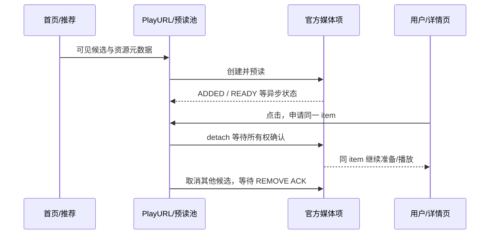

# 视频首开优化：官方机制、阶段测量、实现与反例

本文面向 Android/Flutter 与音视频工程师，解释官方 9.14 播放启动链和本分支的改动，保留有效证据、失败候选和没有证明的收益。内核接入、音效及同步基础见 [官方播放器接入指南](official-player-integration.md)。日期为 2026-10-17（东八区），产品行为基线为 308/311。

**稳定 400–500ms 的目标没有完成。** 最新首页三条临时自动画质样本首视频回调平均 767.1ms、首音回调 694.1ms；固定偏好的另一组三条分别为 1139ms、2697ms，且有约 6.31 秒首音反例。用户实际感到变差是需要保留的反馈，不能用历史最好均值否定。现在停止新增优化，34 项改动保持当前状态，最终保留/恢复由用户选择。

本文的 E 编号对应 [研究证据库](research-evidence.json) 的原始路径、摘要全文和哈希；[功能提交清单](module-commits.json)连接每个模块与代码。公开库不含原始账号、签名媒体地址、官方 APK/so、原始录像/trace/PCM。研究报告是可追溯记录，不表示外部读者已拿到全部实验输入。

## 1. 先定义“首开”，否则优化会越做越偏

|指标|起点/终点|能回答什么|不能回答什么|
|---|---|---|---|
|用户点击→详情内容|真实触摸 UP 到可见页面/封面|交互反馈是否及时|视频是否已解码、音频是否开始|
|点击→AudioTrack 创建/start|同一校准时间轴上的系统调用|两 APP 共同可见的输出初始化阶段|扬声器物理首音|
|点击→native first_video|当前 session 第一视频呈现回调|应用可观测首视频阶段|面板扫描/实际光子时刻|
|点击→native first_audio|当前 session 第一音频回调|应用内首音阶段|蓝牙耳机或扬声器末端声学时刻|
|prepare→首音/首画|媒体完成准备到输出|水位、解码、排队、呈现开销|点击前取流/预热时间|
|冷开/热开|进程、DEX、播放器、缓存分开标记|初始化是否在关键路径|不能只按“第一次点”推定冷态|
|预读命中/未命中|点击前 task/item/字节/READY 身份|工作是否提前且真正复用|预读命中样本不代表刷新立即点|
|连续性|首音后持续供数、再缓冲、逐帧/PCM、seek/切档|首开提速是否牺牲后续体验|不能以首帧提前掩盖后续静音/冻结|

400–500ms 必须说明目标指标、缓存和网络条件。目前并未获得“所有视频在真实物理输出下都达标”的证据。封面显示、预览首帧、点击前已 prepared、低清起播、静音预取是不同策略，分别记账。

## 2. 再次 profile 的可靠结论

### 2.1 官方和开发版各三个首页样本

195 轮按用户要求随机选各三条，不要求同视频。小米14/扬声器，同开 Perfetto 和 600×1336 录屏；用 trace 中两次 dispatchMotionLocked 的第二次 UP 为零点，REALTIME→BOOTTIME 通过同 trace 的 clock_snapshot 校准，六条 trace 校验错误为 0。（E209）

|样本|点击→AudioTrack 创建 ms|点击→AudioTrack.start ms|
|---|---:|---:|
|官方 1|448.8|549.8|
|官方 2|269.2|365.2|
|官方 3|308.9|428.9|
|**官方均值**|**342.3**|**448.0**|
|PiliPlus 194：4K HDR|1881.7|2031.7|
|PiliPlus 194：1080p|927.2|981.2|
|PiliPlus 194：1080p60|886.6|911.6|
|**194 均值**|**1231.8**|**1308.2**|

平均差约 860.2ms，主要发生在 AudioTrack 创建之前（该段差 889.5ms）。创建后→start 官方均 105.7ms、开发版 76.4ms，因此不能把慢开都归因于输出设备初始化或蓝牙补偿。

**官方 448ms 是 AudioTrack.start 调用，不是首画/物理首音。** 官方没有公开与我方相同的 native first_audio 回调，禁止拿 448 与后来的 577 或 767.1 直接作同口径排名。三个视频不同、第一条开发版还重新建了服务/类加载器，差值也不是代码净开销。

|194 样本|点击→player 创建|创建→准备/switch|点击→first_video|点击→first_audio|
|---|---:|---:|---:|---:|
|4K HDR|774.7|1060.0|2156.7|5201.7|
|1080p|298.2|572.0|1080.2|967.2|
|1080p60|384.6|457.0|957.6|902.6|

双轨 network_open 到得到流信息分别约 465/842、263/373、214/329ms，`findstreaminfo` 自身日志却接近 0ms。因此“媒体准备很慢”不等于“CPU 分析文件头花了 800ms”；其中含等待供数、读取、定位竞争和调度。准备后仍有 145–189ms 才进入播放准备，4K 样本水位从 500 升到 1000/2000/4000/5000ms，首音比首画晚很多。

官方前两个首页样本已有预览播放器和活跃线程，第三个是普通卡片；原线程名显示旧 SDL 相关路径。该轮没有确认官方全部真实轨道/清晰度，不能把 AV1 探测日志当实际播放编码，也不能用内核新旧解释差值。官方素材还有深色渐入，用非黑像素阈值比较两 APP 首画会失真。

### 2.2 为什么曾经 389/396/577ms，后来又慢

|阶段|有效观察|不应作的推广|
|---|---|---|
|157/158|先停留≥5秒让详情准备，点击后首音约40–54ms|不是首页自动播放冷开；预览首图已经在点击前|
|203|三条首音约457ms、首画557ms|素材、命中状态不同，不能只看版本号比较|
|204|已预读三条首画约396ms|新鲜素材仍有再缓冲|
|206|普通三条平均389ms，刷新三条约648ms|刷新即点与已停留首页不是同一分布|
|后续口头约577ms|特定当轮样本统计|不是当前产品恒定耗时，更不能一直复用作进度|
|305 固定偏好|三条首画1139ms、首音2697ms|其中一条首音6311.9ms，不能被首画均值掩盖|
|309 / 产品308，临时自动|首画544.5/953.7/803.2，均767.1ms；首音413.5/863.7/805.2，均694.1ms|实际一条4K、两条1080p；不能称三条同品质AB|

早期最好值、后期长尾和用户感受同时成立。样本条件不断变化、一次叠加多个策略、局部提速没有兑现为全链路收益，是本轮必须纠正的方法问题。不能把所有坏结果解释成网络，也不能把所有好结果归功于最新补丁。（E173–E174、E199、E204、E230、E327、E329）

## 3. 官方为了快开，具体做了什么

### 3.1 入口之前：准备播放器与可见候选

官方并不总在点击之后才从零开始。首页预览、推荐候选和 `PreloadPool/CacheElement` 提前取得资源、构造媒体项、预读，进入详情接管它。研究追到 parse→createPreloadMediaItem→setIdleBufferInfo→MediaItem.start 的链，Java 等待任务返回不等于 native READY。



本项目借鉴的是“提前工作并移交对象”，不是点击后复制 URL 再从头打开。未命中仍需完整前台准备；提前预读消耗网络/CPU/内存，不是免费获得时间。（E168–E169、E175–E177、E208、E225–E227）

### 3.2 文件头与媒体预读

官方媒体层已经负责格式、索引、DASH 分片和缓存。早期宿主为 HDR/格式安全在 Java 额外读一遍音视频头，然后 native 再读，形成重复工作。正确方向是核实原 native 元数据读取与索引边界，复用同 item 已完成的工作，而不是禁止格式检查。

官方缓存能复用部分 Range 数据；初次零位置 seek 有时会重新打开/定位，因此要辨明“刚打开尚未读取的非 DRM DASH 零位请求”和用户正常 seek。不得全局去掉 seek 或把缺索引的普通 MP4 当 DASH。（E205–E206、E211–E217、E234、E237）

### 3.3 首次画质：有条件的推荐选档，不是所有片统一低清

官方确有初始推荐画质策略。Java 侧按业务模式、服务端 HighRatio/LowRatio 范围与开关构造参数；观察到的兜底范围分别为 [32,116] / [32,64]。ratio 布尔上游没全部查完，不能简单解释为横/竖屏。VOD/STORY 等入口还要求存在有效范围。

原 DASH options `dash-use-recommended-qn`、max/min-recommended-qn、dash-start-screen-ratio 对应锁定布局 +0x724/+0x728/+0x72c/+0x734。native 还受实验组字节 +10、真实梯度列表和其他 gate 限制，构造 0x120 字节输入调用 `GetAICenterOutput(4)`；只写一个开关不保证启用。（E242、E304）

已直接执行原选择 helper（ELF 0x1f6478）和 cost helper（0x1f5f04）验证边界：在预算内选可用较高档，严格阈值、最低档兜底、空列表保留、预算为0时缺省9,900,000；代价包含 `bandwidth * clamp(0.9 + 0.4*bandwidth/1e6, 0.9, 1.4)`。外层 origin qn>120 的条件保留。模型/网络预测的全部在线输入仍未恢复，不能称完整复制官方自适应系统。

首次音频改变有独立开关 `enable_change_start_audio_qn`。不能为了视频更快，把无损音轨偷换 AAC 后说音质保持一致。本分支自动模式保留独立所选音轨，并且默认关闭；固定模式没有暗中变成低清起播。

### 3.4 编码能力与实际码率

官方会结合设备能力选编码。后续同片实测官方 4K 为 AV1，而开发版无显式偏好时曾落 AVC；同样标为 4K60，码率可从 AV1 约6.283Mbps到AVC约23.890Mbps。不能只看分辨率相同就说下载工作量相同。（E315–E316、E323）

当前默认策略在用户未明确选择且硬解可用时，按官方设备能力尝试 AV1→HEVC→AVC，预取和前台共用。手动偏好保留。这个变化有带宽收益证据，但解码启动成本、温控和厂商能力依设备，不能声称所有手机 AV1 必定更快。

### 3.5 CDN/网络：已知与未知

已确认主/备用 URL、重试和原库网络缓存/连接复用条件。227 同片同轨对照显示固定主源或固定备用都不是普遍最快，当前没有交付“并发测速选全局最快 CDN”的算法。官方服务端调度和网络质量预测也没有完全恢复。（E254、E322、E324）

官方 HTTPS 开关影响 `forceHost`（观察到关闭0、开启2、空值false），Pili 请求使用 `force_host=2/https_url_req=1`。UID 同时连接80/443端口不能定位具体媒体请求，不能断言官方都用 HTTP；本产品没有通过关闭 HTTPS 提速。`new-network-enable` 在实际注册表没有对应路径、结果 Not found，不继续堆猜测选项。（E328）

### 3.6 感知优化

官方详情会在播放区域维持封面/预览，减少黑屏的等待感。262 复用对应首页封面缓存及质量（quality10），避免另发quality60请求；匹配视频/cid/代际，真实 first_video 后撤下。按进入详情的区域比例填充，不把封面当视频首帧，不让旧视频封面盖住新片。（E271）

## 4. 本分支的关键实现细节

### 4.1 预热：把初始化提前，但释放仍完整

DEX 33 条目改 STORE/4 字节对齐，原内容不变；cold class load 三次约2.1秒降到0.8–1.0秒。平台父加载器与非 Android debuggable 修复 Unsupported class loader context，让 ART 正常处理动态加载。手工强制 secondary AOT 曾耗时约102秒，没有稳定增益，不作为日常必做流程。（E162、E200、E232）

详情取 playurl 与 runtime prewarm 并行；主页首帧后、返回主页、恢复前台触发空闲预热。成功释放保留原生进程30秒，避免下一片重建 ClassLoader；异常释放仍终止回收。测试确认空闲不保留活跃 AudioTrack，不是偷偷播放静音。进程驻留的内存/主页负载/功耗代价尚未全量测量。（E167、E179、E189–E190）

### 4.2 PlayURL 与 native item 是两层缓存

`play_url_prefetch.dart` 缓存账号绑定响应，最多3项、TTL30秒、单次消费，预取2秒取消且不额外重试；账号变化立即失效。可见候选最多3个，滚动250ms防抖，前台/WiFi等条件限制；10秒续租30秒，离开前台/可见范围清理。新推荐数据一到即预取，不等滚动防抖，历史 feed完成→请求从287.8降到32–69ms。（E164、E168、E228、E236、E240）

native item 有 ADDING/READY/DETACHING/REMOVING 等状态，READY 通知的 request=0 与 ADD/DETACH/REMOVE 命令 ACK 不同；不能要求它等于 add request，否则条目永远停在 ADDING。READY 仍需匹配 task 与合法状态，不能复活已取消对象。前台先取得用户选中的 item，再清理其他候选，避免其他 close 的193–228ms排在前面。不同账号/选择/梯度不能误命中；缓存键、轨道模型、刷新请求必须同源生成。

### 4.3 未 READY 也能移交，但所有权不能省

后台2000ms是媒体预读目标时长，不是必须墙钟等待2秒。原 item 尚未达到该水位也可以移交；若 native HDR/流信息仍未知，就继续准备同一个 item，而不是当 SDR 或销毁重建。前台元数据目标1是媒体时长参数，不能解释为“1ms一定prepare完”。（E204、E208、E225–E226、E237）

detach/remove 必须等精确 ACK 后才释放对象/目录。Open 会重置 IO interrupt 位，所以只发一次取消可能失效；当前 REMOVING 状态每20ms重提 interrupt，最多5秒等待确认。受控旧1269.7→64.1ms，完整30秒输出/PCM一致；不能把这个局部数值当每次点击净收益。（E227）

未命中前台元数据准备后来拆成独立单槽队列，后台最多3槽，避免前台在后台阻塞任务后排队。受控后台人为断流4秒时共享队列约4126ms、独立约86ms；这是调度因果实验，不是线上普遍省4秒，也不是已证明官方恰好采用同样双队列。（检索 `preload264` / `preload265`）

### 4.4 Surface 与媒体准备重叠

原流程等待 Flutter 窗口才创建/开媒体；194 提前打开媒体，同时创建 Surface，真正 decoder 启动前再等正确输出目标，create 从晚于Surface22/35ms变为提前188/82ms。201 只对 Android 视频详情关闭 route snapshot，避免转场把真实视频绘制冻结：受控窗口create→attach278→67ms，转场期间恢复 paint。（E224、E231、E238–E239）

这些必须依赖 session/Surface 世代保护。185 曾先给占位 Surface，再发现 HDR 后重建，重复 decoder 与显示配置导致退步；187 改为原生元数据确认→正确Surface→实际播放。不能为赶首帧跳过 HDR/色彩合同。127 Flutter根Texture修复横屏残留属于正确性，不是本轮首开性能开关。

### 4.5 首次零 seek、缓存与资源成本

`first_seek.c` 仅对刚打开且尚未读取、非 DRM 的 VOD DASH、首次零定位及精确匹配参数跳过冗余调用；普通 seek、非零、直播、读过的 context、错误路径仍走原逻辑。8线程8万生命周期及完整输出有守卫验证，但尚缺当前整机净收益 AB。（E205–E206）

`OfficialMediaCache.java` 复用原媒体磁盘缓存，每轨64MiB、最多4项，低空间阈值200MiB并约束剩余预算；取消/移交完成后按所有权回收。受控请求6→5和完整PCM成立，真实冷热首开涨跌都有，因此缓存不能包装成稳定秒开收益。磁盘占用/IO与预读驻留必须一起记账。

### 4.6 缓冲：修计数，不是盲降水位

慢首音有时是已有解码音频帧未计入可播水位，包队列变少后误判饥饿。231–240 沿原计数单位、stream顺序、frame与packet关系修复：优先考虑真实已解码帧，避免重复计数，补上初始video packet为空但decoded frame非空的条件，seek/EOF/live等不安全状态排除。（E243–E252）

受控同输入prepare后首音约5.1秒→0.43秒，完整帧/PCM检查通过。只补时长不补数量的232候选失败；237局部奏效不直接当整机通过。真实仍有4.53秒再缓冲、后续6秒首音，原500/1000/2000/4000/5000ms策略没有全局删除。153关闭自动水位升档虽可能早出声，但出现续播反例，因此拒绝。（E186、E303）

### 4.7 ReadLooper 与 TLS

旧 SDL 参照重试上限10ms，新路径观测100ms；当前将 EAGAIN 累积等待上限降到10ms，保留前11次立即尝试、EOF/错误/背压/水位规则。原读取等待确实缩短且受控PCM相同，但更多唤醒的能耗影响没量化，不能把206所有改善归因于它。（E230、E233）

TLS D2 只绕过已定位的成功读取调用点每次1ms休眠，保留错误重试和写等待。最初约3秒失败含测试服务器 TLS wrap listener 串行握手阻塞 accept；258 改每连接在线程中握手后，ABBA同40ms请求/8MiB/s/20Mbps输入的两次每组均值507.6→436.8ms。修的是工具后才得到有效局部对照，不抹掉原失败，不宣称整机稳定收益。（E305、E307）

D3 在同包libcrypto发现硬件AES/GCM后，从原软件SDL GCM转接EVP。2MiB微基准92.6→0.785ms，11,520项长度/密钥/边界矩阵、并发、认证错误及原合同验证通过；私有SDL镜像、GOT分流、scratch先认证后拷贝、errno/ERR queue等契约不能省。它没有关闭TLS认证或证书验证。但是实际三条首开仍慢，默认链引入额外私有ABI复杂度的整机收益不够，审查建议优先恢复，**尚未执行**。（E318、E321、E328–E329）

### 4.8 自动画质和切档连续性

自动档位需要同 codec/色彩组梯度；HDR125、DV126、其他特殊档与普通SDR不能随便混。起始推荐后由实际 native 事件更新当前qn，UI请求值、预载快照和实际码流分开。补档请求不能改坏已有预读的精确缓存身份，刷新必须包含全梯度。该功能当前显式可选、默认false。（E242、E304、E310–E311）

多档切换不是换URL就完：原MOV timebase、`min_corrected_pts + dts_shift`、SAP固定+1秒、DTS段标签、queued=1/dispatch=2移交、EOF读锁等都有实际失败。只删除1秒seek偏移仍会提前裁剪旧B帧。284/285补全时间域和所有权后，受控逐帧/PCM及真实三编码限定窗口通过；不能据此保证全部视频无缝。（E308–E310）

307发现AV1升4K后6870次空bsf错误；308在原adaptive flush后检查并关闭失效bitstream filter，保留有效对象和失败返回。修复使限定AV1升档路径继续送包，是正确性补丁，不是证明首次启动更快。若撤自动策略，也不能盲删共用尾包/滤镜生命周期保护。（E312、E317）

## 5. 当前 34 项改动清单

下表继承311审查的决策编号，便于按项讨论。证据等级：**直接**指具体步骤或行为的因果证据；**局部**指组件/受控宿主有效或实装生效，但缺当前整机AB；**功能**指正确性/体验；**不足**指未证明收益。建议是建议，当前没有执行恢复。

### A. 构建与初始化（7项）

|编号|当前改动、作用|证据与反例|建议及代价|
|---|---|---|---|
|A1|从 debug 改为 Flutter profile/AOT 交付|[175 · E157](research-evidence.json)：同 FLAC 冷开历史 4647/4686→2932/3328ms，热开差值较小；不是全部慢开原因|**保留，直接。** 不恢复 debug 作为测试交付基线；profile 尚不等同最终 release|
|A2|官方 DEX 以 STORE、4字节对齐打包，保留原条目内容|[172 · E162](research-evidence.json)：冷类加载三次约 2.1s→0.8–1.0s；全条目内容核验。整机总耗时并非等幅下降|**保留，直接。** 包体/私有代码文件变大；不是每条视频都省 1s|
|A3|平台父加载器及非 Android debuggable，允许正常 ART 编译|[189 · E200](research-evidence.json)：解除 Unsupported class loader context，冷 CPU 明显降低；手工强制二次 AOT 没有稳定收益|**保留标准加载方式，直接。** 不继续手工编译流程；后者不是当前需撤的产品代码|
|A4|详情取 playurl 与官方运行时预热并行|[142 · E179](research-evidence.json)：真实重叠执行、同 PID 复用，不创建活跃 AudioTrack；单例冷开下降不当受控净收益|**保留，直接减少串行依赖。** 真正冷加载仍需完成，默认编码探测会等它|
|A5|主页首帧后、回主页和恢复前台时预热|[167 · E167](research-evidence.json)：点击前完成加载并复用；未证明全设备平均净收益|**建议保留，有条件。** 把 CPU/内存工作提前，可能影响低端机主页负载，尚无功耗结论|
|A6|成功完整释放后保留空闲原生进程 30s|[166 · E190](research-evidence.json)：多次退出/重进同 PID，空闲退出，无活跃音轨；异常释放仍终止回收|**保留，直接避免重复初始化。** 短期占内存；不能把进程保留误写成播放器未释放|
|A7|Android 官方后端下 preInit 默认开启，用户显式设置优先|当前 `storage_pref.dart`、主页/推荐调用；这是 A4/A5/B 组的默认触发策略，没有独立性能 AB|**建议保留，策略项。** 可选择恢复默认关闭，但会同时关闭大部分提前准备收益|

### B. 首页预取、预读与移交（9项）

|编号|当前改动、作用|证据与反例|建议及代价|
|---|---|---|---|
|B1|账号绑定的 playurl 单次消费缓存，最多3项、30s有效期；预取2s取消且不额外重试|[173 · E168](research-evidence.json)及当前 `play_url_prefetch.dart`/`video.dart`/账号切换清理：命中时同卡只有一次 playurl 请求|**保留，直接减少重复请求。** 未点击卡片会多发请求；只能承诺限定 UGC/WiFi/前台范围|
|B2|调用官方 native preloader，播放直接接管同一个 item|[173 · E168](research-evidence.json)、[187 · E237](research-evidence.json)：ADDED/READY/DETACHED 与真实同 item 播放；不是拷贝 URL 后重建|**保留，直接复用工作。** 状态机/精确 ACK/代际保护是必需依赖|
|B3|预读从固定首卡改为最多3个当前可见候选，滚动防抖250ms|[198 · E240](research-evidence.json)：9轮替换、上限3、选中对象复用；高码率短窗口仍有约4.27s首音反例|**建议保留，有条件。** 多候选可争抢网速/CPU；未量化不同网络下的命中收益与代价|
|B4|前台可见候选每10s续租，延长30s TTL|[197 · E228](research-evidence.json)：8/35/65s同任务，无额外媒体下载，久停后仍复用|**保留，直接。** 定时器及资源驻留依赖 B3；离开前台/可见范围应清理|
|B5|推荐列表新数据到达即启动预取，不等滚动防抖|[215 · E236](research-evidence.json)：feed完成→playurl发出原287.8ms，新样本32–69ms|**保留，直接减少人为延迟。** 不是整机必省约250ms，用户点击时机不同|
|B6|先接管用户点中的 item，再取消其他候选|[204 · E199](research-evidence.json)：原其他 close 193–228ms排在前面，新顺序选中 prepare 不再被这些 close 挡住|**保留，直接。** 需与 ACK 所有权处理一起保留|
|B7|已有预读还没达到目标水位也允许移交；元数据未就绪时继续准备同 item|[180 · E208](research-evidence.json)、[203 · E204](research-evidence.json)：真实未完任务接管，未知HDR保持未知；不等后台2000ms预读目标|**保留，直接消除非必需等待。** 不能去掉未知元数据重准备及过期回调防护|
|B8|取消任务反复提交 IO interrupt，直至准确移除 ACK 或5s失败|[214 · E227](research-evidence.json)：同条件旧1269.7→64.1ms，30s输出/PCM一致；20ms重试只在 REMOVING|**保留，直接。** 原Open会重置中断位，单次中断不足；不得提前释放原生所有权|
|B9|未命中时前台元数据准备使用独立单槽队列，后台最多3槽|[264 · E295](research-evidence.json)受控断流 ABBA：共享约4126ms、独立约86ms；[265 · E296](research-evidence.json)实装队列隔离。人为4s阻塞不是线上可省4s|**建议保留，局部因果明确。** 是本宿主HDR准备的适配，不声称官方也双队列；额外固定实例占资源|

### C. 文件头、媒体准备与缓存（8项）

|编号|当前改动、作用|证据与反例|建议及代价|
|---|---|---|---|
|C1|Java文件头探测先 disconnect 再关闭流|[136 · E197](research-evidence.json)、[146 · E161](research-evidence.json)：局部关闭中位约100.35→1.07ms|**保留，直接。** 现在主要是回退/离线路径，不能当在线主路径持续收益|
|C2|仍需 Java 探测时音视频头双线程并行|[146 · E161](research-evidence.json)：服务器屏障验证旧串行失败/新并行通过，4样本探测相关中位753→474ms；同时含C1，不能各自重复计功|**保留，直接。** 当前在线主路径已不重复Java探测|
|C3|必要的 Java 探测也可提前放入后台|[178 · E178](research-evidence.json)：历史真实预读成功；当前已识别在线 DASH 直接用 nativeMetadata，覆盖面缩小|**可保留回退支持，局部。** 不再作为主要秒开成果；若精简，需与C4/离线错误处理联合审阅|
|C4|前台接管未完成 Java 探测 Future，最多等300ms|[181 · E229](research-evidence.json)：单测通过，但当轮两次真实APP未命中新路径；当前 `open→takePreloadProbe→await` 仍存在|**建议优先恢复，证据不足。** 最坏增加等待，且主在线路径不用它。只撤接管等待，不随手删掉C1/C2或索引保护|
|C5|已识别在线 DASH 用官方原生元数据与索引，不再Java额外下载头部；读取同 item 的HDR分类|[183 · E216](research-evidence.json)、[184 · E215](research-evidence.json)、[187 · E237](research-evidence.json)：原native仍正常查流；坏索引拒绝；避免重复请求。185占位Surface导致重建反例促成187修正|**保留，直接+功能。** HDR准备顺序、索引校验、未知格式回退不能拆掉；不是跳过媒体格式检查|
|C6|媒体打开与 Flutter Surface 创建重叠，真正解码前等正确Surface|[194 · E224](research-evidence.json)：原create晚于Surface22/35ms，新提前188/82ms；小样本首画下降，非稳定总体AB|**保留，直接减少串行依赖。** 旧页面/迟到Surface隔离必须保留|
|C7|只跳过未读、非DRM点播 DASH 首次零位重复 seek|[213 · E206](research-evidence.json)：30s输出/PCM一致，8线程8万生命周期；非零、已读、直播等保持原调用|**建议保留，局部。** 原生守卫严格，未证实整机平均节省；不会用于普通拖动|
|C8|复用官方媒体磁盘缓存，每轨64MiB、最多4项、低空间保护|[191 · E211](research-evidence.json)：受控6→5请求及完整PCM；真实冷/热首音首画涨跌都有，未见稳定总收益|**条件保留，可由你选精简。** 占磁盘并增加IO；不是跨视频永久缓存，也不等于加大水位|

### D. 原生读取与TLS（3项）

|编号|当前改动、作用|证据与反例|建议及代价|
|---|---|---|---|
|D1|ReadLooper EAGAIN累积等待上限100→10ms|[205 · E233](research-evidence.json)、[206 · E230](research-evidence.json)：实际等待降到10ms，受控PCM相同；真实6样本普通均389ms、刷新均648ms，但不同素材不能归因全给它|**条件保留，局部。** 参照官方legacy分支10ms，并非官方当前所有分支都这样；增加唤醒，功耗未做对照|
|D2|只在指定TLS成功读路径跳过每次1ms休眠|[258 · E305](research-evidence.json)：修复服务器串行握手干扰后 ABBA，均507.6→436.8ms；2次/组，30s候选输出通过；[259 · E287](research-evidence.json)实装未证实整机净收益|**条件保留，局部。** 错误重试/写等待保留，仍有私有调用点守卫成本。257约3秒反例含工具干扰，不能直接归罪最终候选|
|D3|将原软件TLS GCM转接同包libcrypto硬件EVP|[305/306 · E329](research-evidence.json)：2MiB约92.6→0.785ms，11520项与边界/并发/认证验证通过；真实三条首开仍1139/2697ms|**建议优先恢复，整机收益不足。** 微基准是真收益，但当前证据不够支撑把私有SDL镜像/分流长期留在默认播放链；未证明它引起卡顿，也未关闭认证/证书验证|

### E. 缓冲正确性（1项）

|编号|当前改动、作用|证据与反例|建议及代价|
|---|---|---|---|
|E1|水位计算考虑已解码帧，先帧后包避免重复/漏计；补初始视频包空但解码帧非空分支|[234 · E248](research-evidence.json)、[235 · E249](research-evidence.json)、[240 · E252](research-evidence.json)：受控同输入 prepare后首音约5.1s→0.43s，完整PCM/帧检查；真实仍有4530ms再缓冲以及后续6s首音反例|**保留，功能正确性+局部时延收益。** 不是全局调小缓存；原500/1000/2000/4000/5000ms水位策略仍在，不能宣称所有缓冲问题解决|

### F. 画面与感知（2项）

|编号|当前改动、作用|证据与反例|建议及代价|
|---|---|---|---|
|F1|只对Android视频详情路由关闭转场快照，允许视频实时绘制|[201 · E239](research-evidence.json)：受控开关下窗口create→attach278→67ms，转场中从0次paint变为可绘制|**保留，直接。** 不恢复全应用统一关闭快照；普通页面及其他平台保持原策略|
|F2|首视频帧前显示对应封面，按播放区域适配，首帧后撤掉；切视频防串封面|[262 · E271](research-evidence.json)：真实画面由长黑屏变成封面→视频，封面复用首页质量与缓存|**保留，体验功能。** 没有缩短首音或解码耗时，不拿封面当首视频帧|

### G. 画质与编码（4项）

|编号|当前改动、作用|证据与反例|建议及代价|
|---|---|---|---|
|G1|同编码/色彩组多档梯度、原AICenter起始选档与自动升降，保留独立音轨；显式“自动”默认关闭|[273 · E242](research-evidence.json)、[287 · E298](research-evidence.json)、[290 · E311](research-evidence.json)：真实低档起播/升4K成功；自动/固定三条不同视频不能证明净收益，15.4s再缓冲反例仍开放|**建议保留为可选功能，不默认开启。** 官方在线输入/远端策略尚未完全复现；降低起始视频码率有画质代价，不降低音轨来冒充音质一致|
|G2|无手动编码偏好且硬解时，按设备官方能力选 AV1→HEVC→AVC，预取与播放共用选择|[298 · E316](research-evidence.json)：同4K60 AV1约6.283Mbps、AVC约23.890Mbps，均30s无低包；官方实际AV1已取证|**建议保留，带宽收益已证实。** 启动时延/解码负载依设备；手动偏好保留，不宣称编码换成AV1必然更快|
|G3|多档切换的时间域/段标签/请求交接/尾包并发修复；308补升档滤镜有效性|[284 · E278](research-evidence.json)、[285 · E310](research-evidence.json)、[308 · E312](research-evidence.json)：受控逐帧/PCM及真实三编码1080→4K通过限定窗口；原AV1升档6870次空bsf失败被消除|**保留，功能正确性。** 若撤整套多档，仍需单独保留尾包修复；不能只撤308使自动升档重新破坏送包|
|G4|共享选轨/预加载梯度快照、精确缓存键、全梯度刷新、实际画质终态才更新UI|[287 · E298](research-evidence.json)、[290 · E311](research-evidence.json)：防补档使已有预读失配；测试与实际切档回调确认；未取得初始qn时不伪报4K|**保留，功能正确性。** 是B/G1依赖，不是额外提速算法；恢复必须同步源模型、回调、偏好与UI|

## 6. 哪些借鉴官方，哪些是宿主自己的适配

|机制|来源|区别与边界|
|---|---|---|
|原媒体预读、同item移交、IO中断、缓存|官方Java/native机制|Flutter业务触发、账号/代际及所有权状态机由宿主实现|
|DASH原生元数据、索引、HDR分类|官方媒体层|去除宿主重复Java探测，仍保留错误/未知回退|
|推荐初始qn、能力选codec|官方调用链/原helper|在线模型输入未全部恢复；自动模式默认关闭|
|10ms读重试参照|官方legacy路径|当前newAudioEngine参数适配，不是证明所有官方分支都10ms|
|封面过渡|官方可观察体验与业务线索|Flutter复用封面/缓存/代际，不伪称视频更早解码|
|前台独立元数据队列|本宿主适配|解决自己新增准备阶段被后台阻塞，未证明官方同结构|
|转场snapshot限制、Surface并行|Flutter宿主适配|官方原生UI无需相同修法；限制到实际受影响路由|
|未读首次零seek守卫|原调用语义+宿主适配|严格限定一次，不能推广为禁用seek|
|decoded-frame水位补计、切档时间域/滤镜修复|原native行为定位后的适配|正确性必须保留，不能只按速度均值删|
|TLS成功读等待、GCM分流|原网络代码/同包密码组件+自有桥|局部提速；当前默认链复杂度与整机收益不相称的风险仍在|

“独创”不表示越多越好。本项目优先复用参照机制；自己写的代码主要用于 Flutter/服务生命周期、原库私有合同适配和可验证的缺陷修复。每项偏离都应保留证据和撤回边界。

## 7. 源码阅读顺序和依赖

|入口/文件|要检查的关联|
|---|---|
|`lib/http/play_url_prefetch.dart`|账号世代、TTL/并发、单次消费、超时取消|
|`lib/utils/storage_pref.dart`、设置页|preInit有效默认、自动画质默认false、显式用户偏好|
|`lib/pages/home`、推荐相关controller|首帧/可见候选/刷新立即预取、离开页面和前台清理|
|`lib/pages/video/controller.dart`、`lib/http/video.dart`|选流/补档/响度/预载快照、点击与资源取回的关键路径|
|`lib/plugin/pl_player/official_player.dart`、`controller.dart`|preload/acquire/prepare顺序、取消、真实backend/实际档位|
|`OfficialPreloadCache.java`、`OfficialRuntime.java`|ADDING/READY/DETACH/REMOVE ACK、前后台队列、未知HDR和Surface|
|`DashSource.java`、`FragmentIndex.java`、`OfficialMediaCache.java`|Java fallback、索引保护、缓存边界与释放|
|`media_metadata.c`、`media_index.c`、`first_seek.c`|偏移/guard、原元数据、首次定位资格|
|`audio_buffer.h`、`startup_prefill.h`、`graph_adapter.c`|时间单位、decoded/packet计数、错误/EOF/seek排除|
|`network_read.c`、`tls_crypto.c`|调用点、线程局部状态、错误/认证/原函数回退|
|`media_dash.c`、`media_switch.c`、`media_adaptive.c`、`startup_choice.c`|梯度、时间域、段标签、请求所有权、bsf、原推荐helper|
|视频路由与封面widget|snapshot只限相关路由，首帧前封面，源代际防串|

具体路径以 [模块提交清单](module-commits.json) 的 files 为准；私有native布局与锁定APK身份一起阅读，不能脱离第一份指南的版本守卫。

恢复依赖也属于实现：D3必须同步处理派生镜像、初始化、JNI/GOT、打包与测试，不能仅删install函数留下已改入口；C4仅撤接管等待时仍要处理后台probe释放，保留C1/C2和坏索引拒绝；B组涉及Dart与native、账号与缓存所有权；G1可先撤入口/策略，但尾包和通用滤镜有效性不能顺手退回错误实现。

## 8. 可复用的 profile 与 AB 方法

### 8.1 每轮实验先填清单

```text
假设：哪个具体等待造成哪个用户现象？
唯一变化：开关/代码点/输入是什么？
身份：APK与实际加载库SHA、版本、backend、codec/qn/音轨。
条件：冷/热进程、缓存/预读任务身份、首页停留时长、网络/路由。
时间：触摸UP与设备monotonic/boottime映射；误差范围。
主指标：first_video/first_audio/系统start中的哪一个？
护栏：30秒或指定长度的再缓冲、有效PCM/帧、seek/释放。
停止条件：连续反例、采集无效、结果不支持假设时换证据入口。
```

真实线上体验抽样可随机三条并报告均值，但不能做严格代码因果判断。要归因，用同素材/同编码包/同实际画质、同网络条件和缓存态做AB/ABBA，保留单样本、最大值和失败，不只报平均；多轮切换注意服务器和CDN内容、URL令牌时效仍可能变化。码率声明不是实测吞吐，URI路径哈希也不是媒体字节一致。

### 8.2 设备侧采集示例

以下只是采集入口，不会自动产生可靠首开统计；设备需预先授权，版本和数据源能力以现场为准。

```sh
adb shell perfetto --query
adb shell perfetto -o /data/local/tmp/pili-startup.perfetto-trace \
  -t 15s sched freq idle am wm gfx view binder_driver
adb pull /data/local/tmp/pili-startup.perfetto-trace ./pili-startup.perfetto-trace
```

需要在另一个终端于采集窗口内做一次明确点击，并同时采集当前会话的 native 日志；不要等15秒采集结束才点击。更完整研究使用显式 Perfetto 配置与 clock_snapshot，先确认 InputDispatcher/AudioTrack 所需事件确实出现。只跑上述命令并不保证每台系统开放相同数据源，也不提供官方 first_audio。

CPU调查用自有诊断包短暂启用 profileable，simpleperf 与 Perfetto同轮校时；采完撤权限与探针、核源身份再恢复研究候选。不能把debug或带高频日志的包成绩当无诊断交付包。第三方原APP的只读系统trace和自有进程注入不是一回事；本文不提供绕过设备权限的方案。

日志至少串联：input UP、page enter、playurl request/response、preload提交/ACK/命中、player create、各轨open/first packet、metadata/prepare、Surface create/attach、decoder create、AudioTrack set/start、first_video/first_audio、buffer begin/end。各事件需要session/task/source identity，旧视频事件不混进新片。

### 8.3 分析顺序

1. 先确认点击真的导航、播放器/轨道真的符合条件；未打开的样本是工具失败。
2. 校准时钟再切阶段，保留校准误差和trace覆盖窗口；不得把主机time、logcat wall time、PTS直接相减。
3. 区分墙钟等待与线程CPU：open到metadata慢可能等网络/锁，不能全称解析CPU；CPU采样比例也不是准确墙钟占比。
4. 把并行分支画成关键路径；视频/音频/Surface重叠时不能把各自耗时简单相加。
5. 检查first_video后是否仍buffering、first_audio是否长尾、实际qn是否降档、是否很快再缓冲。
6. 最后比较受控AB与反例；结果不支持就写未证实，不靠换样本重命名继续报好成绩。

### 8.4 本项目必须保留的工具反例

- 自动注入DOWN被系统丢弃，手动点击正常；失败点击未算官方速度样本，也未用深链冒充首页点击。（E198、E209）
- 221试图观察IgHttp回调，但实际路径未经过它；没有回调不等于网络耗时0。（E220）
- TLS服务器串行握手使请求互相阻塞；修好工具后才判断D2。（E305）
- 第一次render分析要求buffer结束reason为特定字符串，实际是end_with_prepare；修分析器后使用原数据，没有偷偷重采更好样本。（E325）
- 首图检测对深色渐入/白开场不公平；封面非黑也不是视频帧。录屏最大采样间隔必须披露。
- 诊断版300采集失败没形成有效测量，不能把“跑了profile”当新增结果。（E320）
- 一个shell中多条命令最后exit0，不代表前面测试全通过；本轮文档复现按每项返回值和日志检查。

## 9. 当前还差在哪里

最新309发现呈现尾段CPU热点；310对同片两次观察 create→prepare1429/1171ms、初buffer均1ms、prepare→首画125/140ms，render CPU约111/110ms。栈含clock_gettime、取帧/等待、消息投递和引用/锁，原render消息3在空队列按context+0x20延迟重投，构造初值0。后续设置调用者未追完，不能断言宿主漏参数或当前补丁导致busy loop；也没有复现309的238ms首次buffer。用户已要求停止优化，因此没有进一步改渲染器。（E325）

仍值得下一阶段查证、但尚未实施的新工作包括：

|剩余问题|已有证据|继续前需要什么|
|---|---|---|
|真实双轨打开241–480ms等长尾|open/first packet/metadata分段；部分TLS CPU|同媒体/同缓存下网络、解密、读包锁的完整拆分|
|decoder创建69–103ms与呈现约百毫秒|真实trace/CPU窗口|正确Surface与硬件配置对照，查明原render delay调用者|
|刷新后立即点击预读不足|已停留与刷新分布不同|稳定复现命中/未命中、预读带宽争抢和代价|
|初始水位及续播长尾|decoded计数已修，仍有6秒首音/再缓冲|实际供数/缓冲策略在线值，不能继续全局压水位|
|自动画质实际策略|原helper/真实升档已执行|官方模型/远端输入缺口、更多连续性与画质代价|
|私有适配复杂度|C4收益未命中、D3局部强但整机弱|用户取舍后再做最小恢复及同条件检查|
|功耗/低端设备|预热、多候选、10ms唤醒的代价未知|独立设备/电量/内存实验，不从小米14外推|

这些工作不能合并成“再优化几百毫秒就好”的时间承诺。当前没有证据把用户感觉变差归因到某一个已证实的坏改动；可靠事实是未稳定达标、部分策略范围扩大、连续性仍有反例。

## 10. 当前取舍建议与保留主线

最小收敛建议仍是优先考虑恢复 **C4（旧Java探测Future最多300ms接管等待）** 和 **D3（TLS GCM替换）**；自动画质继续默认关闭。建议基于证据与维护复杂度，不承诺撤回一定更快，也不声称它们已被证明造成卡顿。

若用户标准是“只有当前整机同条件净收益才保留”，A5/A7/B3/B9/C3/C7/C8/D1/D2/G1/G2需要进一步验证或进入恢复候选。功能安全保护不能因均值不达标一并删掉。直接退回122/135会丢失seek、路由、倍率、资源与显示等独立修复，既不是最小恢复，也不能保证旧网络成绩可复现。

音频/视频对齐仍是主目标。首开专项不能代替音质、HDR、路由、倍速、直播和生命周期验收；用户提出整体Flutter不够流畅也尚未作为本轮全应用性能改造。当前两份指南、模块提交和证据整理结束后，等待用户决定首开取舍，再回到选定工作，不自行启动新一轮优化。

## 附录：工程审查常见错误范式

|错误范式|本项目对应教训|下一次的约束|
|---|---|---|
|从库名/版本猜根因|新旧ijk路径不同不构成慢开因果|沿真实线程、调用与参数证明|
|把局部微基准当整机收益|GCM百倍、取消快1秒都未保证全链路|局部与整机两张账|
|把提前工作说成消灭工作|停留5秒后点击40ms|披露预热/预读成本与命中条件|
|把画质变化当纯提速|4K/1080与AVC/AV1不同工作量|记录实际轨道/码率/清晰度|
|只看首画|首画1.44秒但首音6.31秒|首音、再缓冲、连续输出并列|
|猜网络而不拆阶段|open长、findstreaminfo近0，TLS又有CPU|等待/CPU/锁/供数分开|
|不断换样本证实自己|用户体验变差而报告旧577ms|保存分布和反例，复测同条件|
|取消就释放|native仍拥有item/目录|精确ACK后转移/释放|
|把请求值当生效值|qn、speed、endpoint、backend|真实回调/输出身份核对|
|让研究补丁累积到默认路径|多个条件收益未核的策略叠加|逐模块提交、依赖明确、用户可选择恢复|

本文记录机制和证据，不把长时间研究本身当进展。源码、原始输入、失败记录和已验证回退应保留；阶段结束清理可重建缓存并核磁盘，避免构建或采集因空间不足制造新的假故障。

## 原始结果报告索引

以下条目均可在 [研究证据库](research-evidence.json) 按编号检索全文和 SHA；路径是原研究工作区 source_ref，不是本 fork 内文件。失败、撤回和诊断轮仍保留，不计作成功交付。跨主题证据可从另一份指南索引检索。

|证据|原记录|主题|
|---|---|---|
|E157|`execution/20261014-aot175/RESULTS.md`|175：AOT降低冷启动成本；热开仍未秒开|
|E159|`execution/20261014-buffer-audit143/RESULTS.txt`|143：续播缓冲策略审查；产品和手机保留142|
|E161|`execution/20261014-dash-parallel144/RESULTS.txt`|146：并行读取DASH文件头，已升级安装小米14|
|E162|`execution/20261014-dex-layout172/RESULTS.md`|172：减轻冷运行时的DEX加载，整体秒开仍未完成|
|E164|`execution/20261014-feed-prefetch169/RESULTS.txt`|169 推荐播放资源预取已接入；秒开仍未完成|
|E166|`execution/20261014-handoff-profile174/RESULTS.md`|174：预读命中后的主要等待在UI线程；debug仅解释部分|
|E167|`execution/20261014-idle-prewarm167/RESULTS.txt`|167：首页空闲预热已接入，真实静音与开片验证；秒开仍未通过|
|E168|`execution/20261014-media-handoff173/RESULTS.md`|173：推荐媒体预读已真实移交；整体秒开仍未达标|
|E169|`execution/20261014-network154/RESULTS.txt`|154：原新核预加载→同条目移交→真实播放成立；产品仍149|
|E170|`execution/20261014-official164/RESULTS.txt`|164 官方APP真实分支和158直接开片／返回首页复核|
|E173|`execution/20261014-preinit157/RESULTS.txt`|157：149实装现有提前初始化的正常页面对照|
|E174|`execution/20261014-preinit158/RESULTS.txt`|158：详情页提前缓冲默认开启，已保数据安装小米14|
|E175|`execution/20261014-preload155/RESULTS.txt`|155：原官方预加载取消阻塞根因，以及原 IO 中断机制的受控复用|
|E176|`execution/20261014-preload156/RESULTS.txt`|156：原官方DASH预读取消，以及同进程下一条音视频实际输出|
|E177|`execution/20261014-preload168/RESULTS.txt`|168 官方914推荐预加载触发者静态追踪；无产品更改。|
|E178|`execution/20261014-preload178/RESULTS.md`|178：后台双轨探测改并行，真实预读移交通过；秒开未完成|
|E179|`execution/20261014-prewarm142/RESULTS.txt`|142：详情页提前准备官方播放运行时|
|E180|`execution/20261014-probe161/RESULTS.txt`|161：正常页面选源的文件头探测计时|
|E181|`execution/20261014-probe176/RESULTS.md`|176：真实开片文件头等待与AOT界面栈；手机仍175|
|E182|`execution/20261014-production160/RESULTS.txt`|160研究：同一FLAC在158完整适配链的自动识别与预读移交通过|
|E186|`execution/20261014-resume153/RESULTS.txt`|153：续播缓冲单开关ABBA，否决直接关闭自动升档；交付仍149|
|E189|`execution/20261014-runtime165/RESULTS.txt`|165：成功释放后的运行时短期复用，最终集成及补测见166|
|E190|`execution/20261014-runtime166/RESULTS.txt`|166：修复返回首页后重复初始化；秒开仍未完成|
|E194|`execution/20261014-start-policy159/RESULTS.txt`|159研究：官方DASH资源构造与自动音频编码识别，产品仍158|
|E195|`execution/20261014-start162/RESULTS.txt`|162：初始位置契约与精确续播实输出对照|
|E196|`execution/20261014-startup-profile171/RESULTS.md`|169 真机开片 profile：耗时已分段，秒开尚未修复|
|E197|`execution/20261014-startup136/RESULTS.txt`|首播/CDN差异分析：官方9.14代码与小米14分阶段实测|
|E198|`execution/20261014-touch177/RESULTS.md`|177未取得可靠物理点按开播基线。input tap/held swipe后截图无目标导航，ART一次空文件不计有效采样；后续有未由相应点击可靠归因的页面变化，用户已确认没有操作并授权继续自动测试。自|
|E199|`execution/20261015-acquire-priority204/RESULTS.md`|204：已预读首页三条首画396ms；新鲜素材仍有再次缓冲|
|E200|`execution/20261015-art-integration189/RESULTS.md`|189：实际APP恢复ART编译条件，冷启动改善；整份secondary AOT未稳定追加提速|
|E201|`execution/20261015-clean211/RESULTS.md`|211：撤掉210诊断，恢复206播放实现|
|E202|`execution/20261015-clean220/RESULTS.md`|220：撤除诊断探针，恢复215播放实现|
|E203|`execution/20261015-disk-cleanup/RESULTS.md`|根分区缓存清理|
|E204|`execution/20261015-early-handoff203/RESULTS.md`|203：提前接管已集成，首页三条首音平均457ms、首画557ms|
|E205|`execution/20261015-first-seek212/RESULTS.md`|212 首次零定位：官方参照和受控候选验证|
|E206|`execution/20261015-first-seek213/RESULTS.md`|213：首次零定位按context接入；刷新长尾未解决|
|E207|`execution/20261015-fresh-compare209/RESULTS.md`|209：官方刷新即点对照；206仍有偶发慢开|
|E208|`execution/20261015-handoff180/RESULTS.md`|180：保留未完成预读，真实新内核移交通过|
|E209|`execution/20261015-home-profile195/RESULTS.md`|195：首页各三条实际点击 profile 对照|
|E210|`execution/20261015-io-boundaries208/RESULTS.md`|208：在途读包可挡定位，但相同缓存配置未复现此等待|
|E211|`execution/20261015-media-cache191/RESULTS.md`|191：官方媒体缓存接入，原约800ms两阶段未解决|
|E212|`execution/20261015-media-cache192/RESULTS.md`|192：191缓存候选的API契约标注及真实seek检查|
|E213|`execution/20261015-metadata-preload186/RESULTS.md`|186 原预加载器提前媒体准备验证|
|E214|`execution/20261015-miss-handoff216/RESULTS.md`|216：取消清理旁路未证明稳定收益，不接入产品|
|E215|`execution/20261015-native-index184/RESULTS.md`|184：在线DASH原生索引保护通过，产品仍181|
|E216|`execution/20261015-native-metadata183/RESULTS.md`|183：安全读取原native HDR分类的研究桥已验证|
|E217|`execution/20261015-native-probe182/RESULTS.md`|182：原生HDR识别和缓存入口；公开媒体信息不能替代HDR探测|
|E218|`execution/20261015-network-boundary219/RESULTS.md`|217–219：实际网络打开占主导；未改播放策略|
|E219|`execution/20261015-network-log222/RESULTS.md`|222：确认实际网络分支，主要等待在响应到达之前|
|E220|`execution/20261015-network-metrics221/RESULTS.md`|221：IgHttp回调没有经过，不构成网络阶段测量|
|E221|`execution/20261015-no-snapshot200/RESULTS.md`|200 临时诊断构建|
|E222|`execution/20261015-online-io210/RESULTS.md`|210：真实产品证实读包与初始定位竞争；尚未提速|
|E223|`execution/20261015-open-tail207/RESULTS.md`|207：慢开等待分层；未改产品，保持206|
|E224|`execution/20261015-output-overlap194/RESULTS.md`|194：媒体准备与 Flutter 窗口并行|
|E225|`execution/20261015-pending-metadata202/RESULTS.md`|202：未 READY 接管及缺失媒体信息的同 item 恢复|
|E226|`execution/20261015-pending179/RESULTS.md`|179：原新内核未READY条目移交后完整音视频输出|
|E227|`execution/20261015-preload-cancel214/RESULTS.md`|214：取消窗口修复已接入；稳定秒开和供数连续性仍未完成|
|E228|`execution/20261015-preload-lease197/RESULTS.md`|197：前台推荐预读续租已接入；400–500ms未达标|
|E229|`execution/20261015-probe-handoff181/RESULTS.md`|181：后台文件头任务接续已实装；真实命中和提速尚未证实|
|E230|`execution/20261015-read-retry206/RESULTS.md`|206：普通首页平均389ms；刷新后的慢样本仍未达标|
|E231|`execution/20261015-startup-critical193/RESULTS.md`|193：开片前段的Surface串行门槛|
|E232|`execution/20261015-startup-reference188/RESULTS.md`|188：冷初始化参照和ART编译条件；产品保持187|
|E233|`execution/20261015-startup-starvation205/RESULTS.md`|205：确认读取重试100ms与官方10ms差异；独立对照通过，产品仍204|
|E234|`execution/20261015-startup-supply190/RESULTS.md`|190：定位重复 Range 请求，官方缓存机制在受控原链验证有效|
|E235|`execution/20261015-startup-target196/RESULTS.md`|196：400–500ms目标；预读覆盖和命中后的实测|
|E236|`execution/20261015-supply215/RESULTS.md`|215：新推荐列表立即预取已生效；稳定秒开仍未完成|
|E237|`execution/20261015-surface-handoff187/RESULTS.md`|187：原生媒体准备前置到播放移交，修复185开片回归|
|E238|`execution/20261015-surface-profile199/RESULTS.md`|199 临时诊断构建|
|E239|`execution/20261015-video-transition201/RESULTS.md`|201：视频页转场修复实装，整体开播未达标|
|E240|`execution/20261015-visible-preload198/RESULTS.md`|198：可见推荐预读与有确认的替换已实装，开播目标仍未达|
|E241|`execution/20261016-av1integration244/RESULTS.md`|244：AV1 已接入产品；稳定秒开仍未完成|
|E242|`execution/20261016-buffer-policy273/RESULTS.md`|273：官方首次选档链已追到原生算法；缓冲在线值仍未知|
|E243|`execution/20261016-buffer228/RESULTS.md`|228：无损起播等待与预读对照，候选未采用|
|E244|`execution/20261016-buffer230/RESULTS.md`|230诊断失败|
|E245|`execution/20261016-buffer231/RESULTS.md`|231：现场确认已解码音频漏计|
|E246|`execution/20261016-buffer232/RESULTS.md`|232：只补时长不足，候选拒绝|
|E247|`execution/20261016-buffer233/RESULTS.md`|233：计数与时长联合修正，有限样本通过|
|E248|`execution/20261016-buffer234/RESULTS.md`|234：接入正式播放路径|
|E249|`execution/20261016-buffer235/RESULTS.md`|235：缓冲音频漏计修复已接入，稳定秒开尚未达标|
|E250|`execution/20261016-buffer236/RESULTS.md`|236：235补计条件遗漏已定位，未改生产行为|
|E251|`execution/20261016-buffer237/RESULTS.md`|237：空video包候选有局部作用，整体提速未证实，暂不接入|
|E252|`execution/20261016-buffer240/RESULTS.md`|240实装候选：补齐首次缓冲漏计，首页续播仍有失败|
|E253|`execution/20261016-cancel267/RESULTS.md`|267：首帧尾段已拆到解码器；前台取消窗口未命中，4K AVC长起播复现|
|E254|`execution/20261016-cdn227/RESULTS.md`|227：同片同轨 CDN 对照完成，固定主/备用均非普遍最优|
|E255|`execution/20261016-clean223/RESULTS.md`|223：移除临时网络诊断，保持220播放实现|
|E256|`execution/20261016-clean226/RESULTS.md`|226：TLS诊断撤除，播放实现仍同223/220/215|
|E257|`execution/20261016-clean229/RESULTS.md`|229：撤除预读实验后的干净版本|
|E258|`execution/20261016-clean238/RESULTS.md`|238干净实装：与235实现相同，本轮没有新增整体提速|
|E259|`execution/20261016-clean242/RESULTS.md`|242干净恢复：实现同240，仍是未通过秒开验收的候选|
|E260|`execution/20261016-clean247/RESULTS.md`|247干净同实现已实装|
|E261|`execution/20261016-clean250/RESULTS.md`|250干净同实现|
|E262|`execution/20261016-clean252/RESULTS.md`|252撤诊断实装通过；没有新增性能修改|
|E263|`execution/20261016-clean256/RESULTS.md`|256干净同实现已安装核验|
|E264|`execution/20261016-clean292/RESULTS.md`|292：撤除计时探针，生产实现与290一致；连续性未通过|
|E265|`execution/20261016-codec243/RESULTS.md`|243：AV1 输入补齐候选已取得真实输出，尚未进入主程序|
|E266|`execution/20261016-cold269/RESULTS.md`|269：直接冷切未证明可稳定省下数百毫秒|
|E267|`execution/20261016-controlled239/RESULTS.md`|239固定输入对照：确认首次缓冲漏计的因果影响|
|E268|`execution/20261016-controls288/RESULTS.md`|288 画质命令桥接与用户要求的APK交付|
|E269|`execution/20261016-cover260/RESULTS.md`|260：官方详情页首帧图片覆盖层已定位；尚未改APK|
|E270|`execution/20261016-cover261/RESULTS.md`|261 首帧闭环通过，封面出现速度未通过|
|E271|`execution/20261016-cover262/RESULTS.md`|262 封面过渡候选：官方首帧闭环已接，不能替代真实秒开|
|E272|`execution/20261016-eof280/RESULTS.md`|280：DASH 片尾丢包的两个竞争窗口，完整修正验证|
|E273|`execution/20261016-fixedtls257/RESULTS.md`|257 固定 HTTPS 供数对照：整体未通过，不集成候选|
|E274|`execution/20261016-gate270/RESULTS.md`|270：延迟音频首段时，直接冷切仍被共同开流流程阻塞|
|E275|`execution/20261016-home235/RESULTS.md`|235首页刷新三条：未达标，发现普通AAC长首音|
|E276|`execution/20261016-home240/RESULTS.md`|240首页复测：平均首画574ms，出现续播缓冲，不通过稳定秒开|
|E277|`execution/20261016-inner249/RESULTS.md`|249：AVC首批包等待落实到实际子流读取|
|E278|`execution/20261016-integration284/RESULTS.md`|284：第一处切档基础修正进入产品，尚非新的秒开版本|
|E279|`execution/20261016-io251/RESULTS.md`|251：首批媒体包等待主要位于协议读取；尚无新产品提速|
|E280|`execution/20261016-mode289/RESULTS.md`|289 切档后资源刷新与恢复状态|
|E281|`execution/20261016-multidash274/RESULTS.md`|274：多档输入可用；首播推荐参数被截断；平滑切档出现一秒视频缺口|
|E282|`execution/20261016-multitrack279/RESULTS.md`|279：原自动升档生效；选档必须先于 MediaAsset 构造，片尾短缺仍待定位|
|E283|`execution/20261016-multitrack286/RESULTS.md`|286：产品多档输入、原首档选择及实际画质通知已接入源码|
|E284|`execution/20261016-native268/RESULTS.md`|268：首开差距再分析与原生首包依赖核验|
|E285|`execution/20261016-network-tls224/RESULTS.md`|224：SSL导入槽不是实际播放TLS路径|
|E286|`execution/20261016-network-tls225/RESULTS.md`|225：实际内部TLS计时有效，慢样本主要等待在完整请求写入之后|
|E287|`execution/20261016-network259/RESULTS.md`|259：成功读取休眠适配已实装，真实首页尚未达标|
|E288|`execution/20261016-online281/RESULTS.md`|281：真实多档揭示 SAP 时间域差异；原选档可改善高码率起播，切档尚未整体通过|
|E289|`execution/20261016-online283/RESULTS.md`|283：真实自动升档与跨帧率往返通过；冷开播仍有独立缺口|
|E290|`execution/20261016-open291/RESULTS.md`|291：最新音频慢样本拆至TLS与响应阶段，未新增产品提速|
|E291|`execution/20261016-packet278/RESULTS.md`|278：切档时按显示时间归段导致提前裁剪，研究修正通过四组对照|
|E292|`execution/20261016-packets272/RESULTS.md`|272：真实 AVC 首读逐字节对应媒体包；低平均码率不保证首包更小|
|E293|`execution/20261016-pending282/RESULTS.md`|282：确认并修正切档排队／分发期间的旧 EOF 竞争|
|E294|`execution/20261016-preload263/RESULTS.md`|263 官方预读未命中分支已核实：Pili额外等待与HDR输出适配相连|
|E295|`execution/20261016-preload264/RESULTS.md`|264：原生准备队列可隔离，已验证同item播放；尚未集成产品|
|E296|`execution/20261016-preload265/RESULTS.md`|265 已实装固定前台准备队列；首页首画均576.5ms，稳定目标未达|
|E297|`execution/20261016-probe271/RESULTS.md`|271：确认初始格式探测可挡住开流；候选只提前首图，尚无连续开播收益|
|E298|`execution/20261016-producers287/RESULTS.md`|287：首页/详情/刷新接入完整视频梯度|
|E299|`execution/20261016-read248/RESULTS.md`|248：外层不是同步读阻塞，而是在等上游供包|
|E300|`execution/20261016-readwait253/RESULTS.md`|253无有效性能结果：探针安装故障|
|E301|`execution/20261016-readwait254/RESULTS.md`|254真实读取等待已拆分，发现TLS成功读取后的固定休眠候选|
|E302|`execution/20261016-ready246/RESULTS.md`|246：READY之后交接不足3毫秒，主等待在READY之前|
|E303|`execution/20261016-rebuffer241/RESULTS.md`|241：4K60续播是真缺包，AV1另有确定的原生适配缺口|
|E304|`execution/20261016-recommend275/RESULTS.md`|275：推荐参数转发候选已使原库真实选档；尚未接入产品|
|E305|`execution/20261016-seek258/RESULTS.md`|258：修正受控服务器串行握手；候选出现局部收益，产品未改|
|E306|`execution/20261016-start-codec245/RESULTS.md`|245：同片AVC续播两次失败；HEVC/AV1四次未见再缓冲|
|E307|`execution/20261016-successwait255/RESULTS.md`|255：成功读取后的休眠可省，整体起播/续播改善未成立，暂不集成|
|E308|`execution/20261016-switch276/RESULTS.md`|276：一秒切档缺口定位到原生固定 seek 偏移，受控候选恢复连续输出|
|E309|`execution/20261016-switch277/RESULTS.md`|277：B帧与真实短段补证；仅删除seek偏移不足，发现提前裁剪旧帧|
|E310|`execution/20261016-switch285/RESULTS.md`|285：完整切档适配进入实际产品，自动模式仍待接|
|E311|`execution/20261016-ui290/RESULTS.md`|290 已实装共享画质控制；首开与连续性仍未达标|
|E312|`execution/20261017-adaptive308/RESULTS.md`|308：修复自动升档后空滤镜导致的视频停滞|
|E313|`execution/20261017-clean295/RESULTS.md`|295：撤除294诊断，4K缓冲仍未修复|
|E314|`execution/20261017-clean302/RESULTS.md`|302干净恢复；新增证据是DASH首包阶段的TLS计算热点|
|E315|`execution/20261017-codec297/RESULTS.md`|297 原编码选择与设备能力|
|E316|`execution/20261017-codec298/RESULTS.md`|298 官方能力默认选流已实装；首开目标仍未达到|
|E317|`execution/20261017-compare307/RESULTS.md`|307：官方同片1080P；自动AV1升4K实播失败已定位|
|E318|`execution/20261017-gcm304/RESULTS.md`|304：原SDL与官方硬件GCM契约通过限定矩阵；接入需走私有镜像|
|E319|`execution/20261017-handoff299/RESULTS.md`|299：首媒体包等待与回调/输出配置已分开|
|E320|`execution/20261017-handoff300/RESULTS.md`|300：诊断失败，未形成产品测量|
|E321|`execution/20261017-handoff301/RESULTS.md`|301：子轨前两次读包约200ms，其中约110ms为采样到的CPU执行|
|E322|`execution/20261017-network-policy293/RESULTS.md`|293：网络初始化假设收敛，连接复用条件已定位|
|E323|`execution/20261017-official296/RESULTS.md`|296：同片官方4K为AV1；Pili默认AVC，但AVC复测也能连续播放|
|E324|`execution/20261017-pool294/RESULTS.md`|294：真机连接归还与复用反证|
|E325|`execution/20261017-render310/RESULTS.md`|310诊断收尾：停止优化，转入审查|
|E326|`execution/20261017-startup-audit311/RESULTS.md`|首开优化完整审查：先列结论，等待用户决定|
|E327|`execution/20261017-startup309/RESULTS.md`|309：308自动首页首画767.1ms、首音694.1ms；新增呈现线程CPU热点|
|E328|`execution/20261017-tls303/RESULTS.md`|303：确认传输策略差异，并找到同包可复用的硬件密码实现|
|E329|`execution/20261017-tls305/RESULTS.md`|305/306：官方硬件GCM已接入实际播放器；首开与连续性未达标|
|E338|`execution/20261014-startup-audit/FINDINGS.txt`|首播/CDN对照：初步代码证据，尚未完成计时归因|
